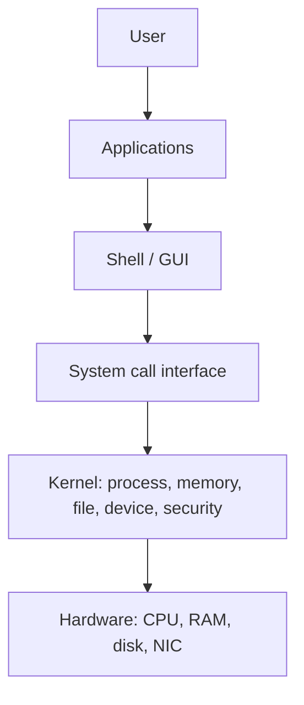
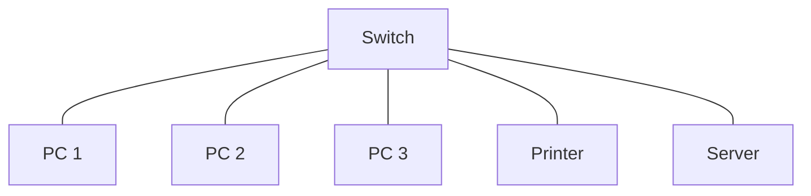

# MCS-022 — Complete Study Guide

### Operating System Concepts and Networking Management
### IGNOU BCA / MCA — Term-End Examination

> **Built from:** 8 previous-year question papers (June 2022 → June 2026) supplied in `mcs22.pdf`
> **Prepared for:** a student with 7 days and limited prior preparation
> **Approach:** concept-first. You will not memorise answers; you will learn to *construct* them.

---

## How to Use This Document

This guide has three layers, and they are meant to be used in this order:

1. **Part 1 (analysis)** tells you *where the marks are*. Read it once, tonight. It takes about an hour and it will stop you from studying the wrong things.
2. **Part 2 (topic modules)** is the actual teaching. Each module follows the same 10-step pattern, so your brain always knows what is coming next.
3. **Part 3 (appendices)** is for the last two days: repeated questions, comparison tables, diagrams to practise, cram sheet, and the 7-day plan.

### The single most useful thing to understand before you start

MCS-022 looks like a huge syllabus, but the paper is not evenly spread. Four blocks carry almost the whole paper:

- **Linux** — commands, file system, permissions, administration (appears in **8/8** papers)
- **Windows 2000/XP** — domains, registry, security, file systems, printing (**7/8** papers)
- **Networking** — topologies, OSI, media, TCP/IP, DNS, FTP (**8/8** papers)
- **Security** — firewalls, cryptography, Kerberos, VPN, RAID (**8/8** papers)

Almost every question is one of those four, dressed in different words. If you learn those four areas properly, you can answer questions you have never seen before.

### A warning about the guide's length

This is deliberately long, because you asked for a primary study material rather than notes. But do **not** read it front to back in one sitting. Use the 7-day plan in Appendix E. Each day tells you exactly which modules to read and which to skip.

---

## Table of Contents

**Front matter**
- [How to Use This Document](#how-to-use-this-document)
- [The Examination Pattern, Decoded](#the-examination-pattern-decoded)

**Part 1: PYQ Analysis**
- [1.1 What Is Inside the PDF](#11-what-is-inside-the-pdf)
- [1.2 Full Question Inventory, Paper by Paper](#12-full-question-inventory-paper-by-paper)
- [1.3 Grouped Topic Frequency Table](#13-grouped-topic-frequency-table)
- [1.4 Recurring Patterns and Predictable Questions](#14-recurring-patterns-and-predictable-questions)
- [1.5 Priority Matrix](#15-priority-matrix)
- [1.6 What These Papers Do *Not* Ask](#16-what-these-papers-do-not-ask)
- [1.7 Accuracy Notes and Flagged Items](#17-accuracy-notes-and-flagged-items)

**Part 2: Topic Modules**

*Priority 1 — Operating System Core*
- [Module 1: What Is an Operating System?](#module-1-what-is-an-operating-system)
- [Module 2: Types and Architectures of Operating Systems](#module-2-types-and-architectures-of-operating-systems)
- [Module 3: Multiprogramming, Buffering and Spooling](#module-3-multiprogramming-buffering-and-spooling)
- [Module 4: Processes, Threads and System Calls](#module-4-processes-threads-and-system-calls)
- [Module 5: Memory Management and Virtual Memory](#module-5-memory-management-and-virtual-memory)

*Priority 1 — Linux*
- [Module 6: Linux Commands, Redirection, Filters and Pipes](#module-6-linux-commands-redirection-filters-and-pipes)
- [Module 7: The Linux File System](#module-7-the-linux-file-system)
- [Module 8: Linux File Permissions](#module-8-linux-file-permissions)
- [Module 9: Linux System Administration](#module-9-linux-system-administration)

*Priority 1 — Windows 2000/XP*
- [Module 10: Windows 2000 Architecture — User Mode, Kernel Mode, Registry](#module-10-windows-2000-architecture--user-mode-kernel-mode-registry)
- [Module 11: Domains, Workgroups, Trusts and Active Directory](#module-11-domains-workgroups-trusts-and-active-directory)
- [Module 12: Windows 2000 Security — Auditing, EFS, Hardening](#module-12-windows-2000-security--auditing-efs-hardening)
- [Module 13: Windows File Systems — FAT16, FAT32, NTFS](#module-13-windows-file-systems--fat16-fat32-ntfs)
- [Module 14: Windows Networking Services and Printing](#module-14-windows-networking-services-and-printing)

*Priority 1 — Networking*
- [Module 15: Network Topologies and LAN/MAN/WAN](#module-15-network-topologies-and-lanmanwan)
- [Module 16: The OSI Model and Network Devices](#module-16-the-osi-model-and-network-devices)
- [Module 17: Transmission Media, Modems, DTE and DCE](#module-17-transmission-media-modems-dte-and-dce)
- [Module 18: TCP/IP, IP Addressing and Packet Switching](#module-18-tcpip-ip-addressing-and-packet-switching)
- [Module 19: DNS — Domain Name System](#module-19-dns--domain-name-system)
- [Module 20: FTP, TFTP, Mail Protocols, SNMP and Apache](#module-20-ftp-tftp-mail-protocols-snmp-and-apache)

*Priority 1 — Security*
- [Module 21: Firewalls, Proxy Servers and Intrusion Detection](#module-21-firewalls-proxy-servers-and-intrusion-detection)
- [Module 22: Cryptography and User Authentication](#module-22-cryptography-and-user-authentication)
- [Module 23: Kerberos](#module-23-kerberos)
- [Module 24: Virtual Private Networks](#module-24-virtual-private-networks)
- [Module 25: Computer Security Foundations](#module-25-computer-security-foundations)
- [Module 26: RAID, Fault Tolerance and Disk Redundancy](#module-26-raid-fault-tolerance-and-disk-redundancy)

*Priority 2–4*
- [Module 27: GUIs — X-Windows, NEXT and Interface Design](#module-27-guis--x-windows-next-and-interface-design)
- [Module 28: Distributed Operating Systems](#module-28-distributed-operating-systems)
- [Module 29: Low-Frequency Topics and Insurance Reading](#module-29-low-frequency-topics-and-insurance-reading)

**Part 3: Examination Material**
- [Appendix A: Most Repeated Questions, Ranked](#appendix-a-most-repeated-questions-ranked)
- [Appendix B: Important Comparisons](#appendix-b-important-comparisons)
- [Appendix C: Important Diagrams to Practise](#appendix-c-important-diagrams-to-practise)
- [Appendix D: Last-Minute Revision Notes](#appendix-d-last-minute-revision-notes)
- [Appendix E: Seven-Day Study Strategy](#appendix-e-seven-day-study-strategy)

---

## The Examination Pattern, Decoded

Every one of the 8 papers follows exactly the same instruction:

> *Question No. 1 is compulsory. Attempt any three questions from the rest.*
> Time: 3 hours · Maximum Marks: 100 · Weightage: 75%

This gives a very specific structure:

| Part | Marks | What it contains | Time you should give it |
|---|---|---|---|
| **Q1** | 40 | Compulsory. A mixed bag: 4–10 tiny Linux/Windows command bits (1–3 marks each), then 2–3 medium/long questions (5–10 marks each) | 70 minutes |
| **Q2–Q5** | 20 each | Each has 2–4 parts, usually one 10-mark long answer plus smaller parts | 3 × 25 minutes = 75 minutes |
| **Q5 (short notes)** | 20 | 4–5 short notes of 4–5 marks each | 25 minutes |
| **Reading + planning** | — | Choose your 3 questions from Q2–Q5 | 10 minutes |

### The strategic consequences

1. **Q1 is unavoidable and it is worth 40 marks.** Half of it is small, factual, command-level questions. Those are the cheapest marks in the paper. Never leave a 1-mark Linux command blank.
2. **You get to choose 3 out of 4.** In every paper, at least one of Q2–Q5 is heavily "Windows 2000 administration", one is heavily "networking", one is "security". If one area terrifies you, you can usually dodge it — but not two.
3. **Short notes are the easiest 20 marks in the paper.** They are always drawn from a small, repeating pool (firewall, VPN, cryptography, FTP, distributed OS, system calls, virtual machines, backup, auditing, group policy, Active Directory, NTFS, SMP, topologies, transmission media, RAID). Appendix A lists the pool.
4. **Marks per point.** IGNOU examiners mark by points, not by prose. As a rule of thumb:
   - **1 mark ≈ 1 line or 1 command**
   - **2 marks ≈ a definition + one example**
   - **5 marks ≈ 8–10 distinct points, or a definition + diagram + 5 points**
   - **10 marks ≈ a definition + classification/architecture + diagram + 6–8 explained points + advantage/disadvantage**

   This is why the "how to construct the answer" section at the end of every module matters more than the content itself.

### What the paper actually rewards

Looking across all 8 papers, the examiner rewards three things repeatedly:

- **A definition in the first two lines.** Almost every 10-mark question begins with "What is X?" or "Define X." A crisp definition immediately earns the first 2 marks.
- **A classification or list.** "Types of...", "features of...", "components of...". IGNOU loves enumerations, and they are easy marks if you have the list in your head.
- **A diagram.** Kerberos, OSI, topologies, RAID, VPN, DNS, X-Windows, firewall placement — all appear with "with the help of a suitable diagram" or are much easier to score with one.

Everything else is elaboration. If you can produce definition → classification → diagram → explained points → conclusion, you will score well even with imperfect detail.

---

# Part 1: PYQ Analysis

## 1.1 What Is Inside the PDF

The file `mcs22.pdf` contains **36 pages** and **8 complete question papers**, arranged newest first.

| # | Session | PDF pages | Paper code | Printed pages |
|---|---|---|---|---|
| 1 | June 2026 | 1–6 | B–2080/MCS–022 | 6 |
| 2 | December 2025 | 8–13 | B–1052/MCS–022 | 6 |
| 3 | June 2025 | 14–17 | B–1084/MCS–022 | 4 |
| 4 | December 2024 | 18–21 | B–1062/MCS–022 | 4 |
| 5 | June 2024 | 22–25 | — | 4 |
| 6 | December 2023 | 26–28 | — | 3 |
| 7 | June 2023 | 29–32 | MCS–022 | 4 |
| 8 | June 2022 | 33–36 | MCS–022 | 4 |

Page 7 is a promotional page ("Solved Papers") from the website that compiled the PDF. It is not part of any paper.

**Nothing in the PDF was unreadable.** All 8 papers extracted cleanly, so every count in this analysis is based on the actual printed text, not on guesswork.

**What is missing:** the papers do not include solutions, and they do not include the syllabus. All topic groupings below are my own, based on the wording of the questions. Where a question's intent was ambiguous, I say so in section 1.7 rather than guessing silently.

---

## 1.2 Full Question Inventory, Paper by Paper

Marks are shown exactly as printed on the paper. Where a paper prints a total that does not match its own item count, I note it.

### June 2026 (B–2080)

| Q | Question (condensed) | Topic group | Marks |
|---|---|---|---|
| 1(a)(i) | Linux command to display 3 named files on terminal | Linux commands | 1 |
| 1(a)(ii) | Redirect output to `out-file`, errors to `err-file`, both to `one-file` | Linux redirection | 3 |
| 1(a)(iii) | Linux command to print a text file from line 17 onwards | Linux commands (`tail`) | 2 |
| 1(a)(iv) | How to check file system consistency in Linux | Linux file system (`fsck`) | 2 |
| 1(a)(v) | What does `wall` do; is it suitable for ordinary users | Linux commands | 2 |
| 1(b)(i) | How multiprogramming improves performance "compared to buffering" | Multiprogramming/buffering | 5 |
| 1(b)(ii) | How TFTP works; how it differs from FTP; where used | FTP/TFTP | 5 |
| 1(c) | Disk mirroring vs duplexing; fault tolerance of RAID 0–6 | RAID/fault tolerance | 2+8 |
| 1(d)(i) | What is File Replication Service (FRS) in Windows 2000 | Windows networking services | 2 |
| 1(d)(ii) | Windows 2000 network printing and print job management; steps to share a printer | Windows printing | 6+2 |
| 2(a) | Device files in Linux; describe `fsck` | Linux file system | 6 |
| 2(b) | Peer-to-peer networking features in Windows 2000 | Windows networking | 4 |
| 2(c) | Cryptography: how it works; symmetric vs asymmetric; alternatives to cryptographic authentication | Cryptography | 10 |
| 3(a) | Filters and pipelining in Linux, with examples | Linux filters/pipes | 6 |
| 3(b) | Kinds of modifications possible to an existing Windows 2000 user account | Windows user admin | 4 |
| 3(c) | Repeater: why needed, OSI layer, features, characteristics | Network devices | 10 |
| 4(a) | Distributed OS: features, characteristics, working | Distributed OS | 10 |
| 4(b) | Trust relationships in Windows 2000; what is Kerberos, how it authenticates clients | Windows domains + Kerberos | 10 |
| 5(a) | Short note: Communication Protocols | Protocols | 4 |
| 5(b) | Short note: `write` command in Linux | Linux commands | 4 |
| 5(c) | Short note: Distributed file system in Windows 2000 | Windows networking | 4 |
| 5(d) | Short note: Hardening services in Windows 2000 | Windows security | 4 |
| 5(e) | Short note: Bus Topology | Topologies | 4 |

### December 2025 (B–1052)

| Q | Question (condensed) | Topic group | Marks |
|---|---|---|---|
| 1(a)(i) | Map `D:/common/teamproject` on `theircomputer` to `Z:` with explicit logon each time | Windows mapped drives | 2 |
| 1(a)(ii) | Linux command to list files, appending `/` to directory names | Linux commands (`ls -F`) | 2 |
| 1(a)(iii) | List any five system folders in Windows 2000 | Windows file system | 2 |
| 1(a)(iv) | NULL connection in Windows 2000 and its security risk | Windows security | 2 |
| 1(a)(v) | List types of "Architecture Driven" and "Application Driven" OS | OS types | 2 |
| 1(b) | What is a firewall; working of packet-switching firewall and proxy server | Firewall | 2+8 |
| 1(c) | Function and working of FTP | FTP | 10 |
| 1(d) | Psychological considerations in designing a GUI; guiding principles for each | GUI | 10 |
| 2(a) | Page replacement algorithm used in Linux | Memory management | 5 |
| 2(b) | How buffering and spooling improve CPU utilisation | Buffering/spooling | 4 |
| 2(c) | System calls used by a program that copies one file to another | System calls | 5 |
| 2(d) | The 6 layers of the THE operating system | OS architecture | 6 |
| 3(a) | read, write, execute permissions in Linux on a file and on a directory | Linux permissions | 6 |
| 3(b) | How auditing in Windows 2000 maintains a secure environment | Windows security | 4 |
| 3(c) | Security risk analysis; three major steps | Security foundations | 10 |
| 4(a) | Function of a modem; types; distinguishing features | Modems | 10 |
| 4(b) | Domains in Windows 2000; advantages; elements of logical structure | Windows domains | 10 |
| 5(a) | Short note: Dialog Boxes in Windows 2000 | GUI | 4 |
| 5(b) | Short note: File Management Subsystem in Linux | Linux file system | 4 |
| 5(c) | Short note: User Groups in Windows 2000 | Windows user admin | 4 |
| 5(d) | Short note: Printer Management in Windows | Windows printing | 4 |
| 5(e) | Short note: Symmetric Multiprocessing | OS architecture | 4 |

> Q5 prints `5×4=20` and lists five notes, i.e. five notes of 4 marks each — consistent.

### June 2025 (B–1084)

| Q | Question (condensed) | Topic group | Marks |
|---|---|---|---|
| 1(a) | Distributed OS; how it differs from Network OS | Distributed OS | 6 |
| 1(b) | Virtual memory; advantages | Memory management | 5 |
| 1(c) | Windows 2000 Server services | Windows networking | 5 |
| 1(d) | Windows 2000 registry management | Windows architecture | 5 |
| 1(e) | Functionality of a GUI | GUI | 5 |
| 1(f) | What is NEXT computer; NEXT user interface | GUI | 5 |
| 1(g) | How to set the date in Linux; can any user do it | Linux administration | 4 |
| 1(h) | What is TCP/IP; advantages | TCP/IP | 5 |
| 2(a) | Domain User Account vs Local User Account; how to add members to a group | Windows user admin | 10 |
| 2(b) | DNS; advantages; step-by-step DNS configuration in Linux | DNS | 10 |
| 3(a) | Windows 2000 remote access; purpose of VPN; VPN protocols | VPN | 10 |
| 3(b) | Network topology; working of any two topologies | Topologies | 10 |
| 4(a) | Need for security in an OS; security features of Windows 2000 | Windows security | 10 |
| 4(b) | Responsibilities of a Linux system administrator; user account management | Linux administration | 10 |
| 5(a) | Short note: Memory management in Linux | Memory management | 5 |
| 5(b) | Short note: FAT-16 and FAT-32 | File systems | 5 |
| 5(c) | Short note: Optical fibre | Transmission media | 5 |
| 5(d) | Short note: Firewall | Firewall | 5 |

### December 2024 (B–1062)

| Q | Question (condensed) | Topic group | Marks |
|---|---|---|---|
| 1(a) | Basic philosophy of X-Windows; how it differs from other GUIs | GUI | 5 |
| 1(b) | What is an OS; multiprogramming OS | OS fundamentals | 8 |
| 1(c) | Any three features of Linux | Linux | 6 |
| 1(d) | Home directory in Linux, with example | Linux file system | 4 |
| 1(e) | Peer-to-peer network; is Windows 2000 suitable | Windows networking | 5 |
| 1(f) | Windows 2000 Server services | Windows networking | 6 |
| 1(g) | Goals of computer security | Security foundations | 6 |
| 2(a) | Security breach; classify and explain types | Security foundations | 10 |
| 2(b) | EFS service; encryption using EFS | Windows security | 5 |
| 2(c) | Functionality of a GUI | GUI | 5 |
| 3(a) | Spooling with an example | Buffering/spooling | 5 |
| 3(b) | Real-time OS and its applications | OS types | 5 |
| 3(c) | Network topology; mesh topology and advantages | Topologies | 10 |
| 4(a) | Modem; four types; four features | Modems | 10 |
| 4(b) | DNS; design goals and design principles | DNS | 10 |
| 5(a) | Short note: FTP | FTP | 5 |
| 5(b) | Short note: User administration in Windows 2000 | Windows user admin | 5 |
| 5(c) | Short note: Cryptography | Cryptography | 5 |
| 5(d) | Short note: IPSec framework | Cryptography | 5 |

### June 2024

| Q | Question (condensed) | Topic group | Marks |
|---|---|---|---|
| 1(a) | Various user authentication methods | Cryptography/authentication | 10 |
| 1(b) | Important components of a DNS | DNS | 4 |
| 1(c) | How to configure DNS in Linux; steps | DNS | 6 |
| 1(d) | What is an OS; features and components | OS fundamentals | 10 |
| 1(e) | All OSI layers | OSI model | 7 |
| 1(f) | Router vs bridge | Network devices | 3 |
| 2(a) | Process to use a mapped drive in Windows 2000 | Windows networking | 5 |
| 2(b) | Domains, workgroups and trusted relationships in Windows 2000 | Windows domains | 5 |
| 2(c) | Components of the Linux OS | Linux | 10 |
| 3(a) | Uses of `cmp`, `tail`, `chmod`, `grep`, `pwd`, `kill`, `ps`, `wc`, `tree`, `head` | Linux commands | 10×1 |
| 3(b) | VPN; security aspects | VPN | 2+5 |
| 3(c) | Steps to create a VPN | VPN | 3 |
| 4(a) | Kerberos; complete client authentication process | Kerberos | 2+8 |
| 4(b) | When is a system fault tolerant; techniques | RAID/fault tolerance | 10 |
| 5(i) | Short note: Firewall | Firewall | 4 |
| 5(ii) | Short note: IP Addressing | TCP/IP | 4 |
| 5(iii) | Short note: Intrusion Detection | Security foundations | 4 |
| 5(iv) | Short note: Remote Login | Linux/protocols | 4 |
| 5(v) | Short note: Proxy Server | Firewall | 4 |

### December 2023

| Q | Question (condensed) | Topic group | Marks |
|---|---|---|---|
| 1(a) | Linux commands: hidden files; running processes; read-by-owner-only on `sample.txt`; last 10 lines; all logged-on users | Linux commands | 2×5 |
| 1(b) | Why firewall; working in detail; limitations | Firewall | 2+5+3 |
| 1(c) | FAT32 vs FAT16; NTFS features in Windows 2000 | File systems | 3+7 |
| 1(d) | X-Windows; major components of Unix-based GUIs in X-Windows | GUI | 2+8 |
| 2(a) | Packet switching; datagram and virtual circuit approaches | Packet switching | 6 |
| 2(b) | POP3 and IMAP | Mail protocols | 4 |
| 2(c) | Guided and unguided media; optical fibre; pros/cons of unguided | Transmission media | 5+5 |
| 3(a) | Define topology; advantages of a computer network | Topologies | 6 |
| 3(b) | Working of ring topology | Topologies | 4 |
| 3(c) | Apache server setting in Linux | Linux administration | 10 |
| 4(a) | User authentication methods; symmetric vs asymmetric cryptography | Cryptography | 6+4 |
| 4(b) | Computer-security classification in detail | Security foundations | 10 |
| 5(a) | Short note: Serial Processing | OS types | 4 |
| 5(b) | Short note: System calls | System calls | 4 |
| 5(c) | Short note: Virtual Machines | OS architecture | 4 |
| 5(d) | Short note: Wide Area Network | LAN/MAN/WAN | 4 |
| 5(e) | Short note: Virtual Private Network | VPN | 4 |

### June 2023

| Q | Question (condensed) | Topic group | Marks |
|---|---|---|---|
| 1(a) | Windows NT Registry: contents; how to secure it; how to audit it | Windows architecture/security | 10 |
| 1(b) | Firewall: definition, functions, limitations | Firewall | 6 |
| 1(c) | RAID: mirroring, duplexing, striping with parity | RAID | 9 |
| 1(d) | File system in Windows XP; how "office file features" are enabled | File systems | 8 |
| 1(e) | Absolute vs relative pathnames in Linux, with examples | Linux file system | 7 |
| 2(a) | File and directory system of Linux, with examples | Linux file system | 7 |
| 2(b) | File permission modes in Linux and commands to grant/revoke | Linux permissions | 8 |
| 2(c) | Purpose of `cp` and `mv`, with examples | Linux commands | 5 |
| 3(a) | Role and responsibilities of user mode vs kernel mode in Windows 2000 | Windows architecture | 8 |
| 3(b) | Kerberos; complete client authentication process | Kerberos | 7 |
| 3(c) | VPN; step-by-step VPN configuration in Windows XP | VPN | 5 |
| 4(a) | LAN vs MAN vs WAN (geography, size, access, hardware, communication) | LAN/MAN/WAN | 10 |
| 4(b) | NTFS and EFS services in Windows 2000 | File systems + security | 10 |
| 5(a) | Short note: Gateway network device | Network devices | 4 |
| 5(b) | Short note: Backup and restoration in Linux | Linux administration | 4 |
| 5(c) | Short note: Distributed operating system | Distributed OS | 4 |
| 5(d) | Short note: Managing user profiles in Windows 2000 | Windows user admin | 4 |

### June 2022

| Q | Question (condensed) | Topic group | Marks |
|---|---|---|---|
| 1(a) | Output of `date who`, `diff abc.txt xyz.txt`, `man who`, `ls -a`, `pwd` | Linux commands | 5 |
| 1(b) | Filters and pipelines in Linux, with examples | Linux filters/pipes | 5 |
| 1(c) | Default location of the print spooler in Windows NT; printer permissions and their significance | Windows printing | 5 |
| 1(d) | Disk striping; limitations; list RAID levels | RAID | 5 |
| 1(e) | Structure and characteristics of any two guided media | Transmission media | 5 |
| 1(f) | DTE vs DCE, with examples | Modems/DTE-DCE | 5 |
| 1(g) | VPN; purpose; VPN technologies supported by Windows 2000 | VPN | 5 |
| 1(h) | SNMP architecture, with diagram | Protocols | 5 |
| 2(a) | Shell script converting all digits in a text file to `*`, path given by user | Linux scripting | 10 |
| 2(b) | Multiprogramming vs multitasking, with examples | Multiprogramming | 10 |
| 3(a) | Network topologies; one advantage and disadvantage of each | Topologies | 10 |
| 3(b) | System Access Control; data backup and off-site retention | Security foundations | 10 |
| 4(a) | Functionality of user mode and kernel mode in Windows 2000 | Windows architecture | 10 |
| 4(b) | Process and thread management in Linux | Processes | 10 |
| 5(a) | Short note: Microkernel architecture | OS architecture | 4 |
| 5(b) | Short note: Data backup strategies | Security foundations | 4 |
| 5(c) | Short note: Auditing in Windows 2000 | Windows security | 4 |
| 5(d) | Short note: Group policy in Windows 2000 | Windows user admin | 4 |
| 5(e) | Short note: Active Directory in Windows 2000 | Windows domains | 4 |

> Q5 prints `4×5=20` but lists **five** notes. The formula and the item count do not match; the total is still 20, so treat each note as 4 marks.

---

## 1.3 Grouped Topic Frequency Table

**How to read this table.** "Papers" counts how many of the 8 papers contained *at least one* question on the topic. A topic asked twice in one paper still counts as one paper, so the number is a measure of *consistency*, not raw question count. "Marks seen" is the range of marks attached to individual questions on that topic.

| # | Topic group | Papers | Sessions | Marks seen | Priority |
|---|---|---|---|---|---|
| 1 | Linux commands, redirection, filters, pipes, scripting | **8/8** | all eight | 1–10 | **P1** |
| 2 | Windows 2000/XP security: registry, auditing, EFS, hardening, NULL session, group policy | **7/8** | J26 D25 J25 D24 D23 J23 J22 | 2–10 | **P1** |
| 3 | OS fundamentals: definition, features, components, types | **6/8** | D25 D24 J24 D23 J23 J22 | 4–10 | **P1** |
| 4 | Windows domains, workgroups, trusts, Active Directory | **6/8** | J26 D25 J25 J24 J23 J22 | 5–10 | **P1** |
| 5 | Windows user/group administration, profiles | **6/8** | J26 J25 D25 D24 J23 J22 | 4–10 | **P1** |
| 6 | Network topologies (+ LAN/MAN/WAN) | **5/8** | J26 J25 D24 D23 J23 J22 | 4–10 | **P1** |
| 7 | VPN and Windows remote access | **5/8** | J25 J24 D23 J23 J22 | 3–10 | **P1** |
| 8 | Computer security foundations: goals, classification, breaches, risk analysis, access control, backup, IDS | **5/8** | D25 D24 D23 J24 J22 | 5–10 | **P1** |
| 9 | File systems: FAT16/FAT32/NTFS, Windows XP FS, Linux FS, `fsck`, device files | **5/8** | J26 D25 D23 J23 J25 | 4–10 | **P1** |
| 10 | Windows networking services: Server services, peer-to-peer, FRS, mapped drives, printing | **5/8** | J26 D25 J25 D24 J24 (+J22 printing) | 2–8 | **P1** |
| 11 | Linux system administration: accounts, backup, Apache, `date`, `fsck`, scripting | **5/8** | J26 J25 D23 J23 J22 | 5–10 | **P1** |
| 12 | Multiprogramming, buffering, spooling, CPU utilisation | **4/8** | J26 D25 D24 J22 | 4–10 | **P1** |
| 13 | Linux file permissions and modes | **4/8** | D25 J24 D23 J23 | 1–8 | **P1** |
| 14 | Firewall and proxy server | **4/8** | D25 J25 D23 J24 | 5–10 | **P1** |
| 15 | Cryptography, symmetric vs asymmetric, authentication methods | **4/8** | J26 J24 D23 D24 | 5–10 | **P1** |
| 16 | RAID, mirroring/duplexing/striping, fault tolerance | **4/8** | J26 J24 J23 J22 | 5–10 | **P1** |
| 17 | GUI: X-Windows, NEXT, GUI functionality, psychology, dialog boxes | 4/8 | D25 D24 J25 D23 | 5–10 | **P2** |
| 18 | OSI model and network devices (repeater, bridge, router, gateway) | 3/8 | J26 J24 J23 | 3–10 | **P2** |
| 19 | Transmission media (guided/unguided, optical fibre) | 3/8 | J25 D23 J22 | 5–10 | **P2** |
| 20 | Modems, types and features; DTE vs DCE | 3/8 | D25 D24 J22 | 5–10 | **P2** |
| 21 | TCP/IP, IP addressing, communication protocols | 3/8 | J26 J25 J24 | 4–5 | **P2** |
| 22 | DNS: components, design goals, Linux configuration | 3/8 | J25 D24 J24 | 4–10 | **P2** |
| 23 | Kerberos | 3/8 | J26 J24 J23 | 7–10 | **P2** |
| 24 | FTP and TFTP | 3/8 | J26 D25 D24 | 5–10 | **P2** |
| 25 | Processes, threads, system calls | 3/8 | D25 D23 J22 | 5–10 | **P2** |
| 26 | Distributed OS and distributed file systems | 3/8 | J26 J25 J23 | 5–10 | **P2** |
| 27 | Packet switching, POP3/IMAP, SNMP, Apache, remote login | 3/8 | J26 D23 J22 | 4–10 | **P2** |
| 28 | Windows printer management: spooler, permissions, sharing | 3/8 | J26 D25 J22 | 5–8 | **P2** |
| 29 | Virtual memory and page replacement | 2/8 | D25 J25 | 5 | **P3** |
| 30 | Filters and pipelines as a standalone question | 2/8 | J26 J22 | 5–6 | **P3** |
| 31 | Backup strategies and off-site retention | 2/8 | J23 J22 | 5 | **P3** |
| 32 | Single-appearance: THE OS layers, SMP, serial processing, virtual machines, IPSec, intrusion detection, remote login | 1 each | D25, D23, D24, J24 | 4–6 | **P4** |

### Why each priority was assigned

- **P1 (16 topics)** — either appeared in **4 or more papers**, or appeared in 3 papers with heavy marks (7–10) and a predictable question shape. These are the topics you cannot skip.
- **P2 (12 topics)** — appeared in **3 papers**, or in 4 papers only as short notes. Each is a reliable 4–10 marks if it comes up, but you can survive without mastering every detail.
- **P3 (3 topics)** — appeared twice, and in both cases as a small part of a larger question, or fully covered inside a P1 topic (filters/pipes are part of Linux commands).
- **P4** — appeared once. Learn the definition and 4–5 points; do not build a whole study session around them.

Note that several topics that are individually rare are still **mandatory reading**, because they are needed to understand a P1 topic. For example, "THE operating system" is P4, but you cannot explain layered architecture without it. Section 1.6 explains this principle.

---

## 1.4 Recurring Patterns and Predictable Questions

### Pattern 1: The "small command" block at the start of Q1

**7 of 8 papers** open Q1 with Linux/Windows command questions worth 1–3 marks each. The commands rotate through a small set:

| Command/idea | Sessions it appeared |
|---|---|
| `ls` (including `-a`, `-F`, hidden files) | D25, J24, D23, J22 |
| `cat` (multiple files) | J26 |
| `tail` (last 10 lines; from line 17) | J26, J24, D23 |
| `head` | J24 |
| `pwd` | J24, J22 |
| `grep` | J24 |
| `wc` | J24 |
| `cmp` / `diff` | J24, J22 |
| `chmod` | J24, D23 |
| `ps` / `kill` | J24, D23 |
| `who` | D23, J22 |
| `date` | J25, J22 |
| `tree` | J24 |
| `cp` / `mv` | J23 |
| `wall` / `write` | J26 |
| Redirection `>`, `2>`, `&>` | J26 |
| `fsck` | J26 |
| Printer spooler location | J22 |

**Implication:** you can prepare the *entire* 10-mark command block in one evening. Module 6 covers every one of these commands with the exact flag and an example.

### Pattern 2: The short-note pool is small and repeats

Across 8 papers there were 32 short notes (4–5 per paper). They came from only about 22 distinct topics, and several repeated:

| Short note | Appeared |
|---|---|
| Firewall | D25, J25, J24 (3 times) |
| VPN | D23 (plus as full questions elsewhere) |
| Cryptography | D24 |
| FTP | D24 |
| Distributed OS | J23 |
| Auditing in Windows 2000 | J22 |
| Active Directory | J22 |
| Group policy | J22 |
| Backup strategies | J22 |
| System calls | D23 |
| Virtual machines | D23 |
| Serial processing | D23 |
| Microkernel | J22 |
| SMP | D25 |
| FAT16/FAT32 | J25 |
| Optical fibre | J25 |
| User groups | D25 |
| Printer management | D25 |
| Dialog boxes | D25 |
| Hardening services | J26 |
| Bus topology | J26 |
| Communication protocols | J26 |
| IP addressing | J24 |
| Intrusion detection | J24 |
| Remote login | J24 |
| Proxy server | J24 |
| Gateways | J23 |
| WAN | D23 |
| Distributed file system | J26 |
| `write` command | J26 |
| File management subsystem | D25 |
| Memory management in Linux | J25 |
| Backup/restore in Linux | J23 |
| User profiles | J23 |

**Implication:** if you can write 6 good lines on each of ~25 items, you have secured 20 marks regardless of which four are chosen. Appendix A gives you that list.

### Pattern 3: A small number of 10-mark questions repeat almost verbatim

| Question shape | Sessions |
|---|---|
| "Explain network topologies / working of X topology / advantages of mesh" | J25, D24, D23, J23, J22 (5) |
| "What is VPN? Purpose / security / steps to configure" | J25, J24, D23, J23, J22 (5) |
| "Firewall: why needed, working, limitations" | D25, J25, D23, J24 (4) |
| "RAID: mirroring vs duplexing vs striping; RAID levels; fault tolerance" | J26, J24, J23, J22 (4) |
| "Linux permissions: read/write/execute on file and directory; chmod" | D25, J24, D23, J23 (4) |
| "Domains / workgroups / trust relationships" | J26, D25, J25, J24 (4) |
| "Multiprogramming vs buffering/spooling/multitasking" | J26, D25, D24, J22 (4) |
| "Kerberos: complete client authentication" | J26, J24, J23 (3) |
| "DNS: components / design goals / configure in Linux" | J25, D24, J24 (3) |
| "Distributed OS: features / vs Network OS" | J26, J25, J23 (3) |
| "Modem: types and features" | D25, D24, J22 (3) |
| "User authentication methods" | J26, J24, D23 (3) |

**Implication:** these twelve question shapes account for roughly **40% of all long-answer marks** in the eight papers. If you can write a confident 10-mark answer to each, you are already close to a pass, and with the Linux/Windows blocks you are into a good score.

### Pattern 4: The same concept asked from different angles

This is the most important pattern for "constructing answers to variations". Examples:

- **Kerberos** is asked as "What is Kerberos?" (J23), "Explain the complete process of client authentication using Kerberos" (J24), and "What is Kerberos? Explain how it helps in identifying and authenticating network clients" (J26). Same content, three phrasings.
- **Domains** is asked as "Describe the concept of domains and their advantages" (D25), "Domains, workgroups and trusted relationships" (J24), "Trust relationships... what is Kerberos" (J26). The domain module covers all three.
- **RAID** is asked as "mirroring vs duplexing + RAID 0–6" (J26), "mirroring, duplexing, striping with parity" (J23), "disk striping and its limitations + list RAID levels" (J22), "fault tolerance techniques" (J24). One RAID module answers all four.
- **Linux permissions** is asked as "meaning of rwx on file and directory" (D25), "uses of chmod" (J24), "set permission so owner can read only" (D23), "permission modes and commands" (J23).
- **Topologies** is asked as "working of any two" (J25), "mesh and its advantages" (D24), "ring working" (D23), "list all with adv/disadv" (J22), "bus" short note (J26).

**Implication:** do not prepare per-question. Prepare per-concept, and the variations take care of themselves. That is exactly how Part 2 is organised.

### Pattern 5: Question 1 mixes OS, Linux and Windows; Q2–Q5 are themed

Looking at Q2–Q5 in each paper, there is usually:

- one question that is mostly **Linux** (commands, file system, permissions, administration)
- one that is mostly **Windows 2000/XP** (domains, accounts, registry, security, printing)
- one that is mostly **networking** (topologies, media, OSI, TCP/IP, DNS, FTP)
- one that is mostly **security** (firewall, crypto, Kerberos, VPN, RAID)

This is why the "attempt any three" choice is really a choice about which of four worlds to drop. The safest strategy is to be strong in **Linux + Windows + Security**, because networking questions often overlap with security (VPN, firewall, DNS).

### Pattern 6: Windows 2000 content is still dominant in 2026

This surprises many students. The June 2026 paper still asks about FRS, Windows 2000 printing, trust relationships, user account modification, peer-to-peer networking in Windows 2000, and hardening services. That is **10 of the 40 marks in Q1** (FRS + printing) and roughly **36 of 100 marks across the whole paper** once you add Q2(b), Q3(b), Q4(b) and Q5(c)/(d).

**Implication:** do not skip the "old" Windows material because it feels outdated. It is the most reliable scoring block in the paper after Linux, and it is *easier* than networking because it is mostly descriptive.

---

## 1.5 Priority Matrix

### Priority 1 — Extremely Important (16 topics, ~75% of the paper)

| Topic | Why P1 |
|---|---|
| Linux commands/redirection/filters/scripting | 8/8 papers; appears in Q1 every time; cheapest marks |
| Windows 2000/XP security features | 7/8 papers; 2–10 marks; multiple angles (registry, EFS, auditing) |
| OS fundamentals and types | 6/8; the "define and explain" backbone of the paper |
| Windows domains/workgroups/trusts/AD | 6/8; always 5–10 marks; highly predictable |
| Windows user/group administration | 6/8; overlaps with domains; easy descriptive marks |
| Network topologies + LAN/MAN/WAN | 5/8; the most repeated 10-mark question in the paper |
| VPN | 5/8; repeated as 3-mark, 5-mark and 10-mark versions |
| Security foundations (goals, breaches, risk analysis, access control, backup) | 5/8; supplies both long answers and short notes |
| File systems (FAT/NTFS/Linux/`fsck`/device files) | 5/8; appears as comparison, short note and 10-mark |
| Windows networking services (Server services, P2P, FRS, mapped drives, printing) | 5/8; heavy in Q1 |
| Linux system administration (accounts, backup, Apache, date) | 5/8; 10-mark questions |
| Multiprogramming/buffering/spooling | 4/8; always a comparison or "how it improves utilisation" |
| Linux file permissions | 4/8; small but guaranteed-type question |
| Firewall/proxy | 4/8; repeated long answer + repeated short note |
| Cryptography and authentication | 4/8; always paired with "symmetric vs asymmetric" |
| RAID and fault tolerance | 4/8; four different phrasings of the same content |

### Priority 2 — High Importance (12 topics, ~20% of the paper)

GUI/X-Windows/NEXT; OSI model and devices; transmission media; modems and DTE/DCE; TCP/IP and IP addressing; DNS; Kerberos; FTP/TFTP; processes/threads/system calls; distributed OS; packet switching/POP3/IMAP/SNMP/Apache/remote login; Windows printing.

These are each worth 4–10 marks when they appear, and they appear in roughly 3 of 8 papers. They are also the topics most likely to be *combined* with a P1 topic in the same question.

### Priority 3 — Moderate (3 topics)

Virtual memory and page replacement; filters/pipes as a standalone; backup strategies. All three are either small (5 marks) or fully contained inside a P1 module.

### Priority 4 — Backup (7 single-appearance topics)

THE OS six layers, symmetric multiprocessing, serial processing, virtual machines, IPSec, intrusion detection, remote login. Learn a definition and 4–5 points each. Total study time: about 45 minutes.

---

## 1.6 What These Papers Do *Not* Ask

This is as important as what they do ask, because it tells you where **not** to spend your seven days.

Across all 8 papers there is **no question** on:

| Topic | Status in these 8 papers |
|---|---|
| CPU scheduling algorithms (FCFS, SJF, round robin) and Gantt charts | **Absent** |
| Deadlock, Banker's algorithm, deadlock detection/recovery | **Absent** |
| Semaphores, critical section, producer–consumer, mutual exclusion | **Absent** |
| Inter-process communication (pipes as IPC, message queues, shared memory) | **Absent** (pipes appear only as shell pipelines) |
| Page-fault calculations, TLB, demand paging numericals | **Absent** (virtual memory is conceptual only) |
| Contiguous/linked/indexed file allocation | **Absent** |
| Disk scheduling (FCFS, SSTF, SCAN) | **Absent** |
| Numerical problems of any kind | **Only one**: the June 2022 shell script |

Two honest caveats:

1. **Eight papers is a sample, not the syllabus.** A future paper *can* ask about deadlock or scheduling. The safe approach is the "insurance" section in Module 29: 30–40 minutes of reading that gives you a definition, a diagram and five points for each, so you are not defenceless. Do not do more than that.
2. **The absence of numericals is consistent across all eight papers and across six years.** That is a strong signal. It is reasonable to spend your limited time on descriptive and comparative content instead of practising calculations.

### Topics that are foundational but rarely asked alone

These appear only *inside* other questions, and you must know them to answer P1 questions well:

- **Paging and segmentation** — needed for virtual memory and for "memory management in Linux"
- **Process states** — needed for process/thread management
- **Interrupts and system calls** — needed for user mode vs kernel mode
- **Layering and microkernel** — needed for OS architecture and THE OS
- **Encapsulation** — needed for OSI and TCP/IP
- **Subnetting basics** — needed for IP addressing
- **Spooling vs buffering** — needed for CPU utilisation questions

These are all covered inside the relevant modules, not as separate topics.

---

## 1.7 Accuracy Notes and Flagged Items

I have not invented any question, year, or mark. Where something is unclear, here is exactly what is unclear and how I handled it.

| Item | Issue | How it is handled |
|---|---|---|
| **D25 Q5** | Prints `5×4=20` and lists five notes. | Consistent — five notes of 4 marks. Not flagged. |
| **J24 Q5** | Prints `4×5=20` but lists five notes (i–v). | Formula and item count do not match; total is 20 either way. Treated as 4 marks per note. |
| **J22 Q5** | Prints `4×5=20` but lists five notes (a–e). | Same inconsistency; total 20. Treated as 4 marks per note. |
| **J26 Q1(b)(i)** | "How does multiprogramming improve system's performance compared to buffering?" — multiprogramming and buffering are not alternatives, so the comparison is odd. Likely intended: "How does multiprogramming improve performance, and what role does buffering play?" | Module 3 teaches both readings and shows how to answer either in one structure. |
| **D25 Q1(a)(v)** | "Architecture Driven and Application Driven operating systems" is IGNOU-specific terminology. The exact classification list is not printed in the paper. | Module 2 presents the standard MCS-022 groupings (application-driven: batch, multiprogramming, time-sharing, real-time, distributed; architecture-driven: uniprocessor, multiprocessor/SMP, clustered) and flags that the precise block list should be cross-checked with the study material. |
| **J23 Q1(d)** | "How the office file features in Windows-XP are enabled" is vague — it may refer to file/folder features or to Office application integration. | Module 13 covers Windows XP file system and file/folder features, and flags the ambiguity. |
| **J26 Q1(c)** | Asks RAID "levels from 0 to 6" — RAID 2, 3 and 4 are obsolete in practice but still examinable. | Module 26 covers all seven levels, with a note on which are practical. |
| **Sessions** | The PDF's papers are labelled June 2026, December 2025, June 2025, December 2024, June 2024, December 2023, June 2023, June 2022. No year is inferred. | Used exactly as printed. |

**One more caution about predictions.** This analysis tells you what has been asked and how often. It does **not** guarantee what will be asked. The guide is built so that understanding the P1 concepts lets you answer *variations*, which is the only real defence against a paper that surprises you.

---
# Part 2: Topic Modules

Each module follows the same ten-part structure, so you always know what is coming:

1. The concept in plain language
2. Why it exists — the problem it solves
3. Step-by-step build-up
4. All the components/types explained
5. Real-world examples (and the link back to the technical idea)
6. Technical terminology decoded
7. Comparison tables
8. Diagrams
9. How the PYQs ask it
10. How to construct your answer (5-mark and 10-mark frameworks)

**Read the modules in priority order, not page order.** Appendix E tells you which modules belong to which day.

---

## Module 1: What Is an Operating System?

> **Priority:** P1 · **Appeared in:** D24 (Q1b, 8), J24 (Q1d, 10), J25 (Q1b indirectly), D25 (Q1a-v, types), plus every other module depends on it
> **Typical marks:** 8–10 for "define + features + components"

### 1. The concept in plain language

An operating system (OS) is the **software layer between you and the computer's hardware**. It does two jobs that sound simple but are enormous:

1. It **manages the hardware** — the CPU, memory, disks, keyboard, screen, network card — so that many programs can use them without colliding.
2. It **gives programs a simpler world to live in** — instead of asking a hard disk to move a read head to a particular track, a program says "read this file", and the OS does the hard part.

A useful way to picture it: the hardware is a very powerful but extremely literal and dangerous machine. The OS is the trained operator standing between you and that machine. You say "print this", and the operator decides which printer, queues the job, handles the paper jam, and tells you when it is done.

### 2. Why it exists — the problem it solves

Imagine a computer with no OS. You want to run a program. You must:

- load the program into a specific memory address yourself,
- know the exact hardware addresses of the disk controller,
- write the instructions that move the read head,
- handle the keyboard interrupt yourself,
- and if two programs want the printer, you must personally coordinate them.

This is what programmers did in the 1950s. It was slow, error-prone, and every program was written for one specific machine.

The OS exists to solve four concrete problems:

| Problem without an OS | What the OS does |
|---|---|
| Programmers must know hardware details | Provides **abstraction** — files instead of disk sectors, processes instead of CPU registers |
| Only one program can run at a time | Provides **multiprogramming** — many programs share the CPU |
| Programs can overwrite each other's memory | Provides **memory protection** — each process gets its own address space |
| Anyone can read anyone's files | Provides **security and access control** — permissions, users, authentication |

So the OS is best understood as an **abstraction provider, a resource manager, and a protection mechanism** at the same time.

### 3. Step-by-step build-up

**Step 1 — The bare machine.** The CPU fetches instructions from memory and executes them. It knows nothing about files or programs. This layer is called *bare metal*.

**Step 2 — Add a kernel.** A small core of software is loaded at boot. It has special privileges: it can execute privileged instructions (like disabling interrupts or changing the memory map) that ordinary programs cannot. This core is the **kernel**.

**Step 3 — Add system calls.** Ordinary programs cannot talk to the kernel directly, because that would be unsafe. Instead they use a controlled doorway called a **system call**. `open()`, `read()`, `write()`, `fork()` are system calls. They temporarily switch the CPU into privileged mode, do the work, and return.

**Step 4 — Add services.** On top of the kernel sit services: a file system, a scheduler, a network stack, device drivers, a user interface. These are what we normally *see* as "the OS".

**Step 5 — Add the shell and GUI.** Finally, the user-facing layer: a command line (bash in Linux, cmd in Windows) or a graphical interface (X-Windows, Windows Explorer).

The result looks like this:

```
+---------------------------------------------------+
|  User applications (browser, editor, compiler)     |
+---------------------------------------------------+
|  Shell / GUI        |  Utilities (ls, cp, grep)    |
+---------------------------------------------------+
|  System call interface                             |
+---------------------------------------------------+
|  KERNEL                                            |
|   - Process management    - Memory management      |
|   - File system           - Device drivers         |
|   - Network stack         - Security               |
+---------------------------------------------------+
|  Hardware (CPU, RAM, disk, NIC, devices)           |
+---------------------------------------------------+
```

### 4. Components of an operating system

This is the list examiners expect when they ask "explain the components of an OS". Learn the six, and learn *what each one manages*.

**(a) Process management.**
A **process** is a program in execution. The OS decides which process runs next (scheduling), gives each process a turn on the CPU (context switching), lets processes start and stop each other, and provides communication between them (inter-process communication). It also handles **threads** — smaller units of execution inside a process.

*Why it matters:* without it, only one program could ever run.

**(b) Memory management.**
The OS decides which process gets which part of RAM, keeps track of what is free, protects one process's memory from another, and moves data between RAM and disk when RAM runs out (**virtual memory**).

*Why it matters:* RAM is small and shared; without management, programs corrupt each other.

**(c) File management.**
The OS presents storage as **files** organised in **directories**, keeps track of where each file's data lives on disk, enforces permissions, and handles opening, reading, writing, closing and deleting.

*Why it matters:* raw disk sectors are unusable by humans and by most programs.

**(d) Device management.**
The OS talks to hardware through **device drivers**. It buffers data, queues requests (for example, print jobs), and provides a uniform interface so a program does not need to know whether it is writing to a disk, a USB stick or a network share.

*Why it matters:* hardware is diverse and full of timing quirks.

**(e) Security and protection.**
The OS authenticates users (login), authorises actions (permissions), audits activity (logs), and isolates processes from each other.

*Why it matters:* a multi-user machine without protection is unusable.

**(f) User interface.**
Command-line interpreter (**shell**) or **GUI**. This is the component users actually interact with.

*Why it matters:* it is the only part most users ever see.

Some textbooks also list **networking** and **accounting/auditing** as separate components. If you have space in a 10-mark answer, add them as a seventh and eighth point — examiners accept them.

### 5. Features of an operating system

"Features" and "components" are different questions, and students lose marks by mixing them.

- **Components** answer: *what parts is it made of?* (process manager, memory manager, file manager…)
- **Features** answer: *what capabilities does it give me?* (multitasking, security, portability…)

Standard features to list:

1. **Multitasking / multiprogramming** — several programs appear to run at once.
2. **Memory management** — allocation, protection, virtual memory.
3. **File system support** — hierarchical directories, permissions.
4. **Device independence** — programs work with different hardware.
5. **Security** — authentication, authorisation, auditing.
6. **User interface** — CLI and/or GUI.
7. **Networking support** — TCP/IP stack, file sharing.
8. **Error detection and handling** — the OS catches hardware and software errors and reports them instead of crashing silently.
9. **Resource accounting** — tracks CPU time, memory and disk used per user (important in multi-user systems).
10. **Portability** — the ability to run on different hardware with modest changes.

### 6. Technical terminology decoded

| Term | Meaning | Why it matters |
|---|---|---|
| **Kernel** | The privileged core of the OS | It is the only code that can execute privileged instructions |
| **Shell** | A program that reads your commands and asks the kernel to perform them | It is a *user program*, not part of the kernel |
| **System call** | The controlled entry point from a user program into the kernel | It is the boundary between safe and privileged code |
| **Process** | A running program with its own memory and state | The unit the OS schedules |
| **Thread** | A single sequence of execution inside a process | Threads share memory, so they are cheaper than processes |
| **Device driver** | Kernel code that knows how to operate one specific device | It hides hardware detail |
| **Interrupt** | A signal from hardware or software that makes the CPU stop and handle an event | It is how the OS reacts quickly without polling |
| **Context switch** | Saving one process's state and restoring another's | It is what makes multitasking possible, and it costs time |
| **Buffer** | A temporary holding area for data in transit | It smooths speed differences between devices |

### 7. Comparison: OS vs kernel vs shell

| | Operating system | Kernel | Shell |
|---|---|---|---|
| **What it is** | The whole system software layer | The privileged core | A command interpreter program |
| **Scope** | Kernel + services + utilities + UI | Process, memory, file, device, security management | Reads commands, runs programs |
| **Privilege** | Mixed | Full (kernel mode) | User mode |
| **Example** | Linux, Windows 2000 | Linux kernel, NT kernel | bash, sh, cmd.exe |
| **Can you remove it?** | No | No | Yes — you can install another shell |

### 8. Diagram: OS as an intermediary



Read it in words: the user acts on applications; applications act on the shell or GUI or directly on system calls; system calls enter the kernel; the kernel alone touches the hardware.

### 9. How the PYQs ask it

**Direct questions from the eight papers:**

- *"What do you mean by Operating System? Explain the features and components of OS."* — June 2024, Q1(d), 10 marks.
- *"What is an operating system? Briefly explain multiprogramming operating system."* — December 2024, Q1(b), 8 marks.
- *"List the different types of Architecture Driven and Application Driven operating systems."* — December 2025, Q1(a)(v), 2 marks.
- *"List and explain each of the structures in the 6 layered THE operating system."* — December 2025, Q2(d), 6 marks.
- *"What is a Microkernel Architecture?"* — June 2022, Q5(a), 4 marks (short note).
- *"Explain real-time operating system and its applications."* — December 2024, Q3(b), 5 marks.

**What the examiner is testing:** whether you know the OS as a *layered system of responsibilities*, not as a brand name. Notice that the questions never ask "what is Windows?" — they ask what an OS *does* and what it is *made of*.

**Other ways IGNOU could frame the same topic:**

- "Explain the functions of an operating system." (functions = the six components seen as actions)
- "Why is an operating system called a resource manager?"
- "Explain the dual-mode operation of an operating system." (user mode vs kernel mode — see Module 10)
- "What services does an operating system provide to users and programs?"
- "Differentiate between an operating system and an application program."

### 10. How to construct your answer

**For 5 marks ("What is an OS?")**

1. Definition (2 lines): "An operating system is system software that acts as an intermediary between the user and the hardware, managing resources and providing an environment in which programs can execute."
2. One line on the two roles: resource manager + abstraction provider.
3. Five functions as one line each: process, memory, file, device, security. Add the user interface as the sixth.
4. One-line example: Linux, Windows 2000, UNIX.
5. Optional single-line diagram.

**For 10 marks ("features and components")**

1. Definition (2 marks' worth).
2. Heading: **Components** — six sub-headings, each 2 lines: what it manages + why it matters. (4 marks)
3. Heading: **Features** — six to eight one-line features. (2 marks)
4. One small diagram: layered OS. (1 mark)
5. Conclusion: one line on why the OS matters in a multi-user, networked environment. (1 mark)

**Technical terms to use:** kernel, system call, process, virtual memory, device driver, protection, abstraction, resource manager.

**Common mistake to avoid:** writing a long history of operating systems when the question asks for components. History belongs in Module 2.

---

## Module 2: Types and Architectures of Operating Systems

> **Priority:** P1 · **Appeared in:** D25 (Q1a-v), D24 (Q1b, Q3b), J24 (Q1d), D23 (Q5a, Q5c), J23 (Q3a, Q4a), J22 (Q2b, Q5a, Q4a), J25 (Q1a)
> **Typical marks:** 2 (list), 5 (one type), 8–10 (compare or explain several)

This module is large because IGNOU keeps returning to it from different angles: "types of OS", "real-time OS", "multiprogramming OS", "serial processing", "distributed vs network OS", "microkernel", "virtual machines", "user mode vs kernel mode".

There are **two different classifications** mixed together in these questions, and understanding the difference is what makes this module click:

- **Classification by application/workload** — what the OS is *for*: batch, multiprogramming, time-sharing, real-time, distributed, network.
- **Classification by internal architecture** — how the OS is *built*: monolithic, layered, microkernel, virtual machine, client–server.

A single OS can be both. Linux is a **time-sharing, multiprogramming, multi-user** OS (application classification) built with a **monolithic-with-modules** kernel (architecture classification).

### 1. The concept in plain language

Early computers could only run one job at a time, and a human had to load each job by hand. As hardware got faster, the CPU spent most of its time waiting for slow devices, which was wasteful. So operating systems evolved to keep the CPU busy and to serve more users.

That evolution produced a family of OS "types". Each type is a **solution to a specific inefficiency**:

| Type | The inefficiency it fixes |
|---|---|
| Serial processing | Humans loading jobs by hand — slow, error-prone |
| Batch processing | CPU idle while operator sets up the next job |
| Multiprogramming | CPU idle while a job waits for I/O |
| Multitasking / time-sharing | One user monopolises the machine; poor interactivity |
| Multiprocessing | One CPU is not enough computing power |
| Real-time | General-purpose scheduling is too slow or too unpredictable |
| Distributed | One machine's resources are not enough, or must be shared |
| Network OS | Machines are separate but need to share files and printers |
| Embedded | A full OS is too large or too power-hungry |

If you remember this table, you can *derive* the definition of each type instead of memorising it. That is the difference between surviving a reworded question and failing it.

### 2. Step-by-step build-up: the historical evolution

**Stage 1 — Serial processing (1940s–50s).**
No OS at all. The programmer signed up for machine time, loaded the program via switches or punched cards, ran it, and read the output. If the program had a bug, the whole cycle repeated.

*Characteristics:* one job at a time; no OS; setup time dominated; poor utilisation.

*Why it is examinable:* it is the baseline against which every later improvement is measured. December 2023 asked for it as a short note.

**Stage 2 — Batch processing (1950s).**
Jobs with similar requirements were grouped into **batches** and fed to the machine by a **resident monitor** — a small program that loaded the next job automatically. The programmer no longer had to be present.

*Characteristics:* jobs run without user interaction; **no interactivity**; CPU still idle during I/O; turnaround time is long (hours).

*Key term:* **turnaround time** = time from submitting a job to receiving its output.

**Stage 3 — Multiprogramming (1960s).**
Several jobs are kept in memory at once. When the running job waits for I/O, the OS switches the CPU to another job. The CPU is kept busy.

*Characteristics:* several jobs in memory; CPU switches on I/O wait; needs memory protection and scheduling; increases **throughput** (jobs completed per unit time).

*This is the single most important type for MCS-022* — it appears in four papers, usually compared with buffering or multitasking. Module 3 is devoted to it.

**Stage 4 — Multitasking / time-sharing (1960s–70s).**
A logical extension: the CPU switches between jobs so rapidly (a **time slice**, typically milliseconds) that each user feels they have the machine to themselves. Multiple interactive users are supported.

*Characteristics:* rapid switching by timer interrupt; **response time** is the key metric; needs a scheduler with priorities; interactive.

*Difference from multiprogramming:* multiprogramming switches **only when a job blocks** (for example, waits for I/O). Time-sharing switches **on a timer**, even if the job could continue. This is the exact distinction June 2022 Q2(b) is testing.

**Stage 5 — Multiprocessing.**
Two or more CPUs (or cores) share memory and work on jobs simultaneously. **Symmetric multiprocessing (SMP)** treats all CPUs as equal, each running any task; **asymmetric multiprocessing** designates one master CPU to assign work.

*Characteristics:* true parallelism; needs locking and cache coherence; higher throughput and reliability.

**Stage 6 — Real-time operating systems (RTOS).**
The correctness of the result depends not only on the answer but on **when** it is produced. Used where a late answer is a wrong answer.

Two sub-types:

- **Hard real-time** — missing a deadline is a system failure (airbag deployment, pacemaker, flight control). Guarantees are contractual.
- **Soft real-time** — missing a deadline degrades quality but is not catastrophic (video streaming, online transaction processing).

*Characteristics:* priority-based preemptive scheduling; predictable (bounded) latency; small kernel; often no virtual memory (because paging causes unpredictable delays).

**Stage 7 — Distributed OS.**
A collection of independent computers that appears to its users as **one single coherent system**. The user does not know which machine is running their process or storing their file.

*Characteristics:* transparency (location, access, failure), resource sharing, scalability, fault tolerance; requires distributed file systems and distributed synchronisation.

*Critical distinction:* in a **network OS**, each machine runs its own OS and the user *knows* which machine they are on (you log in to a server, you map a drive). In a **distributed OS**, the collection behaves as one machine. This distinction is asked directly in June 2025 Q1(a).

**Stage 8 — Network OS.**
Each node has its own OS; the OS adds services for sharing files, printers and authentication across the network. Windows 2000 Server is the classic example used in this course.

**Stage 9 — Embedded OS.**
Designed for a dedicated device with limited resources: washing machines, routers, car engine controllers, IoT sensors. Small footprint, real-time behaviour often required, no general-purpose user interface.

### 3. Classification by architecture

Now the second classification: how the OS is *internally structured*. This is where "microkernel", "layered", "THE", and "virtual machine" come from.

**(a) Monolithic kernel.**
All OS services — scheduling, memory, file system, device drivers, network — run in a single privileged address space.

- *Advantage:* very fast, because a service call is just a function call.
- *Disadvantage:* large, hard to maintain, and a bug in any driver can crash the whole system.
- *Example:* traditional UNIX, Linux (with loadable modules).

**(b) Layered architecture.**
The OS is divided into layers, each built on the layer below and using only the layer below.

- *Advantage:* modular, easier to design and debug, each layer can be tested independently.
- *Disadvantage:* performance overhead from passing requests through many layers; deciding which layer a function belongs to is difficult.
- *Classic example:* **THE operating system** by Dijkstra — six layers, asked in December 2025.

**(c) Microkernel.**
Only the absolute minimum runs in the kernel: low-level memory management, inter-process communication (IPC), and basic scheduling. Everything else — file systems, drivers, network protocols — runs as **user-space servers** that communicate by message passing.

- *Advantage:* reliability (a crashed driver does not crash the kernel), security (less privileged code), extensibility (add a service without recompiling the kernel), portability.
- *Disadvantage:* performance cost of message passing; more complex design.
- *Examples:* Mach, MINIX 3, QNX, L4.

**(d) Virtual machine architecture.**
A **hypervisor** runs on the hardware and creates multiple virtual machines, each of which believes it has its own CPU, memory and devices. Each VM can run a different OS.

- *Advantage:* strong isolation, ability to run multiple OSes on one machine, safe for testing.
- *Disadvantage:* overhead; each VM duplicates an OS.
- *Examples:* VMware, VirtualBox, IBM VM/370 (the classic).

**(e) Client–server (hybrid).**
A refinement of the microkernel idea where services are provided by servers, and clients request them. Windows NT/2000 is often described as a hybrid: a microkernel-style executive plus user-mode subsystems.

### 4. The THE operating system — the six layers

December 2025 asked for these specifically, so learn them in order. THE (Technische Hogeschool Eindhoven) was designed by Edsger Dijkstra in the 1960s.

| Layer | Name | What it does |
|---|---|---|
| **5** | Operator (user) | The operator's console; the top-level interface to the system |
| **4** | User programs | Compilers, utilities and application programs run here |
| **3** | I/O management | Buffers input/output streams; provides device-independent I/O |
| **2** | Operator–console (process communication) | Message passing between processes; synchronisation |
| **1** | Memory and drum management | Allocates memory and swap (drum) space to processes |
| **0** | Processor allocation and multiprogramming | Decides which process runs on the CPU next |

Hardware sits below layer 0. That gives exactly **six layers (0–5)**, which is why the paper says "6 layered". A common way to remember it, bottom to top: **Scheduling → Memory → Communication → I/O → User programs → Operator**. Different textbooks number the layers slightly differently, so write the layer *names* clearly — the names earn the marks, not the numbers.

### 5. Symmetric multiprocessing (SMP) — the short note

December 2025 Q5(e) asked for this as a short note. Six lines:

1. **Definition:** SMP is a multiprocessor design in which two or more identical CPUs share the same physical memory and I/O bus, and each CPU can run any task.
2. **Symmetric:** all processors are equal — no master/slave relationship. Any processor can execute kernel code.
3. **Shared memory:** all processors access one common memory; communication is through shared variables.
4. **Scheduling:** the OS scheduler distributes processes/threads across processors; load balancing is a design goal.
5. **Advantages:** scalability (add CPUs for more throughput), better price/performance than one large CPU, graceful degradation if one CPU fails.
6. **Challenges:** cache coherence (each CPU has its own cache), locking and synchronisation, bus contention.

### 6. Real-world examples that connect back

- **Serial processing** → like a single clerk with one customer at a time, and the customer must fill in every form at the counter.
- **Batch processing** → like a laundry service: you drop off clothes, they process a batch overnight, you collect tomorrow. No interactivity, but efficient.
- **Multiprogramming** → a chef with several dishes on the stove. While one simmers, the chef chops for another. The stove (CPU) is never idle.
- **Time-sharing** → a teacher answering 30 students for one minute each. Everyone feels attended to, and nobody waits long.
- **Real-time** → a traffic light controller. It must change the lights within a fixed time; "late" means an accident.
- **Distributed OS** → a large company's intranet where you save a file and do not know or care which server holds it.
- **Network OS** → an office where you explicitly connect to `\\server\share` and map it to `Z:`.

Each analogy maps to the technical property: the chef = CPU kept busy during I/O; the teacher = time slice; the traffic light = deadline; the intranet = transparency.

### 7. Comparison tables

**Table A: The types that are most often confused**

| | Multiprogramming | Multitasking / Time-sharing | Multiprocessing |
|---|---|---|---|
| **Number of CPUs** | One | One | Two or more |
| **Number of programs in memory** | Several | Several | Several (one per CPU) |
| **Switching trigger** | Process blocks (I/O wait) | Timer interrupt (time slice expires) | Not applicable — real parallel execution |
| **Goal** | Maximise CPU utilisation / throughput | Minimise response time for interactive users | Increase computing power / reliability |
| **Key metric** | Throughput | Response time | Speed-up, scalability |
| **Example** | Early batch mainframes | UNIX, Linux, Windows | SMP servers, multicore laptops |

**Table B: Distributed OS vs Network OS**

| Feature | Distributed OS | Network OS |
|---|---|---|
| **View of the system** | Single coherent system | Collection of independent machines |
| **User awareness** | User does not know where resources are | User knows which machine holds what |
| **Communication** | Message passing, tightly coupled | File sharing, remote login, loosely coupled |
| **Transparency** | High (location, access, failure) | Low |
| **Example** | Amoeba, Plan 9, LOCUS | Windows 2000 Server, Novell NetWare, UNIX with NFS |
| **Failure behaviour** | Should be masked from the user | Visible — the server goes down, the share disappears |

**Table C: Kernel architectures**

| | Monolithic | Layered | Microkernel |
|---|---|---|---|
| **What is in the kernel** | Everything | Organised into layers | Minimum: IPC, scheduling, basic memory |
| **Speed** | Fastest | Slower (layer overhead) | Slowest (message passing) |
| **Reliability** | Low — one bug can crash all | Medium | High — services isolated |
| **Extensibility** | Hard | Medium | Easy |
| **Example** | Linux, traditional UNIX | THE | Mach, QNX, MINIX 3 |

**Table D: Hard vs soft real-time**

| | Hard real-time | Soft real-time |
|---|---|---|
| **Deadline miss** | System failure, possibly catastrophic | Degraded quality, still useful |
| **Guarantee** | Absolute, proven | Best effort with priority |
| **Example** | Airbag, pacemaker, flight control | Video streaming, online booking |
| **Virtual memory** | Usually avoided (unpredictable delay) | Usually acceptable |

### 8. Diagram: evolution of OS types

```
Serial  ->  Batch  ->  Multiprogramming  ->  Time-sharing  ->  Multiprocessing
(no OS)     (no user     (CPU busy during      (interactive,      (parallel CPUs)
             interaction)  I/O waits)            time slices)
                                    |
                                    +--> Real-time (deadlines)
                                    +--> Distributed (one system, many machines)
                                    +--> Network (many machines, shared services)
                                    +--> Embedded (dedicated device)
```

### 9. How the PYQs ask it

**From the eight papers:**

- *"List the different types of Architecture Driven and Application Driven operating systems."* — D25, Q1(a)(v), 2 marks. (List only — do not write essays.)
- *"What is an operating system? Briefly explain multiprogramming operating system."* — D24, Q1(b), 8 marks.
- *"Explain real-time operating system and its applications."* — D24, Q3(b), 5 marks.
- *"Short note: Serial Processing."* — D23, Q5(a), 4 marks.
- *"Short note: Virtual Machines."* — D23, Q5(c), 4 marks.
- *"Short note: Microkernel Architecture."* — J22, Q5(a), 4 marks.
- *"Short note: Symmetric Multiprocessing."* — D25, Q5(e), 4 marks.
- *"What is Distributed Operating System? How is it different from Network Operating System?"* — J25, Q1(a), 6 marks.
- *"Compare multiprogramming and multitasking. Give suitable example for each."* — J22, Q2(b), 10 marks.
- *"Describe with examples... " / "What is a Distributed Operating System? Describe its features, characteristics and working."* — J26, Q4(a), 10 marks.
- *"List and explain each of the structures in the 6 layered THE operating system."* — D25, Q2(d), 6 marks.

**What the examiner is testing:** whether you can place a type of OS in a *family tree* and explain what problem it solved. The questions are almost always "define + characteristics + one example", or "compare A and B".

**Other ways IGNOU could ask the same thing:**

- "Differentiate between batch processing and time-sharing."
- "Explain the concept of multiprocessing. What are its advantages over a single-processor system?"
- "What is an embedded operating system? Give three examples."
- "Explain the layered structure of an operating system with a diagram."
- "Why is a microkernel considered more reliable than a monolithic kernel?"

### 10. How to construct your answer

**For 2 marks (list):** just list. For example: *Application-driven: batch, multiprogramming, time-sharing, real-time, distributed, network. Architecture-driven: uniprocessor, multiprocessor (SMP), clustered.* Nothing else. (Flag: the exact IGNOU block list may use slightly different labels — the grouping above is the standard one.)

**For 5 marks (one type):**

1. Definition (2 lines).
2. Three to four characteristics.
3. One advantage and one limitation.
4. One example.

**For 10 marks (comparison or evolution):**

1. Opening line: name both concepts and say what distinguishes them in one sentence.
2. A comparison table with 5–6 rows (CPU count, switching trigger, goal, metric, example).
3. A short paragraph explaining the *consequence* of the difference (for example: multiprogramming maximises throughput, time-sharing minimises response time).
4. One example for each.
5. Conclusion: one line on where each is used today.

**For 4-mark short notes (serial, microkernel, SMP, virtual machines):** use the "1-3-1" pattern — 1 definition line, 3 characteristic/advantage lines, 1 example line. That is exactly 5 marks' worth in most IGNOU schemes.

---
## Module 3: Multiprogramming, Buffering and Spooling

> **Priority:** P1 · **Appeared in:** J26 (Q1b-i, 5), D25 (Q2b, 4), D24 (Q3a, 5), J22 (Q2b, 10), D24 (Q1b, 8)
> **Typical marks:** 4–5 for "how buffering/spooling improve utilisation", 10 for "multiprogramming vs multitasking"

This module is short but extremely high-yield, because the same three ideas are asked four times in eight papers and the questions are almost identical.

### 1. The concept in plain language

A CPU is extraordinarily fast. A hard disk is thousands of times slower. A printer is millions of times slower. If the CPU had to wait for each of these devices, it would spend 99% of its life idle.

Three techniques fix this, and they work at different levels:

- **Multiprogramming** — keep *several programs* in memory, so when one waits for a device, another can use the CPU.
- **Buffering** — put a *temporary holding area* between a fast device and a slow device, so neither has to wait for the other at every single byte.
- **Spooling** — put *whole jobs* in a queue on disk so a slow device (usually a printer) can work through them while the CPU continues.

The one-sentence version: **multiprogramming shares the CPU; buffering smooths a data stream; spooling queues whole jobs.**

### 2. Why they exist — the problem they solve

Consider a program that reads a 1 GB file and processes it.

```
Without buffering:
  CPU: "give me byte 1"  -> wait 5 ms -> process (0.001 ms)
  CPU: "give me byte 2"  -> wait 5 ms -> process (0.001 ms)
  ... 1 billion times
  CPU utilisation: ~0.02%
```

The CPU is idle almost all the time. Two independent fixes are possible:

1. Let **another program** use the CPU during those 5 ms → multiprogramming.
2. Ask the disk for **a large block at once** and process it from memory → buffering.

And for printers:

```
Without spooling:
  Program A sends a 200-page job -> printer busy 10 minutes -> everyone waits
With spooling:
  Program A's job goes to a disk queue -> printer works through it
  Program B, C, D continue running normally
```

### 3. Step-by-step build-up

**Step 1 — Uniprogramming.** One program in memory. When it does I/O, the CPU waits. Utilisation is poor.

**Step 2 — Multiprogramming.** The OS keeps *n* programs in memory (this *n* is called the **degree of multiprogramming**). When the running program issues an I/O request, the OS saves its state and switches to another ready program. The CPU is busy while the disk works.

*What is needed for this to work:*
- enough memory to hold several programs,
- **memory protection** so they do not overwrite each other,
- a **scheduler** to choose the next program,
- **context switching** to save and restore state,
- an **interrupt** mechanism so the OS regains control when I/O finishes.

**Step 3 — Buffering.** A **buffer** is a region of memory that holds data temporarily. The producer fills it; the consumer empties it. The two no longer have to be in lockstep.

*Types of buffering:*
- **Single buffering** — one buffer. The producer fills it while the consumer processes the previous block; then they swap.
- **Double buffering** — two buffers, so the producer can fill one while the consumer empties the other. Reduces waiting further.
- **Circular (ring) buffering** — a fixed array of buffers used as a queue; common in I/O and networking.

*Where buffering is used:* disk I/O, keyboard input, network packets, video streaming, printer data, pipe between two commands.

**Step 4 — Spooling.** **Spooling** = **S**imultaneous **P**eripheral **O**perations **O**n-**L**ine. Jobs destined for a slow character device (printer, plotter, card reader) are written to a **spool file on disk** and queued. A background process feeds the device one job at a time. The user's program finishes immediately, believing the print has happened.

*Where spooling is used:* printing (the print spooler), batch job entry, mail delivery queues.

### 4. The components explained

| Component | What it is | Where it lives |
|---|---|---|
| **Job pool** | All jobs waiting to be admitted to memory | Disk |
| **Ready queue** | Processes in memory ready to run | Memory (kernel data structure) |
| **Device queue** | Processes waiting for a particular device | Memory |
| **Buffer** | Temporary data area | Memory |
| **Spool file** | A complete job stored on disk awaiting a device | Disk |
| **Scheduler** | Chooses which process runs next | Kernel |
| **Context switch** | Saving/restoring a process's registers and state | Kernel + hardware |

### 5. Real-world examples

- **Multiprogramming** → a call centre where one agent handles a customer, and while waiting for the customer to find a document, the agent answers another call.
- **Buffering** → a water tank on a rooftop. The municipal supply fills it slowly; you draw from it quickly. Neither side waits for the other.
- **Spooling** → the ticket counter at a railway station. You get a token (job queued); you do not stand at the window while the clerk processes you.

The mapping: the agent = CPU; the tank = buffer; the token queue = spool.

### 6. Terminology decoded

- **Throughput** — number of jobs completed per unit time. Multiprogramming increases this.
- **Turnaround time** — submission to completion. Spooling can increase it for an individual job while increasing overall throughput.
- **Response time** — time from a request to the first response. Time-sharing optimises this.
- **Degree of multiprogramming** — number of processes resident in memory.
- **CPU burst / I/O burst** — a process alternates between computing and waiting for I/O. Multiprogramming exploits the I/O bursts of one process to run the CPU burst of another.
- **Spool** — the disk area holding queued jobs.
- **Buffer** — the memory area holding data in transit.

### 7. Comparison tables

**Table A: Multiprogramming vs buffering vs spooling**

| | Multiprogramming | Buffering | Spooling |
|---|---|---|---|
| **What it shares** | The CPU | A data stream | A whole job/device |
| **Where data is held** | Not applicable | Memory | Disk |
| **Unit of work** | A process | A block of bytes | A complete job |
| **Main benefit** | CPU utilisation, throughput | Smooths speed mismatch, fewer I/O operations | CPU need not wait for a slow device; jobs queue |
| **Typical device** | CPU | Disk, network, keyboard | Printer, card reader |
| **Requires** | Memory protection, scheduler | Buffer memory | Disk space, spooler process |

**Table B: Multiprogramming vs multitasking**

| | Multiprogramming | Multitasking |
|---|---|---|
| **Switch happens when** | Running process blocks (usually I/O) | Time slice expires (timer interrupt) |
| **Goal** | Maximise CPU utilisation | Give every user/process a fair share |
| **Interactivity** | Not necessarily interactive | Interactive by design |
| **Number of users** | Usually one batch stream | Usually many |
| **Example** | Early mainframe batch systems | Linux, Windows desktop |

**Table C: Buffering vs caching** (a common confusion)

| | Buffering | Caching |
|---|---|---|
| **Purpose** | Hold data in transit | Hold a *copy* of data for faster future access |
| **Data is** | The only copy, moving between devices | A duplicate of something stored elsewhere |
| **Lifetime** | Short | Longer, until invalidated |
| **Example** | Keyboard buffer, print buffer | Web browser cache, disk cache |

### 8. Diagram: how multiprogramming keeps the CPU busy

```
Process A:  [CPU][ I/O wait .......... ][CPU]
Process B:        [CPU][ I/O wait ....... ][CPU]
Process C:              [CPU][ I/O wait ....... ]
-----------------------------------------------------------------
CPU line:   [A   ][B  ][C  ][A  ][B  ][C  ][A  ]   <- almost always busy
```

The OS switches to another process whenever the current one blocks. The CPU line has almost no gaps.

### 9. How the PYQs ask it

**From the eight papers:**

- *"How does multiprogramming improve system's performance compared to buffering?"* — J26, Q1(b)(i), 5 marks. (Wording is odd — see the note below.)
- *"Describe how buffering and spooling attempt to improve CPU utilization."* — D25, Q2(b), 4 marks.
- *"Explain spooling with the help of an example."* — D24, Q3(a), 5 marks.
- *"Compare multiprogramming and multitasking. Give suitable example for each."* — J22, Q2(b), 10 marks.
- *"What is an operating system? Briefly explain multiprogramming operating system."* — D24, Q1(b), 8 marks.

**Note on J26 Q1(b)(i).** Multiprogramming and buffering are not alternatives — they are complementary. The safest answer explicitly says so: *"Multiprogramming and buffering solve different problems and are used together. Multiprogramming keeps the CPU busy by switching to another process during I/O; buffering reduces the number of I/O operations by transferring data in blocks. Used together, they maximise CPU utilisation."* Then explain both, then give a combined example. This answers the question under either interpretation and shows understanding.

**What the examiner is testing:** that you understand the *purpose* (CPU utilisation) and can distinguish the *mechanism* (switching processes vs holding data vs queueing jobs).

**Other possible phrasings:**
- "Why is spooling preferred over buffering for printers?"
- "Define degree of multiprogramming. What happens if it is too high?" (Answer: thrashing — too many processes competing for memory, so the system spends its time paging.)
- "Explain how the OS keeps the CPU busy when a process performs I/O."

### 10. How to construct your answer

**For 4–5 marks ("buffering and spooling improve utilisation"):**

1. One line: the problem is the speed mismatch between CPU and I/O devices.
2. Define buffering (1 line) + how it helps (1–2 lines) + one example.
3. Define spooling (1 line) + how it helps (1–2 lines) + printer example.
4. One line: buffering works at the data level, spooling at the job level.
5. Optional: the CPU-utilisation timeline diagram.

**For 10 marks ("multiprogramming vs multitasking"):**

1. Definitions of both (2 lines each).
2. Comparison table with 5 rows.
3. A paragraph on the consequence: throughput vs response time.
4. One example each.
5. A closing line: modern systems combine both — they are multiprogrammed *and* time-shared.

---

## Module 4: Processes, Threads and System Calls

> **Priority:** P2 (but foundational for P1 topics) · **Appeared in:** J22 (Q4b, 10), D25 (Q2c, 5), D23 (Q5b, 4)
> **Typical marks:** 4 (short note), 5 (system calls), 10 (process/thread management in Linux)

### 1. The concept in plain language

A **program** is a file on disk — a recipe. A **process** is that program actually running — a cook following the recipe, with ingredients on the counter and a place in the queue.

The difference matters because the OS does not schedule files; it schedules *running instances*. Two people can run the same recipe at the same time, and they are two separate processes even though the file is one.

A **thread** is a lighter version: one recipe being followed by several cooks who share the same counter and ingredients. They can work in parallel on different steps, but if one spills something, it affects all of them.

### 2. Why it exists — the problem it solves

The OS needs a way to represent "something that is running" so it can:

- give it CPU time,
- give it memory,
- protect it from other running things,
- pause it and resume it,
- let it communicate with others.

That representation is the **process**. Without it, the OS could not multitask at all.

Threads exist for a different reason: **creating a process is expensive**. A new process needs a new address space, new page tables, new file descriptors. A new thread inside an existing process needs only a stack and a register set. So when a program needs concurrency *within itself* (a browser downloading several files, a word processor spell-checking while you type), threads are far cheaper.

### 3. Step-by-step build-up

**Step 1 — What a process contains.** A process has four things:

| Part | What it holds |
|---|---|
| **Text (code) segment** | The machine instructions |
| **Data segment** | Global and static variables |
| **Heap** | Memory allocated at run time (`malloc`) |
| **Stack** | Local variables, function calls, return addresses |

Plus the **PCB** (below).

**Step 2 — The Process Control Block (PCB).** The OS keeps one PCB per process. It contains:

- process ID (PID),
- process state,
- program counter (where it is executing),
- CPU registers,
- memory limits / page table pointer,
- list of open files,
- accounting information (CPU time used),
- scheduling priority,
- parent process ID.

The PCB is the process's "identity card and medical file" combined.

**Step 3 — Process states.** A process moves through a small set of states:

```
                 admitted              scheduler dispatch
   NEW  ------------------->  READY  -------------------->  RUNNING
                                ^  <-------------------------  |
                                |        preempted / time up    |
                                |                              | exit
                                |                              v
                                +-------  WAITING  <-------  (terminated)
                                          (blocked on I/O)
```

- **New** — being created.
- **Ready** — in memory, waiting for the CPU.
- **Running** — executing on the CPU.
- **Waiting / Blocked** — waiting for I/O or an event.
- **Terminated** — finished.

The transition **Running → Ready** happens when the time slice expires. **Running → Waiting** happens when the process asks for I/O. **Waiting → Ready** happens when the I/O completes.

**Step 4 — Context switching.** To switch from process A to B, the OS saves A's registers and program counter into A's PCB, then loads B's from B's PCB. This takes time (typically microseconds) and is pure overhead — no useful work is done. This is why too-frequent switching hurts performance.

**Step 5 — Threads.** A thread has its own:

- program counter,
- register set,
- stack.

A thread **shares** with other threads in the same process:

- code segment,
- data segment,
- heap,
- open files.

This sharing is why threads communicate easily (just read a shared variable) and also why they are dangerous (two threads writing the same variable causes a **race condition**).

**Step 6 — System calls.** A user program cannot touch hardware. It asks the kernel through a **system call** — a controlled jump into kernel mode. The common ones:

| System call | Purpose |
|---|---|
| `fork()` | Create a child process (a copy of the parent) |
| `exec()` | Replace the current process image with a new program |
| `wait()` | Wait for a child to finish |
| `exit()` | Terminate the process |
| `open()`, `read()`, `write()`, `close()` | File operations |
| `pipe()` | Create a one-way communication channel |
| `kill()` | Send a signal to a process |
| `brk()` / `mmap()` | Request more memory |

### 4. The classic example: copying a file, system call by system call

December 2025 asked exactly this (Q2(c), 5 marks). Here is the answer as a sequence:

1. `open("source.txt", O_RDONLY)` → returns a file descriptor `fd_in`. The kernel checks permissions and locates the file.
2. `open("dest.txt", O_WRONLY | O_CREAT | O_TRUNC, 0644)` → returns `fd_out`.
3. `read(fd_in, buffer, n)` → the kernel copies up to `n` bytes from disk into the user's buffer; returns the number of bytes actually read.
4. `write(fd_out, buffer, count)` → the kernel copies `count` bytes from the buffer to the destination file.
5. Repeat steps 3–4 until `read` returns `0` (end of file).
6. `close(fd_in)` and `close(fd_out)` → release the descriptors and flush buffers.

**Why this is a good exam answer:** it names the calls in order, explains what each does, and mentions the loop and the end-of-file condition. That is five distinct points.

### 5. Process and thread management in Linux (J22 Q4b, 10 marks)

Linux specifics you should be able to name:

- **`fork()`** creates a child that is an exact copy of the parent. Both continue from the same point; the return value tells them apart (0 in the child, child's PID in the parent).
- **`exec()` family** (`execl`, `execv`, `execvp`) replaces the process image. `fork()` followed by `exec()` is how every shell command is run.
- **`wait()` / `waitpid()`** lets the parent collect the child's exit status and prevents **zombie** processes.
- **`clone()`** is the Linux system call underneath thread creation; it lets the caller choose which resources (memory, file descriptors) are shared. Threads are created with `CLONE_VM | CLONE_FS | CLONE_FILES`.
- **`pthread` library** provides the user-level thread API.
- **`ps`** lists processes (`ps -ef`, `ps aux`), **`top`** shows them live, **`kill`** sends signals, **`nice`/`renice`** change priority.
- **`/proc`** is a virtual file system exposing process information (for example `/proc/<pid>/status`).
- **Scheduler:** modern Linux uses **CFS** (Completely Fair Scheduler), which tracks virtual runtime and always runs the task with the least virtual runtime, approximating fair sharing. (Older kernels used the O(1) scheduler.)
- **Process creation hierarchy:** every process has a parent; the tree starts at `init` (PID 1) or `systemd`.

### 6. Terminology decoded

| Term | Meaning |
|---|---|
| **PID** | Process identifier — a unique number |
| **PPID** | Parent process ID |
| **Zombie** | A finished child whose exit status has not yet been collected by the parent |
| **Orphan** | A process whose parent died; it is adopted by `init` |
| **Daemon** | A background process with no terminal (for example `sshd`) |
| **Preemptive** | The OS can take the CPU away (timer interrupt) |
| **Non-preemptive** | A process keeps the CPU until it blocks or finishes |
| **Race condition** | Two threads access shared data and the result depends on timing |
| **Mutex / semaphore** | Mechanisms to prevent race conditions |
| **Kernel thread** | A thread managed by the kernel, schedulable independently |
| **User thread** | A thread managed by a library, invisible to the kernel |

### 7. Comparison tables

**Table A: Process vs thread** (the most frequently examined comparison in OS papers generally)

| | Process | Thread |
|---|---|---|
| **Definition** | A program in execution with its own address space | A single execution sequence within a process |
| **Address space** | Separate | Shared with sibling threads |
| **Creation cost** | High (new page tables, PCB) | Low (stack + registers) |
| **Context switch cost** | High (flush TLB, change address space) | Low (same address space) |
| **Communication** | Needs IPC (pipes, shared memory, messages) | Directly through shared variables |
| **Isolation** | Strong — one crash does not kill others | Weak — one thread's crash can kill the process |
| **Example** | Two separate `chrome` processes for two tabs | Renderer, network and UI threads inside one tab |

**Table B: System call vs library function vs command**

| | System call | Library function | Shell command |
|---|---|---|---|
| **Runs in** | Kernel mode | User mode (may call system calls) | User mode (a program) |
| **Example** | `read()` | `fread()` | `cat` |
| **Purpose** | Request a kernel service | Convenience wrapper | User-facing tool |

### 8. Diagram: process vs thread memory layout

```
PROCESS 1                          PROCESS 2
+------------------+               +------------------+
| code             |               | code             |
| data             |               | data             |
| heap             |               | heap             |
+------------------+               +------------------+
| Thread A | Thread B |            | Thread C |
| stack    | stack    |            | stack    |
| regs     | regs     |            | regs     |
+----------+----------+            +----------+
   ^ shares code/data/heap            ^ separate address space
```

### 9. How the PYQs ask it

- *"Describe the system calls used by a program that copies one file to another on a computer."* — D25, Q2(c), 5 marks.
- *"Explain the process and thread management in Linux Operating System."* — J22, Q4(b), 10 marks.
- *"Short note: System calls."* — D23, Q5(b), 4 marks.

**What the examiner is testing:** that you know the *mechanism* of execution (process state, PCB, context switch) and the *interface* (system calls), and that you can name real Linux calls rather than speaking abstractly.

**Other phrasings to expect:**
- "Differentiate between a process and a program."
- "Explain the various states of a process with a diagram."
- "What is a context switch? Why is it overhead?"
- "How are threads created in Linux?"

### 10. How to construct your answer

**For 4 marks (system calls short note):** definition (1 line) + why they are needed (kernel mode vs user mode, 1 line) + a list of 4–5 examples with one-line purposes + one line on how a call works (trap → kernel → return).

**For 5 marks (file copy):** the six-step sequence above, with the call name and purpose for each. Do not write code; write the sequence.

**For 10 marks (process/thread management in Linux):** five sections, two lines each:
1. Process concept and PCB.
2. Process states diagram.
3. Creation: `fork()`, `exec()`, `wait()`.
4. Threads: `clone()`, `pthread`, shared vs private resources.
5. Scheduling and tools: CFS, `ps`, `top`, `kill`, `/proc`.

---

## Module 5: Memory Management and Virtual Memory

> **Priority:** P3 standalone, but **essential** for P1 topics · **Appeared in:** D25 (Q2a, 5), J25 (Q1b, 5), J25 (Q5a, 5)
> **Typical marks:** 5

### 1. The concept in plain language

**Memory management** is the OS deciding who gets which part of RAM.

**Virtual memory** is the illusion that each program has a huge, private block of memory all to itself — even though the physical RAM is small and shared.

Think of a hotel. Each guest is told "you have room 101", and the room number never changes from their point of view. Behind the scenes, the hotel may move them to a different physical room, or even put their luggage in storage, and the guest never notices because the front desk (the OS) translates "room 101" into wherever they actually are.

### 2. Why it exists

Without virtual memory:

- A program larger than RAM cannot run at all.
- Every program must know where it will be loaded, so it cannot be relocated.
- One buggy program can overwrite another's memory.
- Adding RAM changes nothing about how programs are written.

With virtual memory:

- Programs can be larger than physical RAM (the excess lives on disk).
- Programs are relocatable — they can be loaded anywhere.
- Programs are isolated — a program can only touch its own pages.
- Memory can be shared safely (read-only shared libraries).
- The OS can overcommit: run more programs than would physically fit.

### 3. Step-by-step build-up

**Step 1 — Fixed partitioning (historical).** Memory is divided into fixed-size partitions; each job gets one. Simple, but wasteful: a 10 KB job in a 64 KB partition wastes 54 KB (**internal fragmentation**).

**Step 2 — Dynamic partitioning.** Partitions are created on demand, sized to the job. Better utilisation, but leaves small unusable gaps between partitions (**external fragmentation**). Compaction can fix it, but it is expensive.

**Step 3 — Paging.** Physical memory is divided into fixed-size **frames**; logical memory is divided into same-size **pages**. Any page can go into any free frame. A **page table** maps page numbers to frame numbers.

- *Eliminates external fragmentation.*
- *Internal fragmentation only in the last page of a process.*
- *Page size is typically 4 KB.*

**Step 4 — Segmentation.** Memory is divided into **variable-sized logical segments** — code, data, stack, heap — matching the programmer's view. A segment table holds base and limit for each segment.

- *Matches program structure; easy sharing and protection.*
- *Suffers external fragmentation.*

**Step 5 — Virtual memory with demand paging.** Not all pages are loaded. A page is loaded only when it is referenced. If a referenced page is not in memory, a **page fault** occurs:

```
1. CPU references page P -> not in memory -> page fault (trap to OS)
2. OS finds a free frame (or evicts a page using a replacement algorithm)
3. If the evicted page was modified, write it back to disk
4. Load page P from disk into the frame
5. Update the page table
6. Restart the faulting instruction
```

**Step 6 — Address translation.** The CPU generates a **virtual address**, split into a page number and an offset. The **MMU** (memory management unit) looks up the page number in the page table (cached in the **TLB**) and produces the physical address.

```
virtual address = [ page number | offset ]
                        |
                   page table -> frame number
                        |
physical address = [ frame number | offset ]
```

**Step 7 — Page replacement.** When memory is full and a page fault occurs, the OS must evict something. The choice is made by a **page replacement algorithm**. This is the part December 2025 asked about for Linux specifically.

### 4. Page replacement algorithms

| Algorithm | How it works | Problem |
|---|---|---|
| **FIFO** | Evict the page that has been in memory longest | **Belady's anomaly** — more frames can cause *more* faults |
| **Optimal (OPT)** | Evict the page not needed for the longest time in the future | Impossible to implement; used as a benchmark |
| **LRU** | Evict the least recently used page | Good, but exact LRU is expensive to implement |
| **Clock / Second chance** | FIFO with a reference bit: if the bit is 1, clear it and skip; if 0, evict | Approximation of LRU, cheap |
| **LFU** | Evict the least frequently used page | Old but heavily used pages never leave |

### 5. The Linux page replacement algorithm (D25 Q2a, 5 marks)

Linux does not use a textbook algorithm. It uses a **two-list, clock-like variant**:

1. Every page has **two LRU lists**: an **active list** and an **inactive list**.
2. When a page is accessed, its **reference bit** is set by the hardware.
3. A kernel thread called **`kswapd`** periodically scans pages:
   - If a page on the inactive list has its reference bit set, it is **promoted to the active list** (it is being used).
   - If a page on the active list has not been referenced, it is **demoted to the inactive list**.
4. When memory is short, pages are evicted from the **tail of the inactive list** — the pages that have been used least recently.
5. **Dirty pages** (modified) must be written back to disk before eviction; **clean pages** (file-backed, unmodified) can simply be dropped.
6. Linux also distinguishes **page cache** (file data) from **anonymous memory** (heap/stack). Anonymous pages that are evicted go to **swap**; file-backed pages can be re-read from the file.

**How to phrase it in the exam:** *"Linux uses a variant of the clock (second-chance) algorithm implemented with two LRU lists — active and inactive. The `kswapd` daemon moves pages between the lists based on reference bits and evicts from the tail of the inactive list. Dirty pages are written back before eviction; clean file-backed pages are simply discarded. This approximates LRU without the cost of maintaining exact timestamps."*

That paragraph, plus a small diagram of the two lists, is a complete 5-mark answer.

### 6. Real-world examples

- **Virtual memory** → a student with a small desk (RAM) and a bookshelf (disk). They keep the current chapter on the desk and fetch others as needed. The desk feels like it holds the whole book.
- **Paging** → a book split into fixed-size pages, stored in any order in a cabinet; an index tells you which drawer holds page 57.
- **Segmentation** → a book split into chapters of different lengths, each stored as a unit.
- **Page fault** → you reach for a chapter that is not on the desk, so you walk to the shelf.
- **Thrashing** → you spend all your time walking to the shelf and never read anything.

### 7. Comparison tables

**Table A: Paging vs segmentation**

| | Paging | Segmentation |
|---|---|---|
| **Unit size** | Fixed (e.g., 4 KB) | Variable, logical |
| **Division based on** | Physical convenience | Program structure (code, data, stack) |
| **Fragmentation** | Internal (last page) | External |
| **Address** | Page number + offset | Segment number + offset |
| **Visible to programmer** | No | Yes (conceptually) |
| **Sharing** | Harder | Easier (share a segment) |

**Table B: Virtual memory vs physical memory**

| | Physical memory | Virtual memory |
|---|---|---|
| **What it is** | Actual RAM chips | An abstraction presented to processes |
| **Size** | Limited by hardware | Limited by address width + disk |
| **Address** | Physical address | Virtual address, translated by MMU |
| **Speed** | Fast | Fast if the page is resident; slow on a fault |

**Table C: Fragmentation**

| | Internal fragmentation | External fragmentation |
|---|---|---|
| **Where** | Inside an allocated block | Between allocated blocks |
| **Cause** | Fixed-size allocation larger than needed | Variable allocation leaves gaps |
| **Fix** | Smaller block size | Compaction, or paging |

### 8. Diagram: demand paging and a page fault

```
Process virtual memory            Physical frames
+--------+                        +--------+
| page 0 |----> in frame 3         | f0     |
| page 1 |----> NOT PRESENT --+    | f1     |
| page 2 |----> in frame 7    |    | f2     |
+--------+                   |    | f3: p0 |
                             |    | f4     |
        page fault ----------+    | f7: p2 |
                                    +--------+
        OS loads page 1 from disk into a free/evicted frame
```

### 9. How the PYQs ask it

- *"What is Virtual Memory? Explain its advantages."* — J25, Q1(b), 5 marks.
- *"Explain the algorithm used for page replacement for managing memory in Linux."* — D25, Q2(a), 5 marks.
- *"Short note: Memory management in Linux."* — J25, Q5(a), 5 marks.

**What the examiner is testing:** the *idea* of virtual memory (illusion, isolation, larger-than-RAM) and one concrete implementation detail (Linux's replacement strategy). No numerical page-fault calculations appeared in these eight papers, so do not practise those.

**Other phrasings:**
- "What is demand paging? Explain with a diagram."
- "Differentiate between paging and segmentation."
- "What is thrashing? How can it be controlled?"
- "Explain the role of the MMU and TLB."

### 10. How to construct your answer

**For 5 marks (virtual memory):**
1. Definition: "Virtual memory is a technique that gives each process the illusion of a large, contiguous, private address space, implemented by mapping virtual addresses to physical frames and moving pages between RAM and disk."
2. How it works: 4 steps (page table, MMU, page fault, replacement).
3. Advantages: 4 one-liners (larger programs, isolation, relocation, sharing).
4. One limitation: performance depends on locality; thrashing is possible.

**For 5 marks (Linux page replacement):** the paragraph in section 5, plus the two-list diagram, plus one line on `kswapd`.

**For 5 marks (Linux memory management short note):** virtual memory + demand paging + `kswapd` + swap space + page cache + `free`/`vmstat` as tools.

---
## Module 6: Linux Commands, Redirection, Filters and Pipes

> **Priority:** P1 · **Appeared in:** **all 8 papers** · J26 (Q1a i–v, Q3a, Q5b), D25 (Q1a-ii, Q3a), J25 (Q1g), D24 (Q1c, Q1d), J24 (Q3a), D23 (Q1a), J23 (Q1e, Q2a–c), J22 (Q1a, Q1b, Q2a)
> **Typical marks:** 1–3 per command; 5–6 for filters/pipes; 10 for a shell script

This is the single most reliable topic in the paper. It appears in every paper, usually at the very start of Q1, and the marks are cheap because the answers are one line each.

**Strategy:** do not memorise a list of commands. Learn the *shape* of a Linux command and the *purpose* of each flag. Then any command question becomes easy.

### 1. The concept in plain language

Linux gives you a **shell** — a program that reads what you type, runs the program you named, and shows you the output. A command is just the name of a program plus some options and arguments:

```
command   -options   arguments
  ls        -l        /home/rookie
  |          |            |
  what      how        to what
```

Three ideas make the shell powerful:

- **Redirection** — send output somewhere other than the screen.
- **Pipes** — send the output of one command into another command.
- **Filters** — small programs that read input, transform it, and write output. Chained with pipes, they become a data-processing assembly line.

### 2. Why it exists

A graphical file manager can copy a file. It cannot easily answer "which of these 4,000 log lines contain the word ERROR, sorted by time, with duplicates removed, saved to a file". The shell can, in one line:

```bash
grep ERROR server.log | sort | uniq -c | sort -nr > errors.txt
```

That is why Linux administration is still done on the command line, and why IGNOU keeps testing it.

### 3. The command reference you actually need

#### (a) Files and directories

| Command | Purpose | Example |
|---|---|---|
| `pwd` | Print working directory (where am I?) | `pwd` → `/home/rookie` |
| `cd` | Change directory | `cd /etc`, `cd ..`, `cd ~` |
| `ls` | List directory contents | `ls -l`, `ls -a`, `ls -F`, `ls -lh` |
| `cat` | Display file(s) / concatenate | `cat file-1 file-2 file-3` |
| `tac` | Display a file in reverse line order | `tac notes.txt` |
| `head` | First 10 lines (default) | `head -n 5 file` |
| `tail` | Last 10 lines (default) | `tail file`, `tail -n +17 file` |
| `more` / `less` | Page through a file | `less /var/log/syslog` |
| `cp` | Copy | `cp a.txt b.txt`, `cp -r dir1 dir2` |
| `mv` | Move or rename | `mv old.txt new.txt` |
| `rm` | Remove | `rm file`, `rm -r dir`, `rm -i file` |
| `mkdir` | Make directory | `mkdir project`, `mkdir -p a/b/c` |
| `rmdir` | Remove empty directory | `rmdir olddir` |
| `touch` | Create empty file / update timestamp | `touch notes.txt` |
| `ln` | Create link | `ln file hardlink`, `ln -s file softlink` |
| `find` | Search for files | `find /home -name "*.txt"` |
| `tree` | Display directory tree | `tree /etc` |
| `file` | Identify file type | `file image.png` |
| `wc` | Count lines, words, characters | `wc -l file` |
| `du` | Disk usage of files/directories | `du -sh /home` |
| `df` | Free disk space | `df -h` |

**Answers to the specific command questions in the papers:**

- *Display three files on the terminal* → `cat file-1 file-2 file-3`
- *Print a file from line 17 onwards* → `tail -n +17 filename` (the `+` means "start at this line", not "last n lines")
- *List files and append `/` to directory names* → `ls -F` (or `ls -p`, which appends `/` only)
- *List all files including hidden* → `ls -a` (or `ls -la` for details)
- *Print last 10 lines* → `tail filename`
- *List all currently running processes* → `ps -ef` or `ps aux`
- *Show all users currently logged on* → `who` (or `w`, which adds what they are doing)
- *Create an empty file* → `touch filename`

#### (b) Text searching and comparison

| Command | Purpose | Example |
|---|---|---|
| `grep` | Search for a pattern in text | `grep "error" log.txt`, `grep -i -n "error" log.txt` |
| `egrep` | Extended regular expressions | `egrep "error\|fail" log.txt` |
| `sort` | Sort lines | `sort names.txt`, `sort -n numbers.txt` |
| `uniq` | Remove adjacent duplicate lines | `sort names.txt \| uniq` |
| `cut` | Extract columns | `cut -d: -f1 /etc/passwd` |
| `paste` | Merge files side by side | `paste a.txt b.txt` |
| `tr` | Translate characters | `tr 'a-z' 'A-Z' < file` |
| `diff` | Line-by-line differences | `diff abc.txt xyz.txt` |
| `cmp` | Byte-by-byte comparison | `cmp file1 file2` |
| `sed` | Stream editor (substitute) | `sed 's/old/new/g' file` |
| `awk` | Field processing | `awk '{print $1}' file` |

**`diff` vs `cmp`:** `cmp` compares two files byte by byte and reports the **first** differing byte (good for binary files). `diff` compares line by line and shows **all** differing lines with `<` and `>` markers (good for text). This distinction is worth a mark.

#### (c) Processes

| Command | Purpose | Example |
|---|---|---|
| `ps` | Snapshot of processes | `ps -ef`, `ps aux` |
| `top` | Live process view | `top` |
| `kill` | Send a signal to a process | `kill 1234`, `kill -9 1234` |
| `killall` | Kill by name | `killall firefox` |
| `jobs` | List background jobs of this shell | `jobs` |
| `bg` / `fg` | Move a job to background/foreground | `bg %1` |
| `nice` / `renice` | Change priority | `nice -n 10 command` |

**`kill` is not "kill" literally** — it sends a **signal**. `kill -15` (SIGTERM) asks politely; `kill -9` (SIGKILL) forces termination and cannot be caught. A 1-mark answer should say "sends a signal, default SIGTERM, to a process identified by PID".

#### (d) Permissions and ownership

| Command | Purpose | Example |
|---|---|---|
| `chmod` | Change permissions | `chmod 755 script.sh`, `chmod u+x file` |
| `chown` | Change owner | `chown rookie file` |
| `chgrp` | Change group | `chgrp staff file` |
| `umask` | Default permission mask | `umask 022` |

These are covered fully in Module 8.

#### (e) System information and administration

| Command | Purpose |
|---|---|
| `date` | Show or set system date/time |
| `cal` | Calendar |
| `who` / `w` | Logged-in users |
| `wall` | Write to **all** logged-in terminals |
| `write` | Write to **one** specified user's terminal |
| `man` | Manual page for a command |
| `uptime` | How long the system has been running |
| `uname -a` | Kernel and system information |
| `free -h` | Memory usage |
| `mount` / `umount` | Attach/detach a file system |
| `fsck` | Check and repair a file system |
| `tar` | Archive files |
| `gzip` / `gunzip` | Compress/decompress |
| `crontab` | Schedule jobs |
| `su` / `sudo` | Become another user / run as root |

**`wall` vs `write`** (J26 asked both):

- `wall` = **w**rite **all**. Broadcasts a message to every logged-in user's terminal. Example: `echo "Server rebooting in 5 minutes" | wall`.
- `write` = send a message to **one** named user. Example: `write priya`.

*Is `wall` suitable for ordinary users?* In practice, it depends on the system's configuration. Historically `wall` could be used by any user who had write permission on other terminals; on many modern distributions it is restricted so that only root (or a privileged group) can broadcast, because an unrestricted broadcast is disruptive and can be abused for spam or social engineering. The safe exam answer is: **`wall` is intended as an administrative command for system-wide announcements and should normally be restricted to the superuser; ordinary users should use `write` to message one specific user instead.**

#### (f) Setting the date (J25 Q1g)

```bash
date                          # show current date/time
date -s "2026-06-15 10:30:00" # set date and time (root only)
hwclock -w                    # write the system time to the hardware clock
```

**Can any user set the date?** No. Changing the system clock affects every process, log file timestamp, scheduled job and security certificate on the machine, so it requires **root** privileges. An ordinary user gets "Operation not permitted". This is a deliberate security control: if any user could change the clock, they could falsify audit logs or trigger/skip scheduled tasks.

### 4. Redirection — the complete picture

Every Linux program has three standard streams:

| Stream | Number | Default destination |
|---|---|---|
| Standard input | 0 | Keyboard |
| Standard output | 1 | Terminal |
| Standard error | 2 | Terminal |

Redirection changes where they go:

| Syntax | Meaning |
|---|---|
| `cmd > file` | Send stdout to file (overwrite) |
| `cmd >> file` | Append stdout to file |
| `cmd 2> file` | Send stderr to file |
| `cmd 2>> file` | Append stderr |
| `cmd > file 2>&1` | Send **both** stdout and stderr to file (order matters) |
| `cmd &> file` | Bash shorthand for both |
| `cmd < file` | Take stdin from file |
| `cmd << EOF` | Here-document (inline input until EOF) |
| `cmd1 \| cmd2` | Pipe stdout of cmd1 into stdin of cmd2 |
| `cmd \| tee file` | Show output **and** write it to file |
| `cmd > /dev/null` | Discard output |

**Answers to J26 Q1(a)(ii):**

```bash
command > out-file            # output to out-file
command 2> err-file           # error messages to err-file
command > one-file 2>&1       # both to one-file
```

**Why `2>&1` must come after `>`:** the shell processes redirections left to right. `> one-file` first points stdout at the file; then `2>&1` says "make stderr point where stdout currently points" — which is the file. If you write `2>&1 > one-file`, stderr is pointed at the *old* stdout (the terminal) and only stdout goes to the file. This is a favourite interview/exam subtlety.

### 5. Filters and pipes

A **filter** is a program that reads from standard input, transforms the data, and writes to standard output. Examples: `grep`, `sort`, `uniq`, `wc`, `cut`, `tr`, `sed`, `awk`, `head`, `tail`.

A **pipe** (`|`) connects the stdout of one command to the stdin of the next, without a temporary file.

```
+--------+      +-------+      +-------+      +--------+
| cat    | ---> | grep  | ---> | sort  | ---> | uniq   | ---> screen
| log.txt|      | ERROR |      |       |      | -c     |
+--------+      +-------+      +-------+      +--------+
```

**Worked examples you can quote in the exam:**

```bash
# 1. Count how many times each error appears, most frequent first
grep ERROR server.log | sort | uniq -c | sort -nr

# 2. List the 5 largest files in a directory
ls -lS | head -6

# 3. Count logged-in users
who | wc -l

# 4. Show only the usernames from /etc/passwd
cut -d: -f1 /etc/passwd | sort

# 5. Find a process and kill it
ps -ef | grep firefox | grep -v grep | awk '{print $2}' | xargs kill
```

**Difference between a pipe and redirection:** redirection connects a stream to a **file**; a pipe connects a stream to **another process**. A pipe is temporary and exists only while both commands run.

### 6. Shell scripting — the June 2022 question

**Question (J22 Q2a, 10 marks):** *Write a Linux shell script that will convert all numeric digits present in a text file into `*`. The path of the text file would be given by the user. Support your code with suitable comments.*

**Model answer:**

```bash
#!/bin/bash
# ------------------------------------------------------------
# Script: mask_digits.sh
# Purpose: replace every digit (0-9) in a given file with '*'
# Usage:   ./mask_digits.sh /path/to/file
# ------------------------------------------------------------

# 1. Check that the user supplied exactly one argument
if [ $# -ne 1 ]; then
    echo "Usage: $0 <file-path>"
    exit 1
fi

FILE="$1"

# 2. Check that the file exists and is a regular file
if [ ! -f "$FILE" ]; then
    echo "Error: '$FILE' is not a regular file"
    exit 2
fi

# 3. Use tr to translate each digit into '*'
#    tr reads stdin and writes stdout, so redirect input and output
tr '0-9' '*' < "$FILE"

# 4. If the change must be saved in place, write to a temp file
#    and then move it back:
# tr '0-9' '*' < "$FILE" > "$FILE.tmp" && mv "$FILE.tmp" "$FILE"
```

**Why this is a full-mark answer:**

- Shebang line (`#!/bin/bash`) — 1 mark
- Argument check (`$# -ne 1`) — 1 mark
- File existence check (`-f`) — 1 mark
- The transformation itself (`tr '0-9' '*'`) — 3 marks
- Redirection from and to files — 1 mark
- Comments explaining each step — 2 marks
- Optional in-place variant — 1 mark

**Alternative using `sed`:** `sed 's/[0-9]/*/g' "$FILE"`. Mention it as an alternative for extra credit.

**Shell scripting basics you should know for any variation:**

| Concept | Syntax |
|---|---|
| Variable | `NAME="value"`, use as `$NAME` |
| Command substitution | `TODAY=$(date +%F)` |
| Argument | `$1`, `$2`, `$#` (count), `$0` (script name) |
| Test | `if [ "$x" -eq 5 ]; then ... fi` |
| String test | `[ "$x" = "yes" ]`, `[ -z "$x" ]` (empty) |
| Loop | `for f in *.txt; do ...; done` |
| While | `while read line; do ...; done < file` |
| Arithmetic | `$((a + b))` |
| Exit status | `$?` (0 = success) |

### 7. Real-world examples

- **Redirection** → instead of reading a report on screen, you save it to a file to email later.
- **Pipe** → an assembly line: one worker cuts, the next paints, the next packs. No warehouse in between.
- **Filter** → a coffee filter: liquid passes, grounds stay.
- **`grep`** → Ctrl+F, but for 100,000 files at once.

### 8. Comparison tables

**Table A: `>` vs `>>` vs the pipe operator**

| | `>` | `>>` | pipe (`\|`) |
|---|---|---|---|
| **Destination** | File (overwrites) | File (appends) | Another process |
| **Data survives?** | Yes | Yes | No — consumed |
| **Typical use** | Save output | Build a log | Chain filters |

**Table B: `cat` vs `more` vs `less` vs `head` vs `tail`**

| Command | Shows | Best for |
|---|---|---|
| `cat` | Whole file | Short files, concatenation |
| `more` | One screen at a time, forward only | Long files (old) |
| `less` | One screen, forward and backward | Long files (modern) |
| `head` | First n lines | Beginnings, headers |
| `tail` | Last n lines | Logs, recent entries |

**Table C: `grep` vs `find`**

| | `grep` | `find` |
|---|---|---|
| **Searches** | File **contents** | File **names/metadata** |
| **Example** | `grep "error" *.log` | `find . -name "*.log"` |
| **Combine** | `find . -name "*.log" -exec grep "error" {} \;` | |

### 9. How the PYQs ask it

**Command questions (all papers):** listed in the tables above. The pattern is always "write the command to…" or "what is the use of…".

**Longer questions:**

- *"Describe with examples what filters and pipelining are in Linux."* — J26, Q3(a), 6 marks.
- *"Explain the concept of filters and pipelines in Linux operating system. Give example for each."* — J22, Q1(b), 5 marks.
- *"Write a Linux shell script that will convert all numeric digits present in a text file into `*`…"* — J22, Q2(a), 10 marks.
- *"Explain the output of the following commands: `date who`, `diff abc.txt xyz.txt`, `man who`, `ls -a`, `pwd`."* — J22, Q1(a), 5 marks.
- *"Write the use of: cmp, tail, chmod, grep, pwd, kill, ps, wc, tree, head."* — J24, Q3(a), 10 × 1.
- *"Write the Linux commands for: list hidden files, list processes, set read-only-for-owner, print last 10 lines, show logged-on users."* — D23, Q1(a), 2 × 5.

**On J22 Q1(a)(i), `date who`:** the paper prints the two words together. Read literally, `date who` runs `date` with `who` as an operand, which produces `date: invalid date 'who'`. The intended answer is almost certainly the two commands `date` and `who` run separately (or `date; who`). In the exam, write both: *"`date` displays the system date and time. `who` lists the users currently logged in. If typed literally as `date who`, `date` treats `who` as an invalid date operand and prints an error."* That covers both readings and demonstrates precision.

**What the examiner is testing:** that you can *use* Linux, not just describe it. These are the easiest marks in the paper — one correct command earns full marks.

**Other phrasings:**
- "What is the difference between `>` and `>>`?"
- "Write a command to count the number of lines in a file."
- "How would you search for a word in all `.txt` files in a directory?"
- "Explain any five Linux commands with their syntax."

### 10. How to construct your answer

**For 1 mark:** write the command only. `cat file-1 file-2 file-3`. No explanation needed.

**For 2 marks:** command + one line of explanation.

**For 5–6 marks (filters and pipes):**
1. Define a filter (1 line) and name four examples.
2. Define a pipe (1 line) with the `|` syntax.
3. Draw the pipeline diagram.
4. Give two worked examples with a one-line explanation of each.
5. One line on the difference between a pipe and redirection.

**For 10 marks (shell script):**
1. State the approach in one sentence ("use `tr` to translate the digit range").
2. Write the script with comments.
3. Explain each block below the code.
4. Mention error handling and an alternative (`sed`).
5. Note how to save the change in place.

---

## Module 7: The Linux File System

> **Priority:** P1 · **Appeared in:** J26 (Q2a, 6; Q1a-iv, 2), D25 (Q5b, 4), J25 (Q5a), D24 (Q1d, 4), J23 (Q1e, 7; Q2a, 7)
> **Typical marks:** 4 (home directory), 6 (device files + fsck), 7 (file/directory system, pathnames), 10 (components of Linux)

### 1. The concept in plain language

A file system is how a computer organises storage. Instead of a giant sequence of disk blocks, you get **files** with names, grouped in **directories**, arranged in a **tree**.

Linux adds one distinctive idea: **everything is a file**. A hard disk, a keyboard, a printer, a network socket, even a running process's information — all appear as files in the directory tree. That is why you can read a disk with `cat` (dangerous, but possible) and why `/dev` and `/proc` exist.

### 2. Why it exists

- **Names instead of addresses.** Humans need `report.txt`, not "block 4821 of inode 90210".
- **Organisation.** Thousands of files need hierarchy.
- **Metadata.** You need to know size, owner, permissions, and modification time.
- **Sharing and protection.** Multiple users need controlled access.
- **Uniform interface.** Programs should not care whether data is on a hard disk, a USB stick or a network share.

### 3. Step-by-step build-up

**Step 1 — Blocks.** The disk is divided into fixed-size blocks (typically 4 KB). Files are stored in one or more blocks.

**Step 2 — Inodes.** Each file has an **inode** (index node): a data structure holding everything about the file *except its name*:

- file type and permissions,
- owner and group,
- size,
- timestamps (access, modify, change),
- link count,
- pointers to the data blocks (direct, indirect, double-indirect).

**Step 3 — Directories.** A directory is itself a file whose contents are a table of *name → inode number*. That is why renaming a file is instant: only the directory entry changes, not the data.

**Step 4 — The tree.** Directories are linked into a single hierarchy starting at **`/`** (the root). Every file has exactly one path from the root.

**Step 5 — Mounting.** Different physical file systems (a partition, a USB stick, a network share) are attached to a directory in the tree with `mount`. After mounting, the new file system appears as a subtree. `umount` detaches it.

**Step 6 — Journaling.** Modern Linux file systems (ext3, ext4, XFS) keep a **journal** of pending changes. After a crash, the system replays the journal instead of scanning the whole disk, which makes recovery fast and consistent.

### 4. The standard directory layout

| Directory | Contains |
|---|---|
| `/` | Root of everything |
| `/bin` | Essential user commands (`ls`, `cp`, `cat`) |
| `/sbin` | System administration commands (`fsck`, `mount`) |
| `/etc` | Configuration files (`passwd`, `fstab`, `httpd.conf`) |
| `/home` | Users' home directories (`/home/rookie`) |
| `/root` | Home directory of the root user |
| `/dev` | Device files (`sda`, `tty`, `null`) |
| `/proc` | Virtual file system exposing kernel and process info |
| `/var` | Variable data: logs, mail, spool, databases |
| `/tmp` | Temporary files, cleared on reboot |
| `/usr` | User programs and libraries (`/usr/bin`, `/usr/lib`) |
| `/lib` | Shared libraries needed at boot |
| `/mnt`, `/media` | Mount points for temporary/permanent mounts |
| `/opt` | Optional add-on software |
| `/boot` | Kernel and boot loader files |

**If asked "list five system folders in Windows 2000"** (D25), the Windows equivalents are `WINNT` (or `WINDOWS`), `WINNT\System32`, `Documents and Settings`, `Program Files`, and `WINNT\Temp`. Do not confuse them with Linux directories.

### 5. Device files (J26 Q2a)

Linux represents hardware as files in `/dev`. There are two kinds:

| Type | Meaning | Example | Access pattern |
|---|---|---|---|
| **Block device** | Transfers data in fixed-size blocks; supports random access | `/dev/sda` (disk), `/dev/sda1` (partition) | Buffered, seekable |
| **Character device** | Transfers data as a stream of bytes | `/dev/tty` (terminal), `/dev/null`, `/dev/random` | Unbuffered, sequential |

**Why device files matter:** a program can use the same `open`/`read`/`write`/`close` calls for a disk and a keyboard. The kernel's **device driver** translates those calls into hardware operations. This is the "everything is a file" abstraction in action.

**Special device files worth naming:**

- `/dev/null` — discards everything written to it (the "bit bucket").
- `/dev/zero` — produces an endless stream of zero bytes.
- `/dev/random`, `/dev/urandom` — random bytes for cryptography.
- `/dev/sda`, `/dev/nvme0n1` — disks.

You can identify a device file in `ls -l` because the first character is `b` (block) or `c` (character), and the size field is replaced by two numbers: **major** and **minor** device numbers.

```
brw-rw---- 1 root disk 8, 0 Jun 15 10:00 /dev/sda
                          ^  ^
                       major minor
```

### 6. `fsck` — file system consistency (J26 Q1a-iv, Q2a)

`fsck` = **f**ile **s**ystem **c**heck. It verifies and repairs consistency.

**What can go wrong?** If the machine loses power mid-write, the inode table, free-block bitmap and directory entries can disagree. For example: an inode says a block is in use, but the free-space bitmap says it is free. Left alone, the same block could be given to two files.

**What `fsck` checks:**

1. Superblock integrity (the file system's own metadata).
2. Inode consistency (link counts, mode, size).
3. Directory structure (entries pointing to valid inodes, no loops).
4. Block bitmap vs inode block pointers (no double allocation, no lost blocks).
5. Free list and free-space counts.

**How to run it:**

```bash
sudo fsck /dev/sda1        # check a partition (must be unmounted)
sudo fsck -y /dev/sda1     # answer "yes" to all repairs
sudo fsck -n /dev/sda1     # check only, make no changes
sudo fsck -f /dev/sda1     # force a check even if marked clean
```

**Important exam point:** `fsck` must be run on an **unmounted** file system (or in read-only mode), because repairing a file system that is being modified can make things worse. At boot, the system runs `fsck` automatically if the file system was not cleanly unmounted.

### 7. Pathnames: absolute vs relative (J23 Q1e)

**Absolute path** — starts at the root `/`. It means the same thing from anywhere.

```bash
/home/rookie/projects/report.txt
/etc/passwd
```

**Relative path** — starts from the **current working directory**. It depends on where you are.

```bash
projects/report.txt      # if you are in /home/rookie
../other/file.txt        # parent directory, then other/
./script.sh              # current directory
```

**Special path components:**

| Symbol | Meaning |
|---|---|
| `/` | Root, or separator |
| `.` | Current directory |
| `..` | Parent directory |
| `~` | Your home directory |
| `~priya` | Priya's home directory |

**Why it matters:** absolute paths are safer in scripts (they work regardless of where the script is run), while relative paths are shorter and more portable within a project.

### 8. The home directory (D24 Q1d)

When a user logs in, the shell starts in their **home directory** — a personal space for their files and settings. In Linux it is usually `/home/username`; for root it is `/root`.

**Example:** user `rookie` logs in. The prompt appears in `/home/rookie`. Running `pwd` shows `/home/rookie`. Running `cd` with no argument (or `cd ~`) returns there from anywhere. Running `ls -a` shows hidden configuration files such as `.bashrc`, `.profile`, `.ssh/`.

**Why it matters:** it isolates users' personal data, holds their per-user configuration, and is where `~` expands. The home directory path is stored in `/etc/passwd` (the sixth field).

### 9. Links: hard vs soft

| | Hard link | Soft (symbolic) link |
|---|---|---|
| **What it points to** | The same inode | A path name |
| **Can cross file systems?** | No | Yes |
| **Can link to a directory?** | No (normally) | Yes |
| **If the original is deleted** | Data survives (link count drops) | Link breaks (dangling) |
| **Command** | `ln file link` | `ln -s file link` |

### 10. Comparison tables

**Table A: Linux vs Windows file systems (conceptual)**

| | Linux | Windows 2000 |
|---|---|---|
| **Tree** | Single root `/` | Drive letters `C:\`, `D:\` |
| **Case sensitivity** | Case-sensitive (`File` ≠ `file`) | Case-insensitive |
| **Path separator** | `/` | `\` |
| **Device access** | Device files in `/dev` | Special names (`CON`, `NUL`, `COM1`) |
| **Permissions** | rwx for owner/group/other | ACLs (NTFS) |
| **Metadata** | Inode | MFT entry (NTFS) |

**Table B: Absolute vs relative path**

| | Absolute | Relative |
|---|---|---|
| **Starts with** | `/` | Anything else |
| **Depends on cwd** | No | Yes |
| **Example** | `/var/log/syslog` | `../log/syslog` |
| **Best for** | Scripts, cron jobs | Interactive work |

**Table C: Block vs character device**

| | Block device | Character device |
|---|---|---|
| **Data unit** | Block (e.g., 4 KB) | Byte/character |
| **Random access** | Yes | Usually no |
| **Buffering** | Yes | Minimal |
| **Example** | Hard disk | Terminal, `/dev/null` |

### 11. Diagram: the Linux directory tree

```
/
├── bin/          essential commands
├── sbin/         admin commands
├── etc/          configuration
├── home/
│   ├── rookie/   <- your home directory
│   └── priya/
├── dev/          devices (sda, tty, null)
├── proc/         kernel & process info
├── var/
│   ├── log/
│   └── spool/
├── tmp/
├── usr/
│   ├── bin/
│   └── lib/
├── lib/
├── boot/
└── mnt/
```

### 12. How the PYQs ask it

- *"What are device files in Linux? Describe the `fsck` utility that keeps the file system consistent."* — J26, Q2(a), 6 marks.
- *"In Linux, how would you check a file system consistency?"* — J26, Q1(a)(iv), 2 marks.
- *"Short note: File Management Subsystem in Linux."* — D25, Q5(b), 4 marks.
- *"What is home directory in Linux system? Explain with the help of an example."* — D24, Q1(d), 4 marks.
- *"Discuss the absolute and relative pathnames in LINUX with the help of suitable examples for each."* — J23, Q1(e), 7 marks.
- *"Describe the file and directory systems of LINUX with suitable examples."* — J23, Q2(a), 7 marks.

**What the examiner is testing:** whether you understand the *structure* (tree, inodes, devices) and the *tools* (`fsck`, `mount`, paths). The questions are descriptive and reward a diagram plus a table.

**Other phrasings:**
- "Explain the concept of inodes."
- "What is mounting? Why is it needed?"
- "Differentiate between a hard link and a symbolic link."
- "Explain the Linux directory structure with a diagram."

### 13. How to construct your answer

**For 2 marks (check consistency):** `fsck /dev/sda1` + one line: "checks and repairs inode, directory and block-bitmap consistency; run on an unmounted file system."

**For 4 marks (home directory):** definition, path, example with `pwd` and `cd ~`, hidden config files, one line on `/etc/passwd`.

**For 6 marks (device files + fsck):** two halves. First: block vs character devices, `/dev`, major/minor numbers, "everything is a file". Second: what `fsck` checks (4 bullets), how to run it, the unmounted rule.

**For 7 marks (paths):** define both, give two examples each, table of special symbols, one paragraph on when each is used.

---
## Module 8: Linux File Permissions

> **Priority:** P1 · **Appeared in:** D25 (Q3a, 6), J24 (Q3a, `chmod`), D23 (Q1a-iii, 2), J23 (Q2b, 8)
> **Typical marks:** 1–2 for a single command, 6–8 for "explain permissions on files and directories"

This is a small topic that appears in four papers, always in a predictable form. Learn one table and two syntaxes and you are done.

### 1. The concept in plain language

Linux is a multi-user system. Every file has an **owner**, a **group**, and **everyone else**. For each of those three categories, the system records three permissions: can you **read** it, can you **write** it, can you **execute** it.

So each file has nine permission bits:

```
-rwxr-xr--
 |  |  |  |
 |  |  |  +-- other: r--  (read only)
 |  |  +----- group: r-x  (read + execute)
 |  +-------- owner: rwx  (read + write + execute)
 +----------- file type: - (regular file), d (directory), l (link)
```

The first character is the **type**; the next nine are the permissions.

### 2. Why it exists

Without permissions:

- Any user could read any other user's private files.
- Any user could delete system files and break the machine.
- A malicious program could overwrite your documents.
- There would be no way to share a file with a group but not with the world.

Permissions are the simplest layer of OS security, and they are why Linux can safely host many users on one machine.

### 3. What r, w, x mean — for a file vs for a directory

**This is the exact question asked in December 2025 (6 marks), and most students get the directory column wrong.**

| Permission | On a **file** | On a **directory** |
|---|---|---|
| **r (read)** | Read the file's contents (`cat`, `less`) | **List** the names of entries in the directory (`ls`) |
| **w (write)** | Modify the file's contents (edit, append, truncate) | **Create, delete or rename** entries in the directory (note: deleting a file needs write on the *directory*, not on the file) |
| **x (execute)** | Run the file as a program or script | **Enter/traverse** the directory (`cd` into it) and access files inside it by name |

**The crucial insight:** on a directory, `r` without `x` lets you *see names* but not *use* them. You can `ls` but you cannot `cd` or open any file. And `x` without `r` lets you enter and open a file if you already know its exact name, but you cannot list the directory. This is a common exam trick.

**Another crucial insight:** deleting a file is controlled by the **directory's** `w` permission, not the file's. You can delete a read-only file if you have write permission on its directory. This is why `rm -f` sometimes works on files you cannot edit.

### 4. The numeric (octal) system

Each permission has a value:

| Permission | Value |
|---|---|
| `r` | 4 |
| `w` | 2 |
| `x` | 1 |
| `-` | 0 |

Add them for each category:

| Number | Permissions | Symbolic |
|---|---|---|
| 7 | rwx | read + write + execute |
| 6 | rw- | read + write |
| 5 | r-x | read + execute |
| 4 | r-- | read only |
| 3 | -wx | write + execute |
| 2 | -w- | write only |
| 1 | --x | execute only |
| 0 | --- | none |

A three-digit number gives owner, group, other:

```
chmod 754 file
       7       5       4
     owner   group   other
     rwx     r-x     r--
```

### 5. `chmod` — both syntaxes

**Symbolic mode:**

```
chmod [who][operator][permissions] file
        u/g/o/a   +/-/=      r/w/x
```

| Example | Meaning |
|---|---|
| `chmod u+x script.sh` | Add execute for owner |
| `chmod g-w file` | Remove write from group |
| `chmod o=r file` | Set other to read only (replaces existing) |
| `chmod a+r file` | Add read for everyone |
| `chmod u=rwx,go=rx file` | Owner rwx, group and other r-x |

**Numeric mode:**

| Example | Result |
|---|---|
| `chmod 777 file` | rwx for everyone (dangerous) |
| `chmod 755 file` | Owner rwx, others r-x (typical for programs) |
| `chmod 644 file` | Owner rw-, others r-- (typical for documents) |
| `chmod 600 file` | Owner rw- only (private file) |
| `chmod 400 file` | Owner read only |
| `chmod 700 dir` | Private directory |

**Answers to the specific questions:**

- *"Set permission on `sample.txt` so that the file can be read by the owner only"* (D23) →
  `chmod 400 sample.txt` or `chmod u=r,go= sample.txt`
- *"Use of `chmod`"* (J24) → changes file/directory permissions; supports symbolic and octal modes; examples above.

### 6. `umask` — default permissions

When you create a file, Linux does not give it 777. It starts from a default and subtracts the **umask**:

- Default for files: `666` (no execute by default — you must add it deliberately)
- Default for directories: `777` (execute is needed to enter them)

```
umask 022
new file:      666 - 022 = 644  (rw-r--r--)
new directory: 777 - 022 = 755  (rwxr-xr-x)
```

`umask` with no argument shows the current mask. It is set in `/etc/profile` (system-wide) or `~/.bashrc` (per user).

### 7. `chown` and `chgrp`

```bash
chown rookie report.txt            # change owner
chown rookie:staff report.txt      # change owner and group
chown -R rookie:staff /home/rookie # recursively
chgrp staff report.txt             # change group only
```

Only **root** can change the owner of a file (ordinary users cannot give away their files, which prevents quota and accountability abuse). A file's owner can change its group, but only to a group they belong to.

### 8. Special permission bits (worth one bonus line)

| Bit | Symbolic | Effect |
|---|---|---|
| **setuid** | `s` in owner execute position (`rws`) | Program runs with the **owner's** privileges, not the caller's. Example: `passwd` runs as root so users can change their own passwords. |
| **setgid** | `s` in group execute position | Program runs with the group's privileges; on a directory, new files inherit the directory's group. |
| **sticky bit** | `t` in other execute position | On a directory, only the file's owner (or root) can delete it. Example: `/tmp`. |

Numeric form: setuid = 4000, setgid = 2000, sticky = 1000. So `chmod 4755` sets setuid.

### 9. Real-world examples

- **`/etc/passwd`** is `644` — everyone can read it (they need to), only root can write.
- **`/etc/shadow`** is `640` or `600` — only root can read the password hashes.
- **Your home directory** is usually `700` or `755` — private or shareable.
- **`/tmp`** is `1777` — everyone can write, but the sticky bit stops you deleting other people's files.
- **A shell script** you want to run needs `x`: `chmod +x deploy.sh`.

### 10. Comparison tables

**Table A: Permission effects on file vs directory** (reproduce this in the exam)

| | File | Directory |
|---|---|---|
| **r** | View contents | List names |
| **w** | Modify contents | Create/delete/rename entries |
| **x** | Execute | Enter (cd) and traverse |
| **r without x on directory** | — | Can list names, cannot access files |
| **x without r on directory** | — | Can access a known filename, cannot list |
| **Deletion controlled by** | Directory's w | Parent directory's w |

**Table B: Symbolic vs numeric chmod**

| | Symbolic | Numeric |
|---|---|---|
| **Form** | `u+x`, `go-w`, `a=r` | `755`, `644` |
| **Relative or absolute** | Can be relative (`+`/`-`) | Always absolute |
| **Best for** | Small changes | Setting a complete mode |
| **Readability** | Clear intent | Compact |

**Table C: chmod vs chown vs chgrp**

| Command | Changes | Who can run it |
|---|---|---|
| `chmod` | Permission bits | Owner or root |
| `chown` | Owner (and optionally group) | Root only (for owner change) |
| `chgrp` | Group | Owner, to a group they belong to |

### 11. Diagram: decoding `ls -l`

```
-rwxr-xr--  1  rookie  staff  4096  Jun 15 10:30  report.sh
│└┬┘└┬┘└┬┘  │    │       │      │        │          │
│ │  │  │   │    │       │      │        │          └─ name
│ │  │  │   │    │       │      │        └─ modification time
│ │  │  │   │    │       │      └─ size in bytes
│ │  │  │   │    │       └─ group
│ │  │  │   │    └─ owner
│ │  │  │   └─ hard link count
│ │  │  └─ other: r--
│ │  └─ group: r-x
│ └─ owner: rwx
└─ type: - regular file
```

### 12. How the PYQs ask it

- *"Explain the meaning of read, write and execute permissions in Linux on a file and on a directory."* — D25, Q3(a), 6 marks.
- *"Write the use of `chmod`."* — J24, Q3(a), 1 mark.
- *"Set permission to a file, say `sample.txt`, so that the file can be read by owner only."* — D23, Q1(a)(iii), 2 marks.
- *"Describe various file permission modes in LINUX and associated commands for granting/revoking file permissions."* — J23, Q2(b), 8 marks.

**What the examiner is testing:** the file-vs-directory distinction (the part most students miss) and the ability to write a correct `chmod` command.

**Other phrasings:**
- "What is the octal representation of `rw-r--r--`?"
- "Explain the sticky bit with an example."
- "What is `umask`? How does it affect newly created files?"
- "Why can a user delete a file they cannot write to?"

### 13. How to construct your answer

**For 2 marks:** the command, plus one line. `chmod 400 sample.txt` — owner read only, no permissions for group or others.

**For 6 marks (file vs directory):**
1. One line: nine bits, three categories.
2. The nine-bit diagram (`-rwxr-xr--`).
3. Table with two columns (file / directory) and three rows (r, w, x).
4. Two "tricky" notes: `r` without `x` on a directory; deletion needs directory write permission.
5. One example command.

**For 8 marks (modes and commands):**
1. Definition of permission bits.
2. Symbolic notation with `u/g/o/a` and `+/-/=`.
3. Octal values table (4/2/1).
4. Four `chmod` examples, two symbolic and two numeric.
5. `chown` and `chgrp` with one example each.
6. `umask` in two lines.
7. One line on setuid/sticky for extra credit.

---

## Module 9: Linux System Administration

> **Priority:** P1 · **Appeared in:** J25 (Q4b, 10), J23 (Q5b, 4), D23 (Q3c, 10), J22 (Q2a, 10), J26 (Q1a-iv)
> **Typical marks:** 4 (backup short note), 10 (responsibilities, Apache)

Linux administration questions are "list and explain" questions. The content is not difficult; the challenge is having enough distinct points. This module gives you about 30.

### 1. The concept in plain language

A **system administrator** is the person responsible for keeping a Linux machine or server running, secure, updated, backed up and usable by other people.

On a personal laptop you are your own administrator. On a server, the administrator is the person who:

- creates and removes user accounts,
- installs and updates software,
- monitors disk space, memory and CPU,
- configures services (web server, mail, DNS, firewall),
- takes backups,
- reads logs and investigates problems,
- applies security patches.

### 2. Why it exists

Linux is designed so that **ordinary users cannot break the system**. Administrative actions require **root** privileges (or `sudo`). Someone must hold those privileges and use them responsibly. That role is the system administrator.

The separation is deliberate: if every user could install kernel modules or change the firewall, the machine would be insecure within a week.

### 3. Main responsibilities (J25 Q4b, 10 marks)

Learn these as eight headings, each with two lines of explanation:

**(1) User and group management.**
Create, modify and delete accounts; set and reset passwords; create groups; assign users to groups; manage home directories and quotas; disable accounts when people leave.

**(2) File system management.**
Partition disks, create file systems (`mkfs`), mount and unmount (`mount`, `umount`, `/etc/fstab`), check consistency (`fsck`), monitor space (`df`, `du`), clean up old files, manage quotas.

**(3) Software and package management.**
Install, update and remove software (`apt`, `yum`, `dnf`, `rpm`), apply security patches, manage repositories, resolve dependencies.

**(4) Process and performance management.**
Monitor processes (`ps`, `top`, `htop`), kill runaway processes (`kill`), adjust priorities (`nice`, `renice`), tune kernel parameters (`sysctl`), monitor load and memory (`vmstat`, `free`, `iostat`).

**(5) Service and network configuration.**
Configure and start services (Apache, SSH, DNS, DHCP, NFS, Samba), manage runlevels/systemd targets, configure network interfaces, set up firewalls (`iptables`/`nftables`), manage hostnames and routing.

**(6) Backup and recovery.**
Design a backup schedule, perform backups (`tar`, `rsync`, `dump`), verify them, store copies off-site, test restoration, document the procedure.

**(7) Security administration.**
Apply the principle of least privilege, disable unnecessary services, configure permissions, monitor logs (`/var/log/`), audit logins (`last`, `lastlog`), configure SSH keys, install security updates, respond to incidents.

**(8) Documentation and user support.**
Maintain records of configuration changes, write procedures, help users, train them on acceptable use.

### 4. User account management in Linux

**The four key files:**

| File | Contents |
|---|---|
| `/etc/passwd` | One line per user: `username:x:UID:GID:comment:home:shell` |
| `/etc/shadow` | Password hash and ageing information (readable only by root) |
| `/etc/group` | Group name, GID, member list |
| `/etc/gshadow` | Group passwords (rarely used) |

**A line from `/etc/passwd`:**

```
rookie:x:1000:1000:Rookie Student:/home/rookie:/bin/bash
   |    |  |    |         |              |          |
  name  | UID  GID     comment        home dir    login shell
      password placeholder
```

**The commands:**

| Task | Command | Example |
|---|---|---|
| Add user | `useradd` | `useradd -m -s /bin/bash priya` |
| Set password | `passwd` | `passwd priya` |
| Modify user | `usermod` | `usermod -aG sudo priya` |
| Delete user | `userdel` | `userdel -r priya` (removes home) |
| Add group | `groupadd` | `groupadd project` |
| Add user to group | `usermod -aG` | `usermod -aG project priya` |
| Lock account | `passwd -l` | `passwd -l priya` |
| Unlock | `passwd -u` | `passwd -u priya` |
| View identity | `id` | `id priya` |
| Switch user | `su` | `su - priya` |
| Run as root | `sudo` | `sudo apt update` |

**The `-m` flag matters:** without it, `useradd` creates the account but not the home directory. With `-m`, it creates `/home/priya` and copies the skeleton files from `/etc/skel`.

**Password ageing** is controlled in `/etc/shadow` (fields for minimum age, maximum age, warning period) and with `chage -l priya`.

**Account security practices:** strong password policy (`pam_pwquality`), lock inactive accounts, remove accounts of departed staff, avoid shared accounts, use `sudo` instead of logging in as root, and review `/etc/passwd` for unexpected UID 0 accounts.

### 5. Backup and restoration (J23 Q5b, 4 marks)

**What to back up:** user data (`/home`), configuration (`/etc`), databases, web content (`/var/www`), mail (`/var/mail`), and a list of installed packages.

**What *not* to back up:** `/proc`, `/sys`, `/dev`, `/tmp`, and usually `/var/cache` — they are regenerated.

**The tools:**

| Tool | Use | Example |
|---|---|---|
| `tar` | Archive files and directories | `tar -czvf backup.tar.gz /home/rookie` |
| `rsync` | Incremental copy, local or remote | `rsync -avz /home/rookie/ backup-server:/backups/` |
| `cpio` | Archive, good for lists of files | `find /etc -name "*.conf" \| cpio -o > conf.cpio` |
| `dump` / `restore` | File-system-level backup | `dump -0uf /backup/root.dump /` |
| `dd` | Raw image copy | `dd if=/dev/sda of=/backup/disk.img` |

**`tar` flags to remember:** `c` create, `x` extract, `t` list, `z` gzip, `j` bzip2, `v` verbose, `f` file.

```bash
tar -czvf backup.tar.gz /home/rookie     # create
tar -tzvf backup.tar.gz                  # list contents
tar -xzvf backup.tar.gz -C /restore      # extract
```

**Restoration principles:**

1. Test restores regularly — an untested backup is not a backup.
2. Keep at least one copy **off-site** (or offline) so a fire, theft or ransomware attack does not destroy both.
3. Follow the **3-2-1 rule**: 3 copies, 2 different media, 1 off-site.
4. Automate with `cron`.
5. Document the restore procedure so someone else can do it.

**A simple `cron` entry:**

```
0 2 * * * /usr/bin/tar -czf /backup/home-$(date +\%F).tar.gz /home
```

Runs at 02:00 every day.

### 6. Apache web server setup in Linux (D23 Q3c, 10 marks)

This is the only "configure a service" question in the eight papers, and it is worth preparing because the steps are easy to list.

**What Apache is:** the most widely used open-source web server. It listens on port 80 (HTTP) and 443 (HTTPS) and serves files from a **document root**.

**Step-by-step setup (Debian/Ubuntu names; note the RHEL equivalents):**

1. **Install:**
   ```bash
   sudo apt update
   sudo apt install apache2          # RHEL: sudo yum install httpd
   ```
2. **Start and enable the service:**
   ```bash
   sudo systemctl start apache2
   sudo systemctl enable apache2     # RHEL: systemctl start/enable httpd
   ```
3. **Check status:**
   ```bash
   sudo systemctl status apache2
   ```
4. **Configure the document root** in `/etc/apache2/sites-available/000-default.conf` (RHEL: `/etc/httpd/conf/httpd.conf`):
   ```apache
   <VirtualHost *:80>
       ServerName www.example.com
       DocumentRoot /var/www/html
       ErrorLog ${APACHE_LOG_DIR}/error.log
       CustomLog ${APACHE_LOG_DIR}/access.log combined
   </VirtualHost>
   ```
5. **Create content and set ownership:**
   ```bash
   echo "<h1>Hello</h1>" | sudo tee /var/www/html/index.html
   sudo chown -R www-data:www-data /var/www/html
   sudo chmod -R 755 /var/www/html
   ```
6. **Enable the site and required modules:**
   ```bash
   sudo a2ensite 000-default.conf
   sudo a2enmod rewrite
   ```
7. **Test the configuration before reloading:**
   ```bash
   sudo apache2ctl configtest
   ```
8. **Reload the service:**
   ```bash
   sudo systemctl reload apache2
   ```
9. **Open the firewall:**
   ```bash
   sudo ufw allow 80/tcp
   sudo ufw allow 443/tcp
   ```
10. **Verify:** open `http://server-ip` in a browser, or `curl http://localhost`.

**Key files to name in the answer:** `/etc/apache2/apache2.conf` (main config), `sites-available/` and `sites-enabled/` (virtual hosts), `/var/www/html` (document root), `/var/log/apache2/access.log` and `error.log` (logs).

**Why the steps matter:** the examiner is checking whether you know the sequence *install → configure → test → reload → firewall*. Mentioning `configtest` before `reload` is a strong detail, because it shows you know that a broken config can take the site down.

### 7. Other administration tasks that appear in the papers

**Setting the date** (J25 Q1g): `date -s "YYYY-MM-DD HH:MM:SS"` then `hwclock -w`, root only. See Module 6.

**Checking file system consistency** (J26): `fsck`, on an unmounted file system. See Module 7.

**Log locations** worth naming: `/var/log/syslog` or `/var/log/messages` (general), `/var/log/auth.log` (authentication), `/var/log/apache2/` (web), `/var/log/dpkg.log` (packages).

**Monitoring commands:** `top`, `htop`, `df -h`, `du -sh`, `free -h`, `uptime`, `vmstat`, `iostat`, `netstat`/`ss`.

### 8. Real-world examples

- **User management** → a college issuing library cards: create, renew, revoke.
- **Backup** → photocopying important documents and storing one copy at home and one at the office.
- **Apache** → a shop's display window: the document root is what customers see; the config file is the shop's internal layout.
- **`fsck`** → a librarian checking that the catalogue matches the shelves.

### 9. Comparison tables

**Table A: `useradd` vs `adduser`**

| | `useradd` | `adduser` |
|---|---|---|
| **Type** | Low-level binary | Interactive Perl script (Debian) |
| **Home directory** | Only with `-m` | Created by default |
| **Prompts** | None | Asks for password, details |
| **Use** | Scripts, precise control | Manual, beginner-friendly |

**Table B: Full vs incremental backup**

| | Full | Incremental |
|---|---|---|
| **What is copied** | Everything | Only changes since last backup |
| **Speed** | Slow | Fast |
| **Restore** | One set | Full + all incrementals in order |
| **Space** | Large | Small |

**Table C: `tar` vs `rsync`**

| | `tar` | `rsync` |
|---|---|---|
| **Output** | One archive file | A mirrored directory tree |
| **Incremental** | Not by default | Yes (delta transfer) |
| **Remote** | Possible but clumsy | Designed for it |
| **Best for** | Archiving, moving | Regular backups, mirroring |

### 10. Diagram: account creation flow

```
admin runs useradd -m -s /bin/bash priya
        |
        v
/etc/passwd updated  --->  /etc/shadow entry created (locked)
        |                          |
        v                          v
/home/priya created        passwd priya sets the hash
        |
        v
/etc/skel files copied (.bashrc, .profile)
        |
        v
user can log in; shell starts in /home/priya
```

### 11. How the PYQs ask it

- *"Explain main responsibilities of Linux system administrator. Also, explain how user's accounts are managed in Linux."* — J25, Q4(b), 10 marks.
- *"Short note: Backup and restoration in LINUX."* — J23, Q5(b), 4 marks.
- *"Explain the process of Apache Server setting in Linux in detail."* — D23, Q3(c), 10 marks.
- *"Explain how you can set date in Linux. Can any user set date in Linux?"* — J25, Q1(g), 4 marks.
- *"Write a Linux shell script…"* — J22, Q2(a), 10 marks (Module 6).

**What the examiner is testing:** whether you understand the *role* and can name *real commands*. Vague answers ("the admin manages the system") score badly; named commands and files score well.

**Other phrasings:**
- "What are the duties of a system administrator in a multi-user environment?"
- "Explain how to add a new user and assign them to a group."
- "How would you schedule an automatic backup?"
- "What is `sudo`? Why is it preferred over logging in as root?"

### 12. How to construct your answer

**For 4 marks (backup short note):** what to back up (1 line), tools (`tar`, `rsync`, 2 lines), 3-2-1 rule (1 line), test restore (1 line).

**For 10 marks (responsibilities + accounts):**
1. One-line definition of the role.
2. Six to eight responsibility headings, two lines each (this is the bulk).
3. Then a sub-heading "User account management": the four files, six commands, one example of adding a user.
4. One line on security practice (`sudo`, least privilege).
5. Conclusion: one line on why documentation and backups matter.

**For 10 marks (Apache):** the ten steps above, with the config snippet and the key file paths. Add a one-line diagram of client → port 80 → Apache → document root.

---
## Module 10: Windows 2000 Architecture — User Mode, Kernel Mode, Registry

> **Priority:** P1 · **Appeared in:** J25 (Q1d, 5), J23 (Q3a, 8), J22 (Q4a, 10), J26 (Q1d-i, Q5d), D25 (Q1a-iii, Q1a-iv), J24 (Q2b)
> **Typical marks:** 5 (registry), 8–10 (user vs kernel mode)

Windows 2000 looks dated, but it is still 30–40% of the paper. This module explains the *architecture* that the security and administration questions depend on.

### 1. The concept in plain language

A CPU can run in two modes:

- **Kernel mode** (also called privileged mode, ring 0) — the code can do anything: touch any memory, talk to any device, disable interrupts, change the CPU's own configuration.
- **User mode** (ring 3) — the code is restricted: it can only touch its own memory, and it must ask the kernel for anything else.

Every modern OS uses this split. It is the foundation of stability and security: a buggy application cannot crash the machine or read another application's memory, because the hardware itself prevents it.

Windows 2000's architecture is the organisation of everything above that split.

### 2. Why it exists

Without a user/kernel split:

- One crashing application would take down the whole system.
- Any program could read your password file.
- A malicious driver could hide from detection.
- There would be no way to enforce permissions, because permissions are enforced by privileged code.

The split also gives a clean design: the kernel provides mechanisms (memory, scheduling, I/O), and user-mode subsystems provide policy and personality (a Win32 look, a POSIX look).

### 3. Step-by-step build-up of the architecture

**Layer 0 — Hardware abstraction layer (HAL).**
A thin layer that hides hardware differences (motherboard chipsets, interrupt controllers) from the kernel. It is why the same Windows kernel can run on different machines. It is implemented in `hal.dll`.

**Layer 1 — The kernel.**
Handles the lowest-level operations: thread scheduling and dispatching, interrupt and exception handling, multiprocessor synchronisation, and trap handling. In Windows 2000 the kernel is relatively small (microkernel-style) and lives in `ntoskrnl.exe`. It is **object-based**: almost everything (files, processes, threads, events) is represented as an object.

**Layer 2 — The Executive.**
The upper part of kernel mode, containing the managers:

| Executive component | Responsibility |
|---|---|
| **Object Manager** | Creates, names and tracks all kernel objects |
| **Process and Thread Manager** | Creates processes/threads, manages their state |
| **Memory Manager** | Virtual memory, paging, working sets, shared memory |
| **I/O Manager** | Routes I/O requests to drivers; manages file systems |
| **Cache Manager** | Caches file data in memory for speed |
| **Security Reference Monitor (SRM)** | Enforces access checks against ACLs |
| **Plug and Play Manager** | Detects hardware and loads drivers |
| **Power Manager** | Manages power states |
| **Configuration Manager** | Implements the registry |
| **Local Procedure Call (LPC)** | Fast communication between processes on one machine |

**Layer 3 — Device drivers.**
Kernel-mode modules that talk to hardware. They can be full drivers, miniports, or file-system drivers. Because they run in kernel mode, a faulty driver is the most common cause of a Windows 2000 blue screen.

**Layer 4 — User mode: environment subsystems.**
These provide the "personality" that applications see:

- **Win32 subsystem** — runs Windows applications. This is the most important subsystem; it also owns the console and the graphical interface.
- **POSIX subsystem** — runs programs written to the POSIX standard.
- **OS/2 subsystem** — for legacy OS/2 programs (limited).

**Layer 5 — User mode: integral subsystems and services.**
These provide system-wide services:

- **Security subsystem** (`lsass.exe`) — handles local security authority, authentication, and audit policy.
- **Workstation service** — client-side network access.
- **Server service** — shares files and printers.
- **Service Control Manager** (`services.exe`) — starts and stops services.
- **Print spooler** (`spoolsv.exe`) — manages print jobs.

**Layer 6 — User applications.**
Your programs, which call Win32 API functions. Those functions call `ntdll.dll`, which performs the actual system call into kernel mode.

### 4. User mode vs kernel mode (J23 Q3a, J22 Q4a)

This is the most-asked Windows question in the set, so learn it as a comparison.

| Aspect | User mode | Kernel mode |
|---|---|---|
| **CPU ring** | Ring 3 | Ring 0 |
| **Memory access** | Only its own virtual address space | All physical and virtual memory |
| **Privileged instructions** | Cannot execute (e.g., `cli`, `hlt`, I/O instructions) | Can execute |
| **Hardware access** | Only through system calls | Direct |
| **Crash impact** | The process dies; the system survives | System crash (blue screen) |
| **Examples** | Word, Explorer, Win32 subsystem, services | Kernel, executive, drivers, HAL |
| **Entry into the other mode** | Via a system call (trap) | Via `iret` back to user mode |
| **Protection** | Enforced by hardware page tables | Trusted; no protection from itself |

**How the transition works (say this in the exam):**

1. A user program calls a Win32 API function such as `ReadFile`.
2. The API calls `ntdll.dll`, which loads the system service number into a register and executes an `int 2Eh` (or `sysenter`) instruction.
3. The CPU switches to ring 0 and jumps to the kernel's system service dispatcher.
4. The kernel validates the parameters, performs the operation (e.g., asks the I/O manager to read from disk), and puts a result in a register.
5. The kernel executes a return-from-trap instruction, and the CPU switches back to ring 3.

**Why the validation step matters:** the kernel must never trust user-supplied pointers. If it did, a malicious program could pass a kernel address and read or overwrite kernel memory. This is the basis of many real-world privilege-escalation vulnerabilities.

### 5. The Windows 2000 registry (J25 Q1d, J23 Q1a, J26 Q5d)

**What it is:** a central hierarchical database that stores configuration information for the operating system, hardware, software and users. It replaces the scattered `.ini` files of Windows 3.x.

**Why it exists:** one consistent place for configuration, with security, atomic updates, and the ability to be queried by both kernel and applications.

**Structure:**

```
Registry
├── HKEY_LOCAL_MACHINE (HKLM)   machine-wide hardware and software config
│   ├── HARDWARE
│   ├── SAM                     user account database
│   ├── SECURITY                security policy
│   ├── SOFTWARE                installed software
│   └── SYSTEM                  boot, drivers, services
├── HKEY_CURRENT_USER (HKCU)    settings for the logged-in user
├── HKEY_USERS (HKU)            all user profiles
├── HKEY_CLASSES_ROOT (HKCR)    file associations, COM objects
└── HKEY_CURRENT_CONFIG (HKCC)  current hardware profile
```

**Vocabulary:**

- **Hive** — a group of keys, backed by a file on disk (e.g., `SYSTEM`, `SAM`, `SOFTWARE`, `NTUSER.DAT`).
- **Key** — like a folder; can contain subkeys and values.
- **Value** — like a file; has a name, a type and data.
- **Data types** — `REG_SZ` (string), `REG_DWORD` (32-bit number), `REG_BINARY` (raw bytes), `REG_MULTI_SZ` (list of strings), `REG_EXPAND_SZ` (string with environment variables).

**Tools:** `regedit.exe` (simple editor), `regedt32.exe` (older, with security/permissions editing), `reg` command line, and Group Policy (which writes registry settings for you).

**How to secure the registry (J23 Q1a asks this):**

1. **Set permissions on keys** using `regedt32` — restrict `HKLM\SAM` and `HKLM\SECURITY` to Administrators and SYSTEM.
2. **Audit access** to critical keys — enable "Audit object access" in Group Policy, then set a SACL on the key, and review the Security log.
3. **Back up the registry** regularly (`ntbackup` includes System State, which contains the registry).
4. **Restrict remote registry access** — disable the Remote Registry service.
5. **Apply the principle of least privilege** — users should not be local administrators.
6. **Protect `regedit`** — remove it from users who do not need it, or restrict via software restriction policy.
7. **Monitor for changes** to autorun keys (`HKLM\SOFTWARE\Microsoft\Windows\CurrentVersion\Run`), which malware abuses.

**How to audit critical components:**

1. Enable **Audit Object Access** in the Local Security Policy or a GPO.
2. Open `regedt32`, select the key, choose **Permissions → Advanced → Auditing**.
3. Add the users/groups to audit and choose **Set Value**, **Create Subkey**, **Delete**, **Write DAC**.
4. Review **Event Viewer → Security log** for event IDs 560/4657 (object access).

### 6. Windows 2000 services

A **service** is a long-running background program that starts without a logged-in user. Examples: `Spooler`, `Server`, `Workstation`, `DNS`, `DHCP`, `RemoteRegistry`.

**Service startup types:**

| Type | Behaviour |
|---|---|
| **Automatic** | Starts at boot |
| **Manual** | Starts when requested (by a program or an administrator) |
| **Disabled** | Cannot start |

**Management tools:** `Services` MMC snap-in (`services.msc`), `net start` / `net stop`, `sc create` / `sc config`.

**Why services matter for security:** every running service is a potential attack surface. Hardening a server largely means disabling services that are not needed (see Module 12).

### 7. System folders in Windows 2000 (D25 Q1a-iii)

The paper asks for "any five system folders". Safe answers:

| Folder | Purpose |
|---|---|
| `WINNT` (or `WINDOWS`) | The operating system installation directory |
| `WINNT\System32` | Core system files, DLLs, executables, drivers |
| `WINNT\System` | 16-bit compatibility files |
| `WINNT\Temp` | Temporary files |
| `Documents and Settings` | Per-user profiles (Desktop, My Documents, NTUSER.DAT) |
| `Program Files` | Installed applications |
| `WINNT\Config` | Registry hive files (SAM, SECURITY, SOFTWARE, SYSTEM) |
| `WINNT\Media` | Sound and system media files |
| `WINNT\Repair` | Emergency repair disk data |

### 8. Real-world examples

- **User vs kernel mode** → a bank counter. Customers (user mode) stay behind the glass; only the clerk (kernel) can open the vault. The customer asks the clerk, and the clerk validates the request.
- **Registry** → the building's master control panel, with separate panels for the building (HKLM) and each apartment (HKCU).
- **HAL** → a universal power adapter: the same device works in different countries.
- **Services** → hotel staff who work whether or not guests are present.

### 9. Comparison tables

**Table A: Windows 2000 vs Linux architecture**

| | Windows 2000 | Linux |
|---|---|---|
| **Kernel type** | Hybrid (microkernel + executive) | Monolithic with modules |
| **Subsystems** | Win32, POSIX, OS/2 | System call interface only |
| **Configuration store** | Registry (binary hives) | Text files in `/etc` |
| **Driver model** | WDM (Windows Driver Model) | Loadable kernel modules |
| **GUI** | Integrated into the OS (GDI/USER in kernel-adjacent) | Separate (X-Windows) |

**Table B: Registry root keys**

| Key | Scope | Typical use |
|---|---|---|
| `HKLM` | Machine | Services, drivers, installed software |
| `HKCU` | Current user | Desktop, preferences |
| `HKU` | All users | Loaded profiles |
| `HKCR` | Machine | File associations |
| `HKCC` | Machine | Current hardware profile |

**Table C: Process vs service**

| | Process | Service |
|---|---|---|
| **Started by** | A user or a program | The Service Control Manager at boot |
| **Needs a login** | Usually yes | No |
| **Has a desktop** | Yes | No (session 0) |
| **Example** | `notepad.exe` | `spoolsv.exe` |

### 10. Diagram: Windows 2000 architecture

```
+-------------------------------------------------------------+
| USER MODE                                                    |
|  Applications (Word, Explorer)                               |
|  Environment subsystems: Win32 | POSIX | OS/2                |
|  Integral subsystems: lsass, services.exe, spoolsv, workstation|
+-------------------------------------------------------------+
|                          ^  system calls  |                  |
|                          |  (int 2Eh)     v                  |
+-------------------------------------------------------------+
| KERNEL MODE                                                  |
|  Executive: Object | Process | Memory | I/O | Cache | SRM    |
|             PnP | Power | Config | LPC                      |
|  Kernel (scheduling, traps, interrupts)                      |
|  Device drivers                                              |
|  HAL                                                         |
+-------------------------------------------------------------+
| HARDWARE                                                     |
+-------------------------------------------------------------+
```

### 11. How the PYQs ask it

- *"Differentiate the role and responsibilities of 'user mode' and 'kernel mode' of Windows-2000 system."* — J23, Q3(a), 8 marks.
- *"Discuss the functionality of user and kernel modes of Windows 2000 operating system."* — J22, Q4(a), 10 marks.
- *"Explain Windows 2000 registry management."* — J25, Q1(d), 5 marks.
- *"Define WINDOWS NT Registry. What does it consist of? Discuss how you can secure the Registry and audit its critical components."* — J23, Q1(a), 10 marks.
- *"List any five system folders in Windows 2000."* — D25, Q1(a)(iii), 2 marks.
- *"What is the File Replication Service (FRS) in Windows 2000?"* — J26, Q1(d)(i), 2 marks (Module 14).

**What the examiner is testing:** that you understand the *privilege boundary* and can name the *components* on each side. The registry question is really "do you know it is a hierarchical database with hives, keys and values, and can you secure it?"

**Other phrasings:**
- "Why is a system call necessary? What happens during a mode switch?"
- "Explain the role of the HAL."
- "What is the difference between a service and a process?"
- "How would you back up the registry?"

### 12. How to construct your answer

**For 5 marks (registry):** definition, hierarchical structure, the five root keys with one line each, hives/keys/values, one line on security (permissions + audit), one line on backup.

**For 8–10 marks (user vs kernel mode):**
1. One-line definition of the two modes.
2. Table with 6–7 rows (ring, memory, instructions, hardware, crash impact, examples, transition).
3. A paragraph on the transition mechanism (system call, trap, validation, return).
4. A paragraph on why the split matters (stability, security, protection).
5. Small diagram of the two layers.
6. Conclusion: one line on the trade-off — protection costs performance, because every transition has overhead.

---

## Module 11: Domains, Workgroups, Trusts and Active Directory

> **Priority:** P1 · **Appeared in:** J26 (Q4b, 10), D25 (Q4b, 10), J25 (Q2a, 10), J24 (Q2b, 5), J23 (Q5d, 4), J22 (Q5e, 5), plus user account questions in J26, D25, D24
> **Typical marks:** 5 (domains/workgroups/trusts), 10 (domains + logical structure)

This is the largest single Windows topic. It is also the most predictable: the questions always ask about domains, workgroups, trusts, accounts or Active Directory, and the content overlaps heavily.

### 1. The concept in plain language

Imagine a college.

- In a **workgroup**, every department keeps its own attendance register and its own keys. There is no principal deciding who may enter which room. Each computer trusts its own users.
- In a **domain**, there is one central office (the **domain controller**) that holds the list of everyone and what they may do. You log in once, and that identity works on every computer in the domain.

A **trust relationship** is an agreement between two domains: "I will accept your users as if they were mine."

**Active Directory** is the database and service that stores all of this — users, computers, groups, policies — and answers authentication requests.

### 2. Why it exists

Workgroups are fine for five computers in one room. They fail at scale:

| Problem in a workgroup | Domain solution |
|---|---|
| Every computer has its own user list | One central directory |
| Adding a user means visiting every PC | Create the account once |
| No central password policy | One policy applied to all |
| No central permissions | ACLs based on domain identities |
| No audit trail across machines | Centralised security logs |
| No way to push settings | Group Policy |

The domain exists to make administration **centralised, consistent and auditable**.

### 3. Step-by-step build-up

**Step 1 — The workgroup.**
A peer-to-peer collection of computers. Each computer maintains its own **local SAM** (Security Accounts Manager) database. To access a share on another computer, you need an account *on that computer*. There is no central authority.

**Step 2 — The domain.**
A logical grouping of computers and users that share a central directory. One or more **domain controllers (DCs)** hold a copy of the directory and authenticate logons. A user account exists once, in the directory, and works across the domain.

**Step 3 — The domain controller and Active Directory.**
Active Directory (AD) is the directory service. It stores **objects** (users, groups, computers, printers, OUs) and their **attributes**. It uses **LDAP** as its access protocol and **DNS** to locate services (via SRV records). Replication keeps multiple DCs consistent.

**Step 4 — Organisational units (OUs).**
Containers inside a domain used to organise objects and to apply Group Policy to a subset of users/computers. An OU is *not* a security boundary; a domain is.

**Step 5 — Trees and forests.**
Multiple domains can be linked into a **tree** (sharing a contiguous namespace, e.g., `college.edu` and `bca.college.edu`) and trees into a **forest** (sharing a schema and global catalogue but not necessarily a namespace).

**Step 6 — Trusts.**
A trust lets users in one domain be authenticated by another. In Windows 2000, trusts within a forest are **two-way and transitive** by default, which is why a user in `bca.college.edu` can access a resource in `mca.college.edu` without extra configuration.

### 4. The logical structure of a domain (D25 Q4b)

The paper asks for "each of the elements of the logical structure of a domain". Learn these six:

| Element | What it is |
|---|---|
| **Domain** | A security and administrative boundary; a collection of objects sharing one directory database |
| **Organisational Unit (OU)** | A container inside a domain for organising objects and applying Group Policy |
| **Tree** | A set of domains sharing a contiguous namespace and a common schema |
| **Forest** | A set of trees sharing a common schema and global catalogue; the top-level security boundary |
| **Trust** | An authentication agreement between domains |
| **Site** | A physical grouping of well-connected subnets, used to control replication traffic |

Plus the **objects** inside: user accounts, computer accounts, groups, shared printers, shared folders, contacts.

### 5. Trust relationships (J26 Q4b, J24 Q2b)

**Definition:** a trust is a relationship in which one domain (the **trusting domain**) accepts the authentication performed by another domain (the **trusted domain**).

**Key vocabulary:**

- **Trusting domain** — the one that grants access.
- **Trusted domain** — the one whose users are trusted.
- **Direction** — one-way (A trusts B, but not vice versa) or two-way.
- **Transitivity** — if A trusts B and B trusts C, does A trust C? In Windows 2000 native mode, yes for intra-forest trusts.

**Types:**

| Type | Direction | Transitive | Use |
|---|---|---|---|
| **Parent–child** | Two-way | Yes | Domains in the same tree |
| **Tree–root** | Two-way | Yes | Joining a new tree to a forest |
| **Forest** | Two-way | Yes | Between forests (Windows 2003+) |
| **Shortcut** | One- or two-way | Yes | Speed up authentication between distant domains |
| **External** | One-way | No | To a Windows NT domain or a separate forest |
| **Realm** | One- or two-way | No | To a non-Windows Kerberos realm (e.g., UNIX) |

**How a trust works in practice (the authentication path):**

1. A user in domain **A** logs in and receives a Kerberos ticket from A's domain controller.
2. The user requests a resource in domain **B**.
3. B sees that it trusts A, and accepts A's ticket as proof of identity.
4. B's resource checks its ACL against the user's **SID** (which includes the domain identifier), and grants or denies access.

**Why trusts matter:** without them, every user would need a separate account in every domain. With them, one identity works across the organisation.

### 6. Domain user account vs local user account (J25 Q2a)

| | Local user account | Domain user account |
|---|---|---|
| **Stored in** | The local SAM on one computer | Active Directory on a domain controller |
| **Scope** | That computer only | The whole domain (and trusted domains) |
| **Can log in to** | Only that machine | Any machine in the domain |
| **Managed by** | Local administrator | Domain administrator |
| **Policy** | Local policy | Domain Group Policy |
| **Use case** | Standalone PC, workgroup, service accounts | Corporate network |

**How to add members to a group in Windows 2000 (the paper asks this):**

1. Open **Active Directory Users and Computers** (for a domain group) or **Computer Management → Local Users and Groups** (for a local group).
2. Locate the group and open its **Properties**.
3. Click the **Members** tab → **Add**.
4. Type the user or group name, click **Check Names**, then **OK**.
5. Click **OK** again to apply.

**Command-line alternative:** `net group "groupname" username /add /domain` (domain) or `net localgroup "groupname" username /add` (local).

### 7. Groups in Windows 2000

**Group scope:**

| Scope | Can contain | Can be used |
|---|---|---|
| **Local** | Users from anywhere | On the local machine only |
| **Global** | Users from its own domain | In any domain in the forest |
| **Domain local** | Users and global groups from anywhere | In its own domain only |
| **Universal** | Users and groups from anywhere | Anywhere in the forest (requires global catalogue) |

**Built-in groups you should name:**

| Group | Power |
|---|---|
| **Administrators** | Full control of the computer/domain |
| **Users** | Normal use; cannot change system settings |
| **Guests** | Very limited access |
| **Backup Operators** | Can back up and restore files regardless of permissions |
| **Power Users** | Can create local users and shares (legacy compatibility) |
| **Server Operators** | Can manage servers |
| **Account Operators** | Can manage user accounts |
| **Print Operators** | Can manage printers |
| **Remote Desktop Users** | Can log on remotely |

**Best practice (say this for extra marks):** put users in **global groups**, put global groups in **domain local groups**, and assign permissions to the domain local group. This is the **AGDLP** rule (Accounts → Global → Domain Local → Permissions), and it keeps administration manageable.

### 8. Active Directory (J22 Q5e, and part of D25 Q4b)

**Definition:** Active Directory is a hierarchical, replicated directory service that stores information about network objects and makes it available to users and applications. It provides centralised authentication, authorisation and administration.

**Key features:**

1. **Hierarchical namespace** — domains, OUs, trees, forests.
2. **Object-based storage** — every resource is an object with attributes.
3. **Schema** — defines the types of objects and their attributes.
4. **Global catalogue** — a partial replica of all objects in the forest, used for fast searches.
5. **Replication** — multi-master; changes on any DC propagate to the others.
6. **LDAP access** — standard protocol for querying and modifying the directory.
7. **DNS integration** — clients locate DCs through DNS SRV records.
8. **Group Policy** — centrally applied configuration.
9. **Kerberos authentication** — the default authentication protocol.
10. **Scalability** — supports millions of objects across many domains.

**Advantages:** single sign-on, central administration, scalability, fault tolerance through replication, fine-grained delegation, integration with DNS and Group Policy.

### 9. User profiles (J23 Q5d)

A **user profile** is the collection of settings and files that define a user's desktop environment: desktop layout, Start menu, My Documents, application settings, registry settings (`NTUSER.DAT`).

| Type | Stored where | Behaviour |
|---|---|---|
| **Local profile** | On the computer | Created at first logon; changes stay on that PC |
| **Roaming profile** | On a server share | Follows the user to any PC in the domain |
| **Mandatory profile** | On a server, read-only | Changes are discarded at logoff; used for kiosks and training rooms |

**Managing profiles:** copy a profile to a server share and set the profile path in the user's account properties; use Group Policy to set mandatory profiles; use `User Profiles` in System Properties to copy or delete profiles on a local machine.

### 10. Group Policy (J22 Q5d)

**What it is:** a mechanism to apply configuration settings to users and computers centrally. A **GPO** (Group Policy Object) is a collection of settings linked to a site, domain or OU.

**What it can control:** password policy, account lockout, desktop restrictions, software installation, scripts, security settings, folder redirection, printer deployment.

**Application order (remember LSDOU):** **L**ocal → **S**ite → **D**omain → **O**U. The last applied wins, so OU policy overrides domain policy.

**Tools:** `gpedit.msc` (local policy), **Active Directory Users and Computers → Group Policy** tab, `gpresult` (what applied), `gpupdate` (refresh).

### 11. Real-world examples

- **Workgroup** → a shared apartment where each flatmate has their own key and their own guest list.
- **Domain** → a hotel with a central reception: one check-in, and your key card works on the gym, the pool and your room.
- **Trust** → two hotels agreeing to honour each other's key cards.
- **OU** → floors of the hotel, used to apply different rules (quiet floor, family floor).
- **Group Policy** → the hotel's rulebook, applied by floor.

### 12. Comparison tables

**Table A: Workgroup vs domain**

| | Workgroup | Domain |
|---|---|---|
| **Model** | Peer-to-peer | Client–server |
| **Accounts** | Local SAM on each PC | Central Active Directory |
| **Logon** | To the local machine | To the domain |
| **Administration** | Per machine | Centralised |
| **Scalability** | ~10–20 computers | Thousands |
| **Security policy** | Per machine | Central GPO |
| **Best for** | Home, small office | Organisation |

**Table B: Domain vs OU**

| | Domain | OU |
|---|---|---|
| **Purpose** | Security and replication boundary | Organisational container |
| **Can hold** | Users, computers, OUs, groups | Users, computers, groups, OUs |
| **Security boundary** | Yes | No |
| **Group Policy** | Can be linked | Can be linked |
| **Replication** | Separate partition | Within the domain partition |

**Table C: Local vs global vs universal group**

| | Local | Global | Universal |
|---|---|---|---|
| **Members** | From anywhere | Own domain | Anywhere in forest |
| **Use on** | Local machine | Any domain in forest | Anywhere in forest |
| **Typical use** | Resource permissions | Grouping users by role | Cross-domain roles |

### 13. Diagram: domain tree and trust

```
            forest root: college.edu
                    |
        +-----------+-----------+
        |                       |
   bca.college.edu         mca.college.edu
        |                       |
   (two-way transitive trust between parent and children)

   A user in bca.college.edu can access a printer in mca.college.edu
   because the trust is transitive and authentication flows through it.
```

### 14. How the PYQs ask it

- *"Explain the concept of domains in Windows 2000. What are their advantages? Briefly describe each of the elements of the logical structure of a domain."* — D25, Q4(b), 10 marks.
- *"How do Trust Relationships work in Windows 2000? What is Kerberos? Explain how it helps in identifying and authenticating network clients."* — J26, Q4(b), 10 marks.
- *"Describe domains, workgroups and trusted relationship in terms of Windows 2000."* — J24, Q2(b), 5 marks.
- *"In Windows 2000, what is Domain User Account and Local User Account? Also, explain how to add members to a group."* — J25, Q2(a), 10 marks.
- *"Short note: Active directory in Windows 2000."* — J22, Q5(e), 4 marks.
- *"Short note: Group policy in Windows 2000."* — J22, Q5(d), 4 marks.
- *"Short note: Managing user profiles in Windows-2000."* — J23, Q5(d), 4 marks.
- *"Short note: User Groups in Windows 2000."* — D25, Q5(c), 4 marks.
- *"What are the different kinds of modifications that can be made to an existing user account in Windows 2000?"* — J26, Q3(b), 4 marks.

**What the examiner is testing:** the difference between centralised and local administration, and the vocabulary of the directory (domain, OU, tree, forest, trust, group, profile).

**Other phrasings:**
- "Why is a domain preferred over a workgroup in an organisation?"
- "Explain the difference between a global group and a domain local group."
- "What is single sign-on? How does Active Directory provide it?"
- "Explain the order in which Group Policy objects are applied."

### 15. How to construct your answer

**For 4–5 marks (short note):** definition, 3–4 features, one advantage, one example.

**For 10 marks (domains + logical structure):**
1. Define domain and contrast with workgroup in one sentence.
2. List the advantages (5 bullets: central accounts, single logon, central policy, scalability, audit).
3. Sub-heading "Logical structure": domain, OU, tree, forest, trust, site — one paragraph each.
4. A small tree diagram.
5. One line on Active Directory as the implementation.
6. Conclusion: one line on why centralisation reduces administrative cost and improves security.

**For 10 marks (trusts + Kerberos):** split the answer. First half: definition of trust, direction, transitivity, types table, authentication path. Second half: Kerberos definition and the ticket exchange (Module 23). Link them with one sentence: "Kerberos is the protocol that makes trusts work in Windows 2000."

---
## Module 12: Windows 2000 Security — Auditing, EFS, Hardening

> **Priority:** P1 · **Appeared in:** J25 (Q4a, 10), D25 (Q3b, 4; Q1a-iv, 2), D24 (Q2b, 5), J23 (Q1a, 10; Q4b, 10), J22 (Q5c, 4), J26 (Q5d, 4)
> **Typical marks:** 2 (NULL session), 4 (auditing, hardening), 5 (EFS), 10 (security features)

This module covers the *mechanisms* Windows 2000 uses to enforce security. Module 25 covers the *theory* of security (goals, threats, risk analysis). They are examined separately, so keep them separate in your notes.

### 1. The concept in plain language

Security in an operating system means four things:

1. **Only the right people get in** — authentication.
2. **They can only do what they are allowed to do** — authorisation / access control.
3. **Their data cannot be read by others** — confidentiality, often through encryption.
4. **You can find out what happened** — auditing.

Windows 2000 implements all four. The exam asks about each of them, often in the same 10-mark question.

### 2. Why the OS needs security (J25 Q4a)

An operating system is the last line of defence. If the OS does not enforce security, no application can.

| Threat | What the OS must do |
|---|---|
| Unauthorised login | Authenticate users before granting a session |
| A user reading another's files | Enforce file permissions |
| A user installing malware | Restrict administrative actions |
| A network intruder | Control network services and shares |
| An insider deleting evidence | Audit and protect logs |
| Stolen laptop | Encrypt data at rest |
| A compromised service | Run with least privilege, isolate processes |

Without OS-level security, every application would have to implement its own protection, and one weak application would expose everything.

### 3. The security features of Windows 2000 (the 10-mark list)

Learn these as **eight headings**, each with a one-line explanation and one example.

**(1) Authentication.**
Proves identity at logon. Windows 2000 supports:
- **Kerberos v5** (default in a domain) — strong, mutual, ticket-based.
- **NTLM** (legacy, for down-level clients) — challenge/response.
- **Smart cards** — certificate-based, two-factor.
- **Certificates** — public-key infrastructure.
- **Interactive logon** through Winlogon/GINA, and **network logon** to a server.

**(2) Authorisation and access control.**
Every user and group has a **SID** (Security Identifier). Every object has a **security descriptor** containing a **DACL** (which permissions are granted/denied) and a **SACL** (which accesses are audited). When a user accesses an object, the **Security Reference Monitor** compares the user's **access token** (SIDs + privileges) against the DACL and grants or denies.

**(3) File and folder permissions (NTFS).**
Read, Write, Execute, Delete, Change Permissions, Take Ownership, and standard combinations (Full Control, Modify, Read & Execute, List Folder Contents, Read, Write). Permissions are inherited from parent folders by default.

**(4) Share permissions.**
Apply only to network access to a shared folder: **Read**, **Change**, **Full Control**. When both share and NTFS permissions apply, the **more restrictive** one wins.

**(5) Auditing.**
Records security-relevant events (logon, file access, policy change) in the Security event log. Configured through Local Security Policy or Group Policy.

**(6) Encryption.**
- **EFS** (Encrypting File System) — encrypts files and folders on NTFS.
- **IPSec** — encrypts and authenticates network traffic.
- **SSL/TLS** — used by IIS for web traffic.

**(7) User rights and privileges.**
Separate from permissions: the right to log on locally, log on through Terminal Services, shut down the system, take ownership, back up files. Assigned through Local Security Policy or Group Policy.

**(8) Security policy and hardening.**
Password policy, account lockout policy, audit policy, restricted groups, service configuration, and the Security Configuration and Analysis tool. Hardening means reducing the attack surface.

You can add two more for a longer answer: **registry security** (permissions and auditing on keys) and **TCP/IP filtering / IPSec policies** (network-level restriction).

### 4. The access control model in detail

This is the part that separates a good answer from a vague one.

```
USER LOGON
   |
   v
Access token:  [ User SID | Group SIDs | Privileges ]
   |
   |  user opens a file
   v
Object security descriptor:
   [ Owner SID | DACL | SACL ]
                    |
                    v
        DACL = list of ACEs:
          Allow  Alice   Read
          Deny   Guests  Full Control
          Allow  Staff   Modify
   |
   v
Security Reference Monitor compares token SIDs against each ACE
   |
   v
Access granted or denied (deny entries are evaluated first)
```

**Key terms:**

| Term | Meaning |
|---|---|
| **SID** | Security Identifier — a unique number for a user, group or computer. Never reused. |
| **Access token** | The list of SIDs and privileges a logged-on user carries |
| **Security descriptor** | The security information attached to an object |
| **DACL** | Discretionary ACL — who is allowed/denied what |
| **SACL** | System ACL — what is audited |
| **ACE** | Access Control Entry — one rule inside an ACL |
| **SRM** | Security Reference Monitor — the kernel component that checks access |

**Why deny entries are evaluated first:** it makes security predictable. If a user is in a group that is allowed and also in a group that is denied, the deny wins. This prevents accidental privilege through group nesting.

### 5. Auditing in Windows 2000 (D25 Q3b, J22 Q5c)

**What auditing is:** the process of recording security-relevant events so that you can detect and investigate misuse.

**What can be audited:**

| Category | Events |
|---|---|
| Account logon | Successful/failed domain logons |
| Logon events | Local logon/logoff, network logon |
| Object access | Reading, writing, deleting files, registry keys |
| Privilege use | Use of sensitive privileges (take ownership, backup) |
| Policy change | Changes to audit policy, user rights |
| Account management | Creating/deleting users and groups |
| Process tracking | Program start/stop |
| System events | Startup, shutdown, service changes |

**How to enable it:**

1. Open **Local Security Policy** (`secpol.msc`) → **Local Policies → Audit Policy**, or use a **Group Policy** object for domain-wide settings.
2. Enable **Audit account logon events**, **Audit logon events**, **Audit object access**, **Audit policy change**, **Audit account management**, **Audit privilege use** — set to *Success* and/or *Failure* as appropriate.
3. For file auditing, enable object access, then set a **SACL** on the specific file/folder (Properties → Security → Advanced → Auditing).
4. View events in **Event Viewer → Security log**.
5. Set log size and retention (overwrite as needed, or archive).

**Why auditing matters:**

- **Detection** — you see brute-force attempts as a burst of failed logons.
- **Accountability** — you can attribute an action to a user.
- **Forensics** — after an incident, the log shows what happened.
- **Compliance** — regulations often require audit trails.
- **Deterrence** — users behave differently when they know actions are recorded.

**Limitations:** auditing does not *prevent* an attack; it records it. Logs can be tampered with unless protected; logs can fill the disk; auditing everything creates noise and performance cost. So audit selectively.

### 6. EFS — Encrypting File System (D24 Q2b, J23 Q4b)

**What it is:** a feature of NTFS that encrypts files and folders so that only the authorised user can read them, even if the disk is removed or the machine is stolen.

**Why it exists:** NTFS permissions protect files only while Windows is running and the disk is in the machine. If an attacker boots from another OS or steals the disk, permissions are bypassed. EFS protects the *data itself*.

**How it works — step by step:**

1. When a user encrypts a file, Windows generates a random **File Encryption Key (FEK)** — a symmetric key (DES/3DES in Windows 2000; AES later).
2. The file is encrypted with the FEK, because symmetric encryption is fast.
3. The FEK is then encrypted with the **user's public key** (from their certificate) and stored in the file's **Data Decryption Field (DDF)**.
4. The FEK is also encrypted with the **recovery agent's public key** and stored in the **Data Recovery Field (DRF)**.
5. To read the file, Windows uses the user's **private key** to decrypt the FEK, then uses the FEK to decrypt the file.
6. If the user loses their key, the **recovery agent** can decrypt the FEK using its private key and recover the file.

```
file data --encrypt with FEK--> ciphertext
FEK --encrypt with user's public key--> DDF
FEK --encrypt with recovery agent's public key--> DRF
```

**How to encrypt (the practical steps):**

1. The file must be on an **NTFS** volume (not FAT).
2. Right-click the file/folder → **Properties → General → Advanced**.
3. Tick **Encrypt contents to secure data** → **OK → Apply**.
4. For a folder, choose whether to encrypt the folder only or the folder and its contents.
5. The file name appears in green in Explorer.
6. **Back up the user's certificate and private key** — without them, the data is unrecoverable if the profile is lost.

**Limitations of EFS:**

- Only works on NTFS.
- Does not protect files in transit over the network.
- Does not protect against a compromised logged-in account (the attacker has the key).
- Temporary files and pagefile may contain unencrypted data unless configured.
- Losing the private key without a recovery agent means permanent data loss.

### 7. Hardening Windows 2000 services (J26 Q5d)

**What hardening means:** reducing the attack surface by removing or restricting anything that is not needed.

**The standard hardening steps:**

1. **Patch the system** — apply service packs and security updates.
2. **Disable unnecessary services** — e.g., IIS if not a web server, Telnet, FTP, Remote Registry, Messenger, Alerter, Simple TCP/IP Services.
3. **Remove unnecessary protocols** — NetBEUI, IPX/SPX, unnecessary bindings.
4. **Restrict NULL sessions** — set `RestrictAnonymous = 1` (or 2) in the registry.
5. **Rename or disable the Administrator account**, and set a strong password.
6. **Enforce strong password and lockout policy.**
7. **Apply least privilege** — users are not local administrators.
8. **Restrict anonymous access to shares** and remove default shares (`C$`, `ADMIN$`) where possible.
9. **Enable auditing** for logon and account management.
10. **Configure IPSec or TCP/IP filtering** to allow only required ports.
11. **Keep the registry secure** — restrict permissions on `SAM` and `SECURITY`.
12. **Physically secure the server** and restrict boot order.

**Exam phrasing:** "Hardening is the process of securing a system by reducing its surface of vulnerability. This is achieved by disabling unnecessary services and protocols, applying patches, enforcing least privilege, restricting anonymous access, and auditing critical events."

### 8. NULL sessions (D25 Q1a-iv)

**What it is:** a **NULL session** is an anonymous connection to a Windows machine's inter-process communication share (`IPC$`) made without supplying a username or password:

```cmd
net use \\192.168.1.10\ipc$ "" /user:""
```

**Why it exists (historically):** to allow legitimate anonymous access to certain resources, such as browsing a domain or accessing a public share.

**The security risk:** a NULL session allows an attacker to **enumerate** information without credentials:

- user names and group names,
- share names,
- password policy details,
- sometimes registry information.

That information is then used for password guessing, targeted phishing, or planning a privilege-escalation attack. Tools such as `enum` and `nbtstat` exploit it.

**How to mitigate:**

1. Set `HKLM\SYSTEM\CurrentControlSet\Control\Lsa\RestrictAnonymous = 1` (Windows 2000) or `2` (later versions).
2. Remove `Everyone` from anonymous access in the "Access this computer from the network" right.
3. Disable the `Server` service's anonymous access, or block ports 139/445 at the firewall.
4. Disable unnecessary shares.

**Exam answer in 2 marks:** definition + one line on enumeration risk + one line on `RestrictAnonymous`.

### 9. Real-world examples

- **Authentication** → showing your ID at the gate.
- **Access control** → your ID opens only the doors you are cleared for.
- **EFS** → a locked briefcase: even if someone steals it, they cannot read the papers.
- **Auditing** → the CCTV recording, which does not stop a theft but tells you who did it.
- **Hardening** → removing spare keys from under the doormat and locking the back window.
- **NULL session** → a receptionist who will tell anyone the names of all employees without asking who they are.

### 10. Comparison tables

**Table A: NTFS permissions vs share permissions**

| | NTFS permissions | Share permissions |
|---|---|---|
| **Apply to** | Local and network access | Network access only |
| **Granularity** | Fine (many permissions, inheritance) | Coarse (Read, Change, Full Control) |
| **Stored in** | The file's security descriptor | The share's configuration |
| **Effective rule** | Combine with share: most restrictive wins | |
| **Best practice** | Set Full Control on the share, control access with NTFS | |

**Table B: Authentication vs authorisation**

| | Authentication | Authorisation |
|---|---|---|
| **Question** | Who are you? | What may you do? |
| **Mechanism** | Password, Kerberos, smart card | ACLs, tokens, permissions |
| **When** | At logon | On every access |
| **Failure** | Cannot log in | Logged in but access denied |

**Table C: Symmetric vs asymmetric use in EFS**

| | Symmetric (FEK) | Asymmetric (user's key pair) |
|---|---|---|
| **Used for** | Encrypting the file data | Encrypting the FEK |
| **Why** | Fast for large data | Solves key distribution |
| **Algorithm** | DES/3DES | RSA |

### 11. Diagram: EFS key flow

```
                 random FEK
                     |
        +------------+------------+
        |                         |
  encrypt file with FEK     encrypt FEK with
        |                   user's PUBLIC key  -> DDF
        v                         |
   encrypted file                 +-> encrypt FEK with
                                      recovery agent's
                                      PUBLIC key -> DRF

To decrypt: user's PRIVATE key -> FEK -> file
If key lost: recovery agent's PRIVATE key -> FEK -> file
```

### 12. How the PYQs ask it

- *"What is the need of security in operating system? Explain various security features of Windows 2000 operating system."* — J25, Q4(a), 10 marks.
- *"How does auditing in Windows 2000 helps in maintaining a secure computer environment?"* — D25, Q3(b), 4 marks.
- *"What is EFS service? Describe the concept of encryption using EFS services."* — D24, Q2(b), 5 marks.
- *"Discuss the following w.r.t. Windows-2000: (i) NTFS (ii) EFS Services."* — J23, Q4(b), 10 marks.
- *"Short note: Hardening services in Windows 2000."* — J26, Q5(d), 4 marks.
- *"What is a NULL connection in Windows 2000 and what risk does it pose to security?"* — D25, Q1(a)(iv), 2 marks.
- *"Short note: Auditing in Windows 2000."* — J22, Q5(c), 4 marks.

**What the examiner is testing:** whether you know the *mechanisms* by name and can explain how they enforce security. The 10-mark question wants breadth (many features); the short notes want depth on one.

**Other phrasings:**
- "Explain the Windows 2000 access control model."
- "What is the difference between a permission and a user right?"
- "How would you secure a Windows 2000 file server?"
- "Why is EFS not a substitute for NTFS permissions?"

### 13. How to construct your answer

**For 2 marks (NULL session):** definition + enumeration risk + `RestrictAnonymous`.

**For 4 marks (auditing):** what it records, how to enable (2 steps), what you learn from it, one limitation.

**For 5 marks (EFS):** definition, why NTFS permissions are not enough, the FEK/DDF/DRF mechanism (4 lines), how to encrypt (2 steps), one limitation.

**For 10 marks (security features):**
1. One line on why the OS must provide security.
2. Eight features, each with a heading and 2 lines.
3. A diagram of the access control model (token → DACL → SRM).
4. One line on the CIA triad link (confidentiality via EFS, integrity via ACLs, availability via fault tolerance).
5. Conclusion: security is layered — authentication, authorisation, encryption, auditing.

---

## Module 13: Windows File Systems — FAT16, FAT32, NTFS

> **Priority:** P1 · **Appeared in:** D23 (Q1c, 10), J23 (Q1d, 8; Q4b, 10), J25 (Q5b, 5), D25 (Q1a-iii, 2), J26 (Q2a indirectly)
> **Typical marks:** 5 (short note), 7–10 (comparison + NTFS features)

### 1. The concept in plain language

A file system is the set of rules a disk uses to store files: how space is divided, how file names are recorded, where the data blocks are, and who may access them.

Windows 2000 supports three: **FAT16**, **FAT32** and **NTFS**. They are generations of the same idea, each fixing the limits of the previous one.

Think of three filing systems in an office:

- **FAT16** — a small cupboard with 65,536 numbered slots. Simple, but each slot must be large, so small files waste space, and the cupboard cannot exceed 2 GB.
- **FAT32** — the same cupboard with far more slots, so slots can be smaller and the cupboard can be much bigger. Still no lock on the cupboard.
- **NTFS** — a proper records office: an index (MFT), a logbook (journal), locks on every drawer (permissions), a safe (encryption), and room for a warehouse (huge volumes).

### 2. Why it exists

FAT16 was designed for floppy disks and small hard drives. By the mid-1990s, disks were larger than FAT16 could address, and businesses needed security and reliability that FAT could not provide. FAT32 extended FAT16; NTFS replaced it for serious use.

The exam asks you to explain *what each one can and cannot do*, which is really a question about design limits.

### 3. FAT16 in detail

**How it works:** the disk is divided into **clusters**. A **File Allocation Table** keeps one entry per cluster, forming a linked list of the clusters belonging to each file. The table entry is 16 bits, so there can be at most **2^16 = 65,536 clusters**.

**The consequence:** if the disk is large, each cluster must be large to cover it. With 65,536 clusters:

| Volume size | Cluster size |
|---|---|
| Up to 32 MB | 512 bytes |
| 64 MB | 1 KB |
| 128 MB | 2 KB |
| 256 MB | 4 KB |
| 512 MB | 8 KB |
| 1 GB | 16 KB |
| 2 GB | 32 KB |

**Limits:**

- Maximum volume: **2 GB** (with 32 KB clusters).
- Maximum file size: **2 GB** (limited by the 32-bit file size field).
- Maximum cluster: 32 KB (64 KB in some implementations).
- **No permissions, no encryption, no compression, no journaling.**
- **Wasteful for small files:** a 1-byte file still occupies a whole 32 KB cluster (**internal fragmentation**).
- File names: 8.3 in pure FAT; VFAT adds long file names.
- Boot sector stores two copies of the FAT for redundancy.

### 4. FAT32 in detail

**How it works:** the FAT entries become 32 bits (28 bits are actually used), so there can be up to **268 million clusters**. More clusters means smaller clusters for the same volume, so less waste.

**Limits:**

- Maximum volume: **2 TB** (theoretical); Windows 2000 can create volumes up to **32 GB** with the FAT32 formatter, though it can mount larger ones.
- Maximum file size: **4 GB** (because the file size field is 32 bits).
- Cluster size: 4 KB to 32 KB depending on volume size.
- Still **no permissions, encryption, compression or journaling**.
- More efficient than FAT16 for volumes between 512 MB and 8 GB.
- Compatible with Windows 95 OSR2, 98, ME, 2000, XP and most other OSes.

**Why it exists:** FAT16 wasted too much space on disks larger than 512 MB, and could not exceed 2 GB. FAT32 solved both, at the cost of compatibility with older systems.

### 5. NTFS in detail (the 10-mark answer)

**NTFS = New Technology File System.** It is the native file system of Windows NT/2000/XP and later.

**How it works:** every file is represented by a record in the **Master File Table (MFT)**. The MFT record holds the file's attributes — name, timestamps, permissions, and the locations of its data (or the data itself for very small files, called **resident** data).

**Features (learn these ten):**

1. **Journaling / recoverability.** NTFS keeps a **transaction log**. After a crash, it replays or rolls back incomplete operations, so the volume stays consistent. This is why NTFS volumes rarely need a full `chkdsk` scan.
2. **Security through ACLs.** Every file and folder has a security descriptor with a DACL. Permissions are enforced by the OS, not by the application.
3. **Encryption (EFS).** Files can be encrypted at the file-system level.
4. **Compression.** Individual files, folders or whole volumes can be compressed transparently.
5. **Disk quotas.** Administrators can limit how much space each user consumes.
6. **Large volumes and files.** Volumes up to 2 TB (and beyond with later versions), files limited mainly by volume size.
7. **Efficient storage of small files.** Small files can be stored inside the MFT record, avoiding a separate cluster.
8. **Sparse files.** A large file with mostly zeros can be stored without allocating space for the zeros.
9. **Unicode file names.** Supports long names in any language (up to 255 characters).
10. **Hard links, symbolic links, mount points, and alternate data streams.** Multiple names for one file; a volume mounted inside a folder; extra data streams attached to a file.

**Additional advantages:** better performance on large volumes, fault tolerance through log-based recovery, support for POSIX requirements (case sensitivity can be enabled), and the ability to set permissions on individual files (not just shares).

**Limitations:** not readable by DOS, Windows 95/98/ME, or most non-Windows systems without extra drivers; more complex; slightly more overhead for very small volumes.

### 6. Windows XP file system (J23 Q1d)

Windows XP uses **NTFS 3.1** as its preferred file system, and also supports FAT16 and FAT32. New features in XP's NTFS include:

- **Simple File Sharing** (XP Professional in a workgroup) — hides the Security tab and uses a simplified model.
- **Offline Files** — caches network files locally so they are available when disconnected.
- **Volume Shadow Copy** — point-in-time copies of files (XP Professional).
- **Encrypted folders** via EFS, with a simplified interface.
- **Disk quotas** and **compression** carried over from Windows 2000.
- **Improved `chkdsk`** and faster MFT operations.

**On the "office file features" wording:** the June 2023 question asks "how the office file features in Windows-XP are enabled". The phrase is ambiguous. The safest interpretation is file and folder features — compression, encryption, offline files, and sharing — and how to enable them through folder Properties → Advanced. Mention that if the question means Microsoft Office integration, it refers to installing Office and enabling its file-format features, but the file-system answer is the one that earns marks.

### 7. Real-world examples

- **FAT16** → a small car park with 65,536 spaces; every space must be big enough for a truck, so bicycles waste a whole space.
- **FAT32** → a multi-storey car park with many more, smaller spaces.
- **NTFS** → a valet service with a register, numbered bays, security cameras, and a safe for valuables.
- **Journaling** → a receptionist who writes down every booking before confirming it, so nothing is lost if the power fails.

### 8. Comparison tables

**Table A: FAT16 vs FAT32 vs NTFS**

| Feature | FAT16 | FAT32 | NTFS |
|---|---|---|---|
| **Max volume** | 2 GB | 2 TB (32 GB format limit in Win2000) | 2 TB+ |
| **Max file size** | 2 GB | 4 GB | Volume-limited |
| **Cluster size** | Up to 32 KB | 4–32 KB | 512 B–64 KB |
| **Permissions (ACLs)** | No | No | Yes |
| **Encryption (EFS)** | No | No | Yes |
| **Compression** | No | No | Yes |
| **Journaling** | No | No | Yes |
| **Disk quotas** | No | No | Yes |
| **Fault tolerance** | Poor | Poor | Log-based recovery |
| **Compatible with** | Almost everything | Win95 OSR2+ | Win NT/2000/XP+ |
| **Best for** | Small/legacy media | Removable drives, compatibility | System and data volumes |

**Table B: FAT vs NTFS security**

| | FAT | NTFS |
|---|---|---|
| **Access control** | None (anyone who can read the disk can read the files) | ACLs per file/folder |
| **Encryption** | None | EFS |
| **Auditing** | None | Yes (SACL) |
| **Boot from another OS** | Files readable | Files protected by permissions (and EFS) |

**Table C: Cluster size and waste**

| Volume | FAT16 cluster | FAT32 cluster | Waste on a 1 KB file |
|---|---|---|---|
| 2 GB | 32 KB | 4 KB | FAT16: 31 KB; FAT32: 3 KB |
| 8 GB | Not supported | 8 KB | FAT32: 7 KB |
| 20 GB | Not supported | 16 KB | FAT32: 15 KB |

### 9. Diagram: FAT vs NTFS structure

```
FAT:
  Directory entry -> first cluster -> FAT chain -> ... -> EOF
  (no permissions, no log)

NTFS:
  MFT record (file name, attributes, ACL, timestamps)
      |
      +-> data runs -> clusters
      |
      +-> $LogFile (journal)
      +-> $Secure (security descriptors)
      +-> $Bitmap (allocated clusters)
```

### 10. How the PYQs ask it

- *"Differentiate between FAT32 and FAT16 file systems. Explain the features of NTFS in context of Windows 2000 OS."* — D23, Q1(c), 3+7 marks.
- *"Short note: FAT-16 and FAT-32."* — J25, Q5(b), 5 marks.
- *"Discuss the file system in Windows-XP and also explain how the office file features in Windows-XP are enabled."* — J23, Q1(d), 8 marks.
- *"Discuss the following briefly w.r.t. Windows-2000: (i) NTFS (ii) EFS Services."* — J23, Q4(b), 10 marks.
- *"List any five system folders in Windows 2000."* — D25, Q1(a)(iii), 2 marks (Module 10).

**What the examiner is testing:** the *limits* (why FAT16 cannot hold a 4 GB file) and the *features* (why NTFS is used for servers). The comparison is always FAT vs NTFS; FAT16 vs FAT32 is a warm-up.

**Other phrasings:**
- "Why can FAT32 not store a file larger than 4 GB?"
- "Explain the role of the MFT."
- "What is journaling? Why does it improve reliability?"
- "Can you convert FAT32 to NTFS without losing data?" (Yes — `convert C: /fs:ntfs`, one-way.)

### 11. How to construct your answer

**For 5 marks (FAT16 and FAT32):** one line each on the FAT table and cluster count, a small limits table (volume, file size, cluster), and one line on why FAT32 was introduced.

**For 3+7 marks (FAT32 vs FAT16 + NTFS features):** first the comparison table (3 rows minimum: volume, file size, cluster size); then ten NTFS features with one line each; then a one-line conclusion on why servers use NTFS.

**For 8 marks (Windows XP):** NTFS 3.1 as default, FAT support, then five XP-specific features (simple file sharing, offline files, shadow copy, EFS, quotas), then how to enable them (folder Properties → Advanced).

---
## Module 14: Windows Networking Services and Printing

> **Priority:** P1 · **Appeared in:** J26 (Q1d-i, Q1d-ii, Q2b, Q5c), D25 (Q1a-i, Q5d), J25 (Q1c, Q3a), D24 (Q1e, Q1f), J24 (Q2a), J22 (Q1c)
> **Typical marks:** 2 (FRS), 4–6 (services, P2P), 8 (printing), 10 (remote access)

Windows 2000 is examined as a **network operating system**, so this module is about the services that make it one.

### 1. The concept in plain language

A standalone Windows 2000 machine manages its own files and users. A Windows 2000 **Server** adds services that let it act as a central point for a network:

- it can translate names to addresses (**DNS**),
- hand out addresses automatically (**DHCP**),
- keep a list of names for legacy clients (**WINS**),
- store user accounts (**Active Directory**),
- share files and printers (**File and Print services**),
- serve web pages (**IIS**),
- let people connect from home (**Remote Access / VPN**),
- keep copies of files on multiple servers (**FRS, DFS**).

The exam asks you to name these services and explain what each does, and separately asks about printing and mapped drives in detail.

### 2. Windows 2000 Server services (J25 Q1c, D24 Q1f)

| Service | What it does |
|---|---|
| **Active Directory** | Central directory of users, computers and groups; authentication |
| **DNS Server** | Resolves names to IP addresses; required by Active Directory |
| **DHCP Server** | Automatically assigns IP addresses, subnet masks, gateways, DNS servers to clients |
| **WINS Server** | Resolves NetBIOS names to IP addresses for legacy clients |
| **RRAS** (Routing and Remote Access) | Routing, dial-up remote access, VPN |
| **IIS** (Internet Information Services) | Web (HTTP), FTP, SMTP and NNTP servers |
| **File and Print services** | Shares folders and printers; manages permissions and spooling |
| **Certificate Services** | Issues and manages digital certificates (PKI) |
| **Terminal Services** | Remote desktop access to applications |
| **Remote Installation Services (RIS)** | Network installation of Windows on client machines |
| **Index Server** | Full-text indexing and searching of documents |
| **Media Services** | Streaming audio and video |
| **Cluster Service** | High availability by grouping servers |
| **Network Load Balancing (NLB)** | Distributes traffic across servers |
| **File Replication Service (FRS)** | Replicates files (especially SYSVOL) between domain controllers |
| **Distributed File System (DFS)** | Presents shared folders across servers as one logical tree |
| **SMTP / NNTP** | Mail transfer and news |
| **Fax Service** | Sends and receives faxes |

**How to answer a 5–6 mark "explain the services" question:** do not list all eighteen. Pick **six to eight** and give one line each, choosing the ones that are most clearly "services": Active Directory, DNS, DHCP, WINS, RRAS, IIS, File and Print, Terminal Services. Then one line on why they matter (centralised management).

### 3. Peer-to-peer networking in Windows 2000 (J26 Q2b, D24 Q1e)

**Definition:** a peer-to-peer network is a workgroup in which computers communicate directly as equals. There is no dedicated server and no central directory. Each computer both provides and consumes resources.

**Features in Windows 2000:**

1. **Workgroup model** — each machine has its own local SAM and its own administrator.
2. **Simple file sharing** — a folder can be shared with a wizard; permissions are limited.
3. **No central authentication** — to use a share on another PC, you need an account on *that* PC (or matching credentials).
4. **Computer Browser service** — maintains a list of computers in the workgroup for "My Network Places".
5. **Internet Connection Sharing (ICS)** — one machine shares its internet connection with others.
6. **NetBEUI / NetBIOS** — legacy protocols often used in small networks.
7. **Limited scalability** — practical for about 10–20 machines.
8. **No Group Policy** — settings must be applied machine by machine.

**Is Windows 2000 suitable for a peer-to-peer network?** Yes, for a small office or home network: it supports workgroups, simple sharing and ICS. But it is *not* the best choice for a large network, because administration is per machine, there is no central authentication, and security is weaker. For more than about 10–20 computers, a domain with Windows 2000 Server is preferable.

### 4. File Replication Service (FRS) — J26 Q1d-i

**Definition:** FRS is a Windows 2000 service that automatically replicates files and folders between domain controllers and between DFS replicas.

**What it replicates:**

- The **SYSVOL** share, which contains Group Policy objects and logon scripts. This is mandatory: every domain controller must have an identical SYSVOL, or policies would apply inconsistently.
- Any folders configured as **DFS replication partners**.

**How it works:**

1. A change is detected on one replica (by monitoring the USN/journal).
2. The change is **staged** into a temporary directory.
3. It is transferred to the other replicas.
4. It is installed and the old version is moved to a **Preexisting** folder (for recovery).
5. Replication is **multi-master** — any domain controller can originate a change.
6. FRS uses a **connection object** and a **schedule** to control bandwidth.

**Advantages:** automatic consistency, fault tolerance (any DC can serve policies), reduced administrative effort, bandwidth control.

**Limitations:** designed for relatively small, slowly changing data (not for databases); conflicts are resolved by "last writer wins" with a version history; replaced by DFS Replication in later Windows versions.

### 5. Distributed File System (DFS) — J26 Q5c

**Definition:** DFS presents shared folders located on different servers as a single, logical directory tree, so users do not need to know which server holds a file.

**Two types:**

| Type | Description |
|---|---|
| **Standalone DFS** | The DFS root is on one server; no Active Directory required; no replication |
| **Domain DFS** | The root is published in Active Directory; supports multiple root targets and replication; fault tolerant |

**Advantages:**

1. **Location transparency** — users see one tree, not many servers.
2. **Simplified administration** — move a share to another server and update the DFS link; users notice nothing.
3. **Load balancing** — a DFS root can have multiple targets.
4. **Fault tolerance** — if one replica fails, another serves the data.
5. **Centralised backup** — backup tools see one namespace.

**How it works:** a DFS root is a share; under it are **DFS links** pointing to other shares (on the same or different servers). The client contacts the root, receives a referral to the actual server, and connects directly.

### 6. Mapped drives (D25 Q1a-i, J24 Q2a)

**What it is:** assigning a drive letter (e.g., `Z:`) to a shared network folder so it behaves like a local disk.

**The specific question (D25):** map `D:/common/teamproject` on `theircomputer` to `Z:` **with explicit logon every time**.

```cmd
net use Z: \\theircomputer\common\teamproject /user:theircomputer\username *
```

- `Z:` — the drive letter.
- `\\theircomputer\common\teamproject` — the UNC path. Note: the share name must exist; `D:/common/teamproject` is the local path on that machine, so the share is usually named `teamproject` or `common`.
- `/user:` — the account to authenticate with.
- `*` — prompt for the password instead of typing it on the command line (safer).
- **Omit `/persistent:yes`** — that is the key to "explicit logon every time". If you use `/persistent:yes`, Windows reconnects at logon using saved credentials. To force a prompt each time, use `/persistent:no` and do not save the credential in Credential Manager.

**GUI steps (J24 Q2a — "process to use a mapped drive"):**

1. Open **My Computer** → **Tools → Map Network Drive**.
2. Choose a drive letter (e.g., `Z:`).
3. Type the folder: `\\theircomputer\teamproject`.
4. Tick or untick **Reconnect at logon** depending on the requirement.
5. Click **Connect using a different user name** if explicit credentials are needed.
6. Enter username and password → **OK**.
7. The drive appears in My Computer; open it like a local disk.

**Useful commands:**

```cmd
net use                          # list mapped drives
net use Z: /delete               # disconnect
net use Z: \\server\share /persistent:no
```

**Why mapping matters:** it gives users a familiar drive letter, lets applications use a simple path, and can be automated with a logon script (`net use Z: \\server\share`).

### 7. Remote access and VPN in Windows 2000 (J25 Q3a)

**Remote access** lets a client connect to a network from outside — over a phone line (dial-up) or the internet (VPN).

**Components:**

- **Remote Access Client** — the user's machine.
- **Remote Access Server** — a Windows 2000 Server running **RRAS**.
- **WAN link** — the telephone network or the internet.
- **Protocols** — PPP for the link, and a tunnelling protocol for VPN.

**VPN protocols supported by Windows 2000:**

| Protocol | What it does |
|---|---|
| **PPTP** (Point-to-Point Tunnelling Protocol) | Tunnels PPP over IP; uses MPPE encryption; simple but weaker |
| **L2TP/IPSec** (Layer 2 Tunnelling Protocol over IPSec) | Tunnels PPP over IP, UDP, Frame Relay or ATM; provides encryption, authentication and integrity through IPSec; stronger |

**Purpose of VPN:** to create a secure, encrypted "tunnel" over an untrusted network (the internet) so a remote user or branch office can access the private network as if directly connected.

**Authentication methods for remote access:** PAP (weak), CHAP, MS-CHAP, MS-CHAP v2, EAP (with smart cards or certificates), RADIUS.

**How RRAS is configured (brief):**

1. Install RRAS from Add/Remove Programs → Windows Components → Networking Services.
2. Open **Routing and Remote Access** → right-click the server → **Configure and Enable Routing and Remote Access**.
3. Choose **Remote access (dial-up or VPN)**.
4. Select the interface (modem or NIC) for incoming connections.
5. Choose the authentication methods and IP address assignment (DHCP or static pool).
6. Configure the remote access policy (who may connect, when, with what authentication).
7. Start the service and test the connection.

### 8. Printing in Windows 2000 (J26 Q1d-ii, D25 Q5d, J22 Q1c)

**The printing architecture:**

```
Application -> GDI (renders the page) -> Print driver (converts to printer language)
   -> Print spooler (spoolsv.exe) -> spool file on disk -> port monitor -> printer
```

**The spooler:** a service (`spoolsv.exe`) that accepts print jobs, stores them, schedules them and sends them to the printer. The spool folder is:

```
%SystemRoot%\System32\spool\PRINTERS
```

For a default Windows 2000 installation this is `C:\WINNT\System32\spool\PRINTERS`. This is the answer to June 2022 Q1(c) "default location of print spooler in Windows NT".

**Printer permissions (J22 Q1c):**

| Permission | Allows |
|---|---|
| **Print** | Send documents to the printer, manage your own documents |
| **Manage Documents** | Pause, resume, restart and delete *any* user's documents |
| **Manage Printers** | Change printer properties, permissions, sharing, delete the printer |

**Significance:** the three levels separate *using* the printer from *administering* it. Ordinary users get Print; helpdesk staff get Manage Documents; administrators get Manage Printers. This follows least privilege.

**Print job management:**

- Open **Printers** → double-click the printer to see the queue.
- Pause/resume the printer or an individual document.
- Change the order by setting **priority** (1–99) on a document.
- Cancel a job.
- Redirect a job to another printer.
- Set **printer pooling** (one logical printer, several physical printers) for load sharing.
- Set **availability hours** to restrict when printing is allowed.

**Steps to share a printer that is not currently shared (J26 Q1d-ii):**

1. Open **Printers** (Start → Settings → Printers).
2. Right-click the printer → **Properties** → **Sharing** tab.
3. Select **Shared as** and type a share name.
4. Optionally install additional drivers for other client versions ( **Additional Drivers** ).
5. Click **OK**.
6. On the client: **Add Printer → Network printer → Browse** (or type `\\servername\printername`), and follow the wizard.
7. Set the shared printer as default if required.

**Why share a printer:** one physical device serves many users; the server spools jobs; drivers are distributed automatically; permissions and quotas can be enforced.

### 9. Real-world examples

- **DNS/DHCP** → a receptionist who knows everyone's room number (DNS) and assigns rooms on arrival (DHCP).
- **FRS** → photocopying the same notice into every branch office automatically.
- **DFS** → a single library catalogue that tells you which branch holds the book.
- **Mapped drive** → a shortcut on your desktop to a shared cupboard.
- **Spooler** → the queue at a photocopier: your job waits its turn while you go back to work.

### 10. Comparison tables

**Table A: FRS vs DFS**

| | FRS | DFS |
|---|---|---|
| **What it does** | Replicates files between servers | Presents shares as one tree |
| **Purpose** | Consistency (SYSVOL, policies) | Convenience and transparency |
| **Requires AD** | For domain replication, yes | Only for domain DFS |
| **Replication** | Yes | Yes, via FRS (Win2000) |

**Table B: Workgroup vs domain (revisited for P2P)**

| | Workgroup (P2P) | Domain |
|---|---|---|
| **Control** | Each PC | Central DC |
| **Accounts** | Local SAM | Active Directory |
| **Scalability** | Small | Large |
| **Suitable for** | Home, small office | Organisation |

**Table C: PPTP vs L2TP/IPSec**

| | PPTP | L2TP/IPSec |
|---|---|---|
| **Encryption** | MPPE | IPSec (3DES/AES) |
| **Authentication** | MS-CHAP | Certificates or pre-shared key |
| **Strength** | Weaker | Stronger |
| **Ports** | TCP 1723, GRE | UDP 500, 1701, ESP |

**Table D: Printer permissions**

| | Print | Manage Documents | Manage Printers |
|---|---|---|---|
| **Send a job** | Yes | Yes | Yes |
| **Manage own jobs** | Yes | Yes | Yes |
| **Manage others' jobs** | No | Yes | Yes |
| **Change printer settings** | No | No | Yes |
| **Delete printer** | No | No | Yes |

### 11. Diagram: print path

```
App --GDI--> driver --EMF/RAW--> spooler (spoolsv.exe)
                                     |
                                     v
                         C:\WINNT\System32\spool\PRINTERS
                                     |
                                     v
                              port monitor -> printer
```

### 12. How the PYQs ask it

- *"What is the File Replication Service (FRS) in Windows 2000?"* — J26, Q1(d)(i), 2 marks.
- *"Describe the support available in Windows 2000 for network printing and managing print jobs. List the steps involved in sharing a printer on the network if it is currently not shared."* — J26, Q1(d)(ii), 6+2 marks.
- *"Describe the peer-to-peer networking features in Windows 2000."* — J26, Q2(b), 4 marks.
- *"What is peer-to-peer network? Is Windows 2000 suitable for peer-to-peer network? Explain."* — D24, Q1(e), 5 marks.
- *"Briefly explain Windows 2000 server's services."* — J25, Q1(c), 5 marks; also D24 Q1(f), 6 marks.
- *"What is Windows 2000 remote access? Write the purpose of VPN. Briefly explain protocols used by Windows 2000 for VPN."* — J25, Q3(a), 10 marks.
- *"Explain the process to use the mapped drive in Windows 2000."* — J24, Q2(a), 5 marks.
- *"How will you map this folder to a drive letter Z: … such that you have to explicitly logon to it every time…"* — D25, Q1(a)(i), 2 marks.
- *"What is the default location of print spooler in Windows NT? Name the different permissions that can be set for printers in Windows NT. Explain the significance of each."* — J22, Q1(c), 5 marks.
- *"Short note: Printer Management in Windows."* — D25, Q5(d), 4 marks.
- *"Short note: Distributed file system in Windows 2000."* — J26, Q5(c), 4 marks.

**What the examiner is testing:** whether you know the *services by name and purpose*, and whether you can give *procedural steps* for common tasks (map a drive, share a printer). Procedural questions are marked generously if the steps are in the right order.

**Other phrasings:**
- "What is the difference between a shared folder and a mapped drive?"
- "How would you restrict printing to certain hours?"
- "Explain the role of DHCP in a Windows 2000 network."
- "What happens if the spooler service stops?"

### 13. How to construct your answer

**For 2 marks (FRS):** definition + what it replicates (SYSVOL) + one benefit.

**For 4 marks (P2P features):** definition + four features + one line on suitability.

**For 5 marks (server services):** six services, one line each, plus a closing line on centralised management.

**For 6+2 marks (printing + sharing steps):** architecture diagram (app → driver → spooler → port), spool folder path, three permissions with significance, then numbered sharing steps.

**For 10 marks (remote access/VPN):** definition of remote access, components, VPN purpose, PPTP vs L2TP table, authentication methods, brief RRAS steps.

---

## Module 15: Network Topologies and LAN/MAN/WAN

> **Priority:** P1 · **Appeared in:** J26 (Q5e, 4), J25 (Q3b, 10), D24 (Q3c, 10), D23 (Q3a, 6; Q3b, 4), J23 (Q4a, 10), J22 (Q3a, 10)
> **Typical marks:** 4 (one topology short note), 6 (definition + network advantages), 10 (all topologies, or one in depth)

**This is the most repeated 10-mark question in the entire set** — five papers ask about topologies in some form. Prepare it thoroughly; it is almost free marks.

### 1. The concept in plain language

A **topology** is the arrangement of computers and cables in a network — the "shape" of the connections.

Think of a classroom:

- Everyone connected to one central socket in the wall → **star**.
- Everyone in a single circle passing notes → **ring**.
- One long bench with everyone sitting along it → **bus**.
- Everyone connected directly to everyone else → **mesh**.

The shape determines cost, reliability, ease of fault-finding and performance. That is why the examiner always asks for **advantages and disadvantages** — the shape is a set of trade-offs.

### 2. Why it exists

You cannot connect computers arbitrarily. Cabling costs money, faults need to be located, and traffic needs to reach its destination. Topology is the design decision that balances:

- **Cost** (how much cable and how many devices),
- **Reliability** (what happens when one link fails),
- **Performance** (how much traffic shares a link),
- **Scalability** (how easy it is to add a node),
- **Fault isolation** (how easy it is to find a fault).

### 3. Physical vs logical topology

A distinction worth one mark:

- **Physical topology** — how the cables and devices are actually arranged.
- **Logical topology** — how data actually flows.

They can differ. A network might be physically star-shaped (all cables to a switch) but logically a bus (all nodes share the same broadcast domain), or logically a ring (token passing) while physically star-wired (Token Ring used a central MAU).

### 4. The topologies in detail

#### (a) Bus topology (J26 Q5e, J22)

**How it works:** a single backbone cable (the bus) runs through the network. Every node taps into it. A transmission travels in both directions and is received by all nodes; each node checks the destination address and ignores frames not addressed to it. Terminators at both ends absorb the signal to prevent reflection.

```
[Terminator]====+======+======+======[Terminator]
                 |      |      |
               Node1  Node2  Node3
```

**Advantages:**

1. Very cheap — least cable.
2. Simple to install for a small network.
3. Easy to extend by adding a tap (within limits).
4. No central device to fail.

**Disadvantages:**

1. **One cable break brings down the whole network.**
2. Fault isolation is very difficult.
3. Performance degrades as nodes are added (all share one channel; collisions).
4. Limited cable length and number of nodes.
5. Not suitable for heavy traffic.

**Used in:** early Ethernet (10BASE-2, 10BASE-5), small temporary networks.

#### (b) Star topology (J25)

**How it works:** every node connects to a central device (hub, switch or access point). All traffic passes through the centre.

```
        Node1
          |
Node2 -- Hub/Switch -- Node3
          |
        Node4
```

**Advantages:**

1. **A single cable failure affects only that node.**
2. Easy to add or remove nodes.
3. Easy fault isolation — check the central device's port.
4. Central management and monitoring.
5. High performance with a switch (dedicated bandwidth per port).

**Disadvantages:**

1. **The central device is a single point of failure.**
2. More cable than a bus (each node needs its own run).
3. Cost of the central device.
4. Performance depends on the hub/switch capacity.

**Used in:** almost all modern Ethernet LANs (with switches).

#### (c) Ring topology (D23 Q3b, J22)

**How it works:** each node connects to exactly two neighbours, forming a closed loop. Data travels in one direction (or both, in a dual ring). A **token** may be passed around; only the node holding the token transmits (token passing), which avoids collisions.

```
   Node1 --> Node2
     ^          |
     |          v
   Node4 <-- Node3
```

**Advantages:**

1. **No collisions** with token passing — predictable performance.
2. Equal access for all nodes.
3. A dual ring can survive one link failure.
4. Signal is regenerated at each node, so distances can be longer than a bus.

**Disadvantages:**

1. **A single break in a single ring stops the network.**
2. Adding/removing a node disrupts the ring.
3. Fault isolation is difficult.
4. One node's failure can affect the whole ring.
5. Higher latency (data may pass through many nodes).

**Used in:** Token Ring (IBM), FDDI, some industrial networks.

#### (d) Mesh topology (D24 Q3c)

**How it works:** every node connects to every other node. With *n* nodes, the number of links is **n(n−1)/2** for a full mesh.

```
      Node1 ----- Node2
       |  \      /  |
       |    \  /    |
       |     \/     |
       |     /\     |
       |   /    \   |
      Node4 ----- Node3
```

**Advantages:**

1. **Highest reliability** — many alternative paths.
2. **No single point of failure.**
3. Dedicated links give high performance and privacy.
4. Faults are easy to isolate.
5. Good for high-traffic, critical connections.

**Disadvantages:**

1. **Very expensive** — huge amount of cable and many ports.
2. Difficult to install and maintain.
3. Difficult to scale (links grow as n²).
4. Complex routing.

**Used in:** WAN backbones, military networks, critical infrastructure, and partially in modern data-centre fabrics.

#### (e) Tree (hierarchical) topology

**How it works:** multiple star networks connected to a backbone, forming a hierarchy.

```
            Root switch
           /           \
      Switch A        Switch B
      /      \        /      \
   Node1   Node2   Node3   Node4
```

**Advantages:** scalable, easy to organise by department/floor, fault in one branch affects only that branch.
**Disadvantages:** the root/backbone is a single point of failure; more cable; complex configuration.

#### (f) Hybrid topology

A combination — for example, a star backbone with star branches, or a mesh core with star access. Most real networks are hybrid.

### 5. LAN, MAN and WAN (J23 Q4a, D23 Q5d)

| Feature | LAN | MAN | WAN |
|---|---|---|---|
| **Full form** | Local Area Network | Metropolitan Area Network | Wide Area Network |
| **Geographical span** | One building or campus (up to ~1 km) | One city (up to ~50 km) | Country, continent, global |
| **Ownership** | Private | Usually private or a consortium; often a telecom provider | Usually multiple telecom providers |
| **Speed** | High (100 Mbps–10 Gbps) | Moderate–high (10 Mbps–10 Gbps) | Lower per link, but improving (Mbps–Gbps) |
| **Latency** | Very low | Low | High |
| **Error rate** | Low | Low–moderate | Higher |
| **Hardware** | Switches, hubs, NICs, access points | Routers, fibre, microwave | Routers, modems, leased lines, satellites |
| **Access mechanism** | CSMA/CD, CSMA/CA, switched Ethernet | Similar to LAN/WAN mix | Point-to-point links, packet switching |
| **Cost** | Low | Moderate | High |
| **Example** | Office network, college lab | City-wide cable TV network, metro Ethernet | The internet, bank branch network |

**Short note on WAN (D23 Q5d):** definition, spans large geographical areas, uses leased lines/packet switching/satellite, connects LANs and MANs, higher latency and cost, owned by carriers, examples: the internet, MPLS networks, VSAT.

### 6. Advantages of a computer network (D23 Q3a)

The paper pairs "define topology" with "advantages of a computer network". Six points:

1. **Resource sharing** — printers, storage, applications.
2. **Communication** — email, messaging, video.
3. **Data sharing** — central databases, files.
4. **Cost reduction** — one server instead of many standalone machines.
5. **Reliability** — replication and alternative paths.
6. **Scalability** — add nodes without redesign.
7. **Centralised management** — updates, backups, security policy.
8. **Remote access** — work from anywhere.

### 7. Real-world examples

- **Bus** → a single corridor with rooms opening off it; if the corridor is blocked, everyone is cut off.
- **Star** → a classroom with the teacher at the centre; students talk through the teacher.
- **Ring** → a conga line passing a message; each person passes it on.
- **Mesh** → a road network with many routes between cities.
- **Tree** → a company hierarchy: head office → regional offices → branches.

### 8. Comparison table (the one to reproduce in the exam)

| Feature | Bus | Star | Ring | Mesh |
|---|---|---|---|---|
| **Cable needed** | Least | Moderate | Moderate | Most |
| **Cost** | Lowest | Moderate | Moderate | Highest |
| **Fault tolerance** | Poor | Good (except centre) | Poor (single ring) | Excellent |
| **Single point of failure** | The bus | The central device | Any link | None |
| **Ease of adding nodes** | Easy | Easy | Difficult | Very difficult |
| **Fault isolation** | Hard | Easy | Hard | Easy |
| **Performance** | Degrades with load | High with switch | Predictable | Highest |
| **Best for** | Small, cheap networks | Modern LANs | Token Ring, FDDI | Backbones, critical links |

### 9. Diagrams

**Star with a switch (the modern default):**



**Mesh link count:** for 5 nodes, 5×4/2 = 10 links. For 10 nodes, 45 links. Mention this formula — it explains why mesh is expensive.

### 10. How the PYQs ask it

- *"What is Network Topology? Explain the working of any two network topologies."* — J25, Q3(b), 10 marks.
- *"What is Network topology? Explain Mesh topology and its advantages."* — D24, Q3(c), 10 marks.
- *"Define Topology in context of Computer Network. List the advantages of Computer Network."* — D23, Q3(a), 6 marks.
- *"Explain the working of Ring Topology."* — D23, Q3(b), 4 marks.
- *"List and explain various network topologies. Write one advantage and disadvantage of each."* — J22, Q3(a), 10 marks.
- *"Short note: Bus Topology."* — J26, Q5(e), 4 marks.
- *"Differentiate LAN, MAN and WAN in context of geographical distribution, size, access mechanism, hardware devices and communication."* — J23, Q4(a), 10 marks.
- *"Short note: Wide Area Network."* — D23, Q5(d), 4 marks.

**What the examiner is testing:** whether you can describe a topology's *working* (how data travels) and evaluate it (advantages/disadvantages). The phrase "with one advantage and disadvantage of each" is a hint that the marking scheme allocates marks per topology.

**Other phrasings:**
- "Which topology is best for a small office and why?"
- "How many links are needed for a full mesh of 8 nodes?"
- "What is the difference between a physical and a logical topology?"
- "Why is star topology preferred in modern LANs?"

### 11. How to construct your answer

**For 4 marks (one topology):** definition (1 line), diagram (1 mark), working (2 lines), 2 advantages, 2 disadvantages.

**For 6 marks (topology + network advantages):** 2 marks definition + 4 marks advantages of networking (four one-liners).

**For 10 marks (all topologies):**
1. One-line definition of topology.
2. Five short sections: bus, star, ring, mesh, tree. For each: a tiny diagram, one line of working, two advantages, two disadvantages.
3. The comparison table (this is where the marks are).
4. Conclusion: star is the modern LAN default; mesh is used in backbones; bus and ring are historical.

**For 10 marks (one topology in depth):** definition, diagram, detailed working (how a frame travels, what happens on failure), 5 advantages, 5 disadvantages, one real example, one line on where it is used today.

---
## Module 16: The OSI Model and Network Devices

> **Priority:** P2 · **Appeared in:** J26 (Q3c, 10), J24 (Q1e, 7; Q1f, 3), J23 (Q5a, 4)
> **Typical marks:** 3 (router vs bridge), 4 (gateway), 7 (all layers), 10 (repeater in depth)

### 1. The concept in plain language

The **OSI model** is a way of splitting network communication into seven layers, each with one job. It is a teaching and design model, not a product.

The reason it exists is the same reason a company has departments: if one team handled everything from writing the letter to driving the van, nothing would scale. Instead, one team writes, one addresses, one sorts, one transports. Each layer only needs to know the layer above and below.

**Encapsulation** is the key idea: as data moves *down* the layers, each layer adds its own header. As it moves *up* at the receiver, each layer removes the header it understands.

### 2. The seven layers (J24 Q1e, 7 marks)

Learn them bottom-up or top-down, but know the **function, the PDU and one protocol/device** for each.

| # | Layer | Function | PDU | Examples |
|---|---|---|---|---|
| 7 | **Application** | Provides network services to user applications | Data | HTTP, FTP, SMTP, DNS, Telnet |
| 6 | **Presentation** | Translation, encryption, compression, format | Data | SSL/TLS, JPEG, ASCII, MPEG |
| 5 | **Session** | Establishes, manages and terminates sessions | Data | RPC, NetBIOS, PPTP |
| 4 | **Transport** | End-to-end delivery, segmentation, flow control, error recovery | Segment (TCP) / Datagram (UDP) | TCP, UDP |
| 3 | **Network** | Logical addressing and routing between networks | Packet | IP, ICMP, ARP (arguably L2/L3) |
| 2 | **Data Link** | Framing, physical addressing (MAC), error detection, media access | Frame | Ethernet, PPP, HDLC, switches, bridges |
| 1 | **Physical** | Transmission of raw bits over a medium | Bit | Cables, hubs, repeaters, NICs |

**A mnemonic:** **A**ll **P**eople **S**eem **T**o **N**eed **D**ata **P**rocessing (Application, Presentation, Session, Transport, Network, Data Link, Physical).

**How to write a 7-mark answer:** one line of definition, the table above, one sentence on encapsulation, one sentence on why layering helps (modularity, interoperability, easier troubleshooting).

### 3. Encapsulation, step by step

```
Sender:
  Application data
    + TCP header          -> segment
    + IP header           -> packet
    + Ethernet header/footer -> frame
    -> bits on the wire

Receiver:
  bits -> frame -> packet -> segment -> data
  each layer strips its own header and passes the rest up
```

**Why it matters:** it explains why a router (layer 3) can forward a packet without understanding the application, and why a switch (layer 2) can forward a frame without understanding IP.

### 4. OSI vs TCP/IP

| OSI | TCP/IP | Notes |
|---|---|---|
| Application, Presentation, Session | Application | TCP/IP merges the top three |
| Transport | Transport | TCP, UDP |
| Network | Internet | IP, ICMP |
| Data Link, Physical | Network Access / Link | Ethernet, Wi-Fi |

TCP/IP is the practical model; OSI is the reference model. Saying this earns a mark.

### 5. Network devices, layer by layer

| Device | Layer | Function |
|---|---|---|
| **Repeater** | 1 | Regenerates a weakened signal |
| **Hub** | 1 | Multi-port repeater; broadcasts to all ports |
| **Bridge** | 2 | Connects two LAN segments; filters by MAC address |
| **Switch** | 2 | Multi-port bridge; forwards frames only to the destination port |
| **Router** | 3 | Connects networks; forwards packets by IP address |
| **Gateway** | 4–7 | Translates between different protocols/architectures |
| **Modem** | 1 | Modulates/demodulates signals for a transmission medium |
| **NIC** | 1–2 | Connects a host to the medium; has a MAC address |
| **Firewall** | 3–7 | Filters traffic by rules |

### 6. Repeater — the 10-mark question (J26 Q3c)

**What it is:** a layer-1 device that receives a signal, **regenerates** it (not merely amplifies it), and retransmits it.

**Why it is needed — attenuation.** A signal weakens as it travels through a cable, due to resistance, capacitance and interference. Beyond a certain distance the receiver cannot distinguish the signal from noise. A repeater restores the signal so the network can extend further.

**Regeneration vs amplification — the crucial distinction:**

- An **amplifier** increases the amplitude of whatever it receives, **including noise**.
- A **repeater** reconstructs the original digital pattern (reads 1s and 0s and retransmits clean pulses), so noise is removed.

That is why a repeater can be chained (within limits) while amplifiers accumulate noise.

**OSI layer:** **Layer 1 (Physical)**. It deals with bits, not frames or addresses.

**Features and characteristics:**

1. Operates at the physical layer; no addressing, no filtering.
2. Regenerates the signal; does not interpret frames.
3. Extends the physical length of a network segment.
4. Connects segments of the **same** network type (same protocol, same speed).
5. Transparent to higher layers — end devices do not know it exists.
6. Does **not** reduce collisions; it extends the collision domain.
7. Adds a small propagation delay.
8. Typically two ports (or a multi-port hub, which is a multi-port repeater).
9. Cannot connect different media types without a converter (a media converter is a specialised repeater).
10. Limited by the network's maximum segment count (the "5-4-3 rule" in classic Ethernet: 5 segments, 4 repeaters, 3 populated).

**Advantages:** cheap, simple, no configuration, extends distance, removes noise.
**Disadvantages:** does not reduce traffic, extends the collision domain, no security or filtering, limited to identical segments, adds latency.

**Where it is used:** extending Ethernet over long cable runs, Wi-Fi range extenders (a wireless repeater), and as the conceptual basis of a hub.

### 7. Router vs bridge (J24 Q1f, 3 marks)

| | Bridge | Router |
|---|---|---|
| **OSI layer** | 2 (Data Link) | 3 (Network) |
| **Address used** | MAC address | IP address |
| **Connects** | Two segments of the same network | Different networks |
| **Broadcast handling** | Forwards broadcasts | Blocks broadcasts by default |
| **Table** | MAC address table | Routing table |
| **Intelligence** | Low | High — path selection |
| **Typical use** | Segmenting a LAN | Connecting LAN to WAN/internet |

**One-line answer:** a bridge connects two segments of the same network using MAC addresses at layer 2; a router connects different networks using IP addresses at layer 3 and chooses the best path.

### 8. Gateway (J23 Q5a, 4 marks)

**Definition:** a gateway is a device (or software) that connects two networks using **different protocols or architectures** and performs **protocol translation** so they can communicate.

**Key points:**

1. Operates at layers 4–7 (above the network layer) because it must understand the application protocols.
2. Unlike a router, which forwards packets of the same protocol, a gateway **translates** between protocols (e.g., TCP/IP to SNA, or SMTP to X.400).
3. It can connect a LAN to a mainframe, a Windows network to a UNIX network, or a corporate network to the internet.
4. "Default gateway" in IP configuration is a related but narrower use: the router that packets use to leave the local subnet.
5. It is the slowest and most complex of the connecting devices because of translation.

### 9. Real-world examples

- **OSI layers** → posting a letter: you write it (application), put it in an envelope (presentation/encryption), address it (network), the postal service sorts and transports it (data link/physical).
- **Repeater** → someone at the back of a hall repeating the speaker's words so everyone hears.
- **Bridge** → a supervisor who passes messages only between two specific teams.
- **Router** → a postal sorting office that chooses the best route.
- **Gateway** → a translator at an international conference.

### 10. Comparison tables

**Table A: Hub vs switch vs router**

| | Hub | Switch | Router |
|---|---|---|---|
| **Layer** | 1 | 2 | 3 |
| **Forwarding** | Broadcast to all ports | Destination MAC only | Best path by IP |
| **Collision domain** | One shared | One per port | One per port |
| **Intelligence** | None | MAC table | Routing table |
| **Cost** | Lowest | Moderate | Higher |

**Table B: Repeater vs amplifier**

| | Repeater | Amplifier |
|---|---|---|
| **Signal handling** | Regenerates the digital pattern | Increases amplitude |
| **Noise** | Removed | Amplified |
| **Layer** | 1 | Physical (analogue) |
| **Chaining** | Possible within limits | Noise accumulates |

**Table C: Bridge vs gateway**

| | Bridge | Gateway |
|---|---|---|
| **Layer** | 2 | 4–7 |
| **Function** | Forward frames between segments | Translate between protocols |
| **Same protocol?** | Yes | No |
| **Complexity** | Low | High |

### 11. Diagram: OSI stack with devices

```
Layer 7  Application   [HTTP, FTP, DNS]
Layer 6  Presentation  [SSL, JPEG]
Layer 5  Session       [RPC]
Layer 4  Transport     [TCP, UDP]        <- gateway (translation)
Layer 3  Network       [IP]              <- router
Layer 2  Data Link     [Ethernet]        <- bridge, switch
Layer 1  Physical      [cable, bits]     <- repeater, hub, modem
```

### 12. How the PYQs ask it

- *"Explain all the OSI layers in a Computer Network."* — J24, Q1(e), 7 marks.
- *"Differentiate between Router and Bridges."* — J24, Q1(f), 3 marks.
- *"What is a repeater and why is it needed? At what layer of the OSI protocol model does it operate? Explain its features and characteristics."* — J26, Q3(c), 10 marks.
- *"Short note: Gateways Network device."* — J23, Q5(a), 4 marks.

**What the examiner is testing:** the layer-to-function mapping, and the ability to distinguish devices that students often confuse (hub/switch/router, bridge/router, repeater/amplifier).

**Other phrasings:**
- "At which OSI layer does a switch operate and why?"
- "What is encapsulation? Explain with a diagram."
- "Why is a router called a layer-3 device?"
- "Explain the difference between a hub and a switch."

### 13. How to construct your answer

**For 3 marks (router vs bridge):** a three-row table (layer, address, function) and one concluding line.

**For 4 marks (gateway):** definition, layer, translation function, one example, one line distinguishing it from a router.

**For 7 marks (OSI):** table of seven layers with function and one example each, plus two lines on encapsulation and one on the benefit of layering.

**For 10 marks (repeater):** definition, the attenuation problem, regeneration vs amplification, layer, 6–8 features, 3 advantages, 3 disadvantages, one use case.

---

## Module 17: Transmission Media, Modems, DTE and DCE

> **Priority:** P2 · **Appeared in:** J25 (Q5c, 5), D23 (Q2c, 10), J22 (Q1e, 5), D25 (Q4a, 10), D24 (Q4a, 10), J22 (Q1f, 5)
> **Typical marks:** 5 (two media), 10 (media + optical fibre, or modems)

### 1. The concept in plain language

**Transmission media** are the physical paths that carry signals: copper cables, glass fibres, or the air itself.

**Guided media** constrain the signal to a physical path (cable). **Unguided media** send the signal through free space (radio, microwave, infrared).

A **modem** converts digital data into a form that can travel over a particular medium (and back again) — the name is a contraction of **mo**dulator-**dem**odulator.

**DTE** and **DCE** are the two ends of a serial connection: the computer and the communication device.

### 2. Why it exists

Every network is ultimately a physical phenomenon. The choice of medium determines:

- **Bandwidth** — how much data per second,
- **Distance** — how far before the signal dies,
- **Noise immunity** — how much interference it tolerates,
- **Cost** — cable and installation,
- **Security** — how easily it can be tapped.

The exam asks you to compare these trade-offs, especially for optical fibre.

### 3. Guided media

#### (a) Twisted pair

**Structure:** two insulated copper wires twisted around each other. The twisting cancels electromagnetic interference (EMI) because the noise induced in each wire is equal and opposite. Multiple pairs are bundled in one cable.

- **UTP** (Unshielded Twisted Pair) — no shield; cheap; used in Ethernet (Cat 5/5e/6).
- **STP** (Shielded Twisted Pair) — a foil/braid shield around the pairs; better noise immunity; more expensive and harder to install.

**Characteristics:**

| Property | Value |
|---|---|
| **Bandwidth** | Up to 1 Gbps (Cat 5e), 10 Gbps (Cat 6a) over short runs |
| **Distance** | 100 m per segment for Ethernet |
| **Connector** | RJ-45 |
| **Cost** | Lowest |
| **Noise immunity** | Moderate (twisting helps) |
| **Security** | Easy to tap |

**Advantages:** cheap, easy to install and terminate, flexible, widely available.
**Disadvantages:** short distance, susceptible to EMI, easy to tap, limited bandwidth compared with fibre.

#### (b) Coaxial cable

**Structure:** a central copper conductor, an insulating layer, a braided metallic shield, and an outer jacket.

**Characteristics:** higher bandwidth than twisted pair; better shielding; used in cable TV and older Ethernet (10BASE-2/5). Distance up to a few hundred metres. Thick and less flexible. Cost moderate.

**Advantages:** good noise immunity, higher bandwidth than UTP, longer runs.
**Disadvantages:** bulky, more expensive than UTP, harder to install, now largely replaced by fibre and UTP.

#### (c) Optical fibre (J25 Q5c, D23 Q2c)

**Structure:** a thin **core** of glass or plastic, surrounded by a **cladding** with a lower refractive index, then a protective coating. Light travels through the core and is reflected internally at the cladding boundary (**total internal reflection**).

**Two types:**

| | Single-mode | Multi-mode |
|---|---|---|
| **Core diameter** | ~8–10 µm | ~50–62.5 µm |
| **Light source** | Laser | LED |
| **Distance** | Tens of km | Up to ~2 km |
| **Bandwidth** | Very high | High |
| **Cost** | Higher | Lower |
| **Use** | Long-haul, WAN | Campus, data centre |

**Characteristics:** enormous bandwidth (Tbps in the lab, 10–100 Gbps in practice), very long distance, immune to EMI, very hard to tap, thin and light, but fragile and expensive to terminate.

**Advantages of optical fibre:**

1. **Very high bandwidth** — far more than copper.
2. **Long distance** without repeaters (tens of km).
3. **Immune to electromagnetic interference** — light, not electricity.
4. **Secure** — tapping causes signal loss and is detectable.
5. **Light weight and small size**.
6. **No crosstalk** between fibres.
7. **No spark hazard** — safe in explosive environments.

**Disadvantages:**

1. **High installation cost** — special tools, skilled technicians.
2. **Fragile** — glass breaks if bent sharply.
3. **Difficult to splice and terminate**.
4. **Requires conversion** to electrical signals at each end (transceivers).
5. **One-way propagation** per fibre, so two fibres (or two wavelengths) are needed for full duplex.
6. **Not suitable for very short runs** on cost grounds.

### 4. Unguided media (D23 Q2c asks for advantages/disadvantages)

| Medium | How it works | Advantages | Disadvantages |
|---|---|---|---|
| **Radio waves** | Omni-directional; penetrate walls | No cable; mobile; covers wide areas | Interference; limited spectrum; insecure; regulated |
| **Microwaves** | Line-of-sight, parabolic dishes | High bandwidth; long distance with towers | Requires line of sight; affected by rain/fog; tower cost |
| **Infrared** | Short-range, line-of-sight | Cheap; secure within a room; no licence | Very short range; blocked by walls; sunlight interference |
| **Satellite** | Microwave to a satellite in orbit | Global coverage; remote areas | High latency (~250 ms); expensive; weather-sensitive |

**General advantages of unguided media:** mobility, no cabling cost, coverage of difficult terrain, rapid deployment.
**General disadvantages:** interference and noise, security risks (easy to intercept), licensing/spectrum regulation, weather dependence, lower reliability than guided media.

### 5. Modems (D25 Q4a, D24 Q4a)

**Function:** a modem converts digital signals from a computer into analogue signals suitable for a transmission medium (modulation) and converts incoming analogue signals back into digital data (demodulation). It also performs error correction, compression, and dialling/answering.

**Why it is needed:** telephone lines, cable TV networks and radio channels were designed for analogue signals. A computer produces digital pulses. Something must translate.

**Types:**

| Type | Medium | Typical speed | Notes |
|---|---|---|---|
| **Dial-up (PSTN) modem** | Telephone line | 56 kbps | Audible handshake; dials a number; occupies the line |
| **DSL modem (ADSL)** | Telephone line, higher frequencies | 1–24 Mbps down | Always on; splits voice and data |
| **Cable modem** | Coaxial TV cable | 10–100+ Mbps | Shared with neighbours |
| **Wireless/GSM modem** | Radio (cellular) | 2G–5G | SIM-based; mobile |
| **Fibre/ONT modem** | Optical fibre | 100 Mbps–1 Gbps | Converts optical to electrical |
| **ISDN modem (TA)** | Digital telephone line | 64/128 kbps | Digital end-to-end |

**Distinguishing features (the paper asks for four):**

1. **Data rate / speed** (bps) and modulation standard (V.90, V.92, ADSL2+).
2. **Error correction** — V.42, which detects and retransmits corrupted frames.
3. **Data compression** — V.42bis, which increases effective throughput.
4. **Auto-answer / auto-dial** — can answer incoming calls or dial a number automatically.
5. **Fallback** — negotiates a lower speed if the line is noisy.
6. **Full-duplex vs half-duplex** operation.
7. **Interface** — serial (RS-232), USB, Ethernet, PCI.

### 6. DTE and DCE (J22 Q1f)

**DTE = Data Terminal Equipment.** The endpoint that generates or consumes data. Examples: computer, terminal, router (as a data source), printer.

**DCE = Data Circuit-terminating Equipment (or Data Communication Equipment).** The device that provides the clock and the connection to the transmission medium. Examples: modem, CSU/DSU, channel service unit.

**Why the distinction matters:** in a serial connection, the **DCE provides the timing (clock) signal**; the DTE uses it. That is why a null-modem cable crosses the transmit/receive and control lines: it lets two DTEs talk without a DCE to clock them.

| | DTE | DCE |
|---|---|---|
| **Role** | Data source/sink | Communication interface |
| **Clock** | Receives clock | Provides clock |
| **Example** | PC, terminal | Modem, CSU/DSU |
| **Connector** | Male (often) | Female (often) |
| **RS-232 signals** | TXD, RXD, DTR | TXD, RXD, DSR, DCD, clock |

### 7. Real-world examples

- **Twisted pair** → the phone cable in your house, but with more twists and better quality.
- **Coaxial** → the cable TV wire.
- **Optical fibre** → a pipe made of mirrors that carries light; the "highway" of the internet backbone.
- **Radio** → a Wi-Fi router broadcasting in all directions.
- **Microwave** → a dish on a tower pointing at another dish on a hill.
- **Modem** → a translator between the digital language of computers and the analogue language of phone lines.
- **DTE/DCE** → a person (DTE) speaking into a telephone (DCE) that converts voice to signals.

### 8. Comparison tables

**Table A: Guided media comparison**

| | Twisted pair | Coaxial | Optical fibre |
|---|---|---|---|
| **Signal** | Electrical | Electrical | Light |
| **Bandwidth** | Moderate | High | Very high |
| **Distance** | 100 m | ~500 m | Tens of km |
| **EMI immunity** | Low–moderate | Good | Complete |
| **Cost** | Lowest | Moderate | Highest |
| **Installation** | Easy | Moderate | Difficult |
| **Security** | Low | Moderate | High |
| **Best for** | LAN access | Cable TV, legacy LAN | Backbone, WAN |

**Table B: Guided vs unguided**

| | Guided | Unguided |
|---|---|---|
| **Path** | Physical cable | Free space |
| **Examples** | UTP, coax, fibre | Radio, microwave, infrared, satellite |
| **Interference** | Controlled | High |
| **Security** | Better | Weaker |
| **Mobility** | None | High |
| **Cost** | Cable + installation | Equipment + spectrum |

**Table C: Modem types**

| Type | Speed | Always on? | Shared? |
|---|---|---|---|
| Dial-up | 56 kbps | No | No |
| ADSL | 1–24 Mbps | Yes | No (dedicated line) |
| Cable | 10–100 Mbps | Yes | Yes (neighbourhood) |
| Cellular | 2–100+ Mbps | Yes | Yes (cell) |
| Fibre ONT | 100 Mbps–1 Gbps | Yes | No |

### 9. Diagram: fibre structure and total internal reflection

```
        jacket
      /        \
     |  cladding |  <- lower refractive index
     |  +------+ |
     |  | core | |  <- higher refractive index
     |  +------+ |
      \        /
        jacket

   light ray:  \\__                          __//
                  \\__                  __//
                     \\__          __//
                        \\__  __//
                     reflects at the core/cladding boundary
```

### 10. How the PYQs ask it

- *"Short note: Optical fibre."* — J25, Q5(c), 5 marks.
- *"What are Guided and Unguided Media? Explain optical fibre. List the advantages and disadvantages of unguided media."* — D23, Q2(c), 5+5 marks.
- *"Describe the structure and characteristics of any two types of guided transmission media."* — J22, Q1(e), 5 marks.
- *"What is the function of a modem? Briefly describe the different types of modems. What are the distinguishing features of modems?"* — D25, Q4(a), 10 marks.
- *"What is modem? Explain any four types of modem. Also, explain any four features of modems."* — D24, Q4(a), 10 marks.
- *"Differentiate between data terminal equipment and data transmission equipment. Give example of each."* — J22, Q1(f), 5 marks.

**What the examiner is testing:** the trade-off table (cost vs bandwidth vs distance vs security) and the ability to describe structure, not just names.

**Other phrasings:**
- "Why is optical fibre preferred for network backbones?"
- "Compare single-mode and multi-mode fibre."
- "What is attenuation? How is it overcome?"
- "Why does a modem need to modulate?"

### 11. How to construct your answer

**For 5 marks (optical fibre):** definition, structure (core/cladding/coating, total internal reflection), two types, three advantages, two disadvantages, one use.

**For 5 marks (two guided media):** for each, one line on structure, one on characteristics (speed/distance), one advantage, one disadvantage. Then a one-line comparison.

**For 10 marks (modem):** definition and function (modulation/demodulation), four types with a line each, four features, one line on where each type is used.

**For 5 marks (DTE/DCE):** definitions, examples, the clock distinction, the null-modem note.

---
## Module 18: TCP/IP, IP Addressing and Packet Switching

> **Priority:** P2 · **Appeared in:** J26 (Q5a, 4), J25 (Q1h, 5), J24 (Q5ii, 4), D23 (Q2a, 6)
> **Typical marks:** 4 (short notes), 5 (TCP/IP advantages), 6 (packet switching)

### 1. The concept in plain language

**TCP/IP** is the protocol suite that runs the internet. It is not one protocol but a family:

- **IP** (Internet Protocol) gets a packet from one machine to another by address. It is *best effort* — it does not guarantee delivery.
- **TCP** (Transmission Control Protocol) sits on top and guarantees that the data arrives complete, in order, and without duplication.
- **UDP** sits alongside TCP and provides a fast, connectionless alternative.

**Packet switching** is the technique IP uses: data is cut into small **packets**, each carrying a destination address, and each packet may take a different route. The receiver reassembles them.

### 2. Why it exists

**Circuit switching** (the telephone model) reserves a dedicated path for the whole conversation. That is wasteful for data, which is bursty: you are silent most of the time but the line is still reserved.

**Packet switching** shares the links. Many conversations interleave their packets on the same wire. This is efficient and resilient — if one route fails, packets can take another.

TCP/IP exists because a network of independent networks needs a common language that is simple, routable, and tolerant of failure. That was the design goal of ARPANET, and it is why the internet scales.

### 3. The TCP/IP layer model

| Layer | Function | Protocols |
|---|---|---|
| **Application** | User services | HTTP, FTP, SMTP, DNS, Telnet, SNMP |
| **Transport** | End-to-end delivery, ports | TCP, UDP |
| **Internet** | Logical addressing and routing | IP, ICMP, ARP, IGMP |
| **Network Access (Link)** | Frames on the physical medium | Ethernet, Wi-Fi, PPP |

**Encapsulation:** application data → TCP segment → IP packet → Ethernet frame → bits.

### 4. Advantages of TCP/IP (J25 Q1h)

1. **Open standard** — not owned by any vendor; anyone can implement it.
2. **Interoperability** — different hardware and operating systems can communicate.
3. **Scalability** — from a two-machine LAN to the global internet.
4. **Robustness** — packets can be rerouted if a link fails.
5. **Routability** — hierarchical addressing allows efficient path selection.
6. **Wide support** — every modern OS and device implements it.
7. **Layered design** — protocols can be replaced or added independently.
8. **Error detection and recovery** — TCP handles retransmission.

### 5. TCP vs UDP

| | TCP | UDP |
|---|---|---|
| **Connection** | Connection-oriented (three-way handshake) | Connectionless |
| **Reliability** | Guaranteed delivery, ordering, no duplicates | Best effort |
| **Header size** | 20 bytes minimum | 8 bytes |
| **Speed** | Slower (acknowledgements, retransmission) | Faster |
| **Flow/congestion control** | Yes | No |
| **Use** | HTTP, FTP, SMTP, SSH | DNS, DHCP, TFTP, VoIP, video, gaming |

**Three-way handshake:** SYN → SYN-ACK → ACK. Mentioning this earns a mark in a TCP question.

### 6. IP addressing (J24 Q5ii, 4 marks)

**An IPv4 address** is 32 bits, written as four decimal octets: `192.168.1.10`.

It has two parts:

- **Network portion** — identified by the subnet mask.
- **Host portion** — identifies the device on that network.

**Classes (classful addressing):**

| Class | First octet | Default mask | Networks | Hosts per network |
|---|---|---|---|---|
| A | 1–126 | 255.0.0.0 (/8) | 126 | ~16 million |
| B | 128–191 | 255.255.0.0 (/16) | 16,384 | 65,534 |
| C | 192–223 | 255.255.255.0 (/24) | ~2 million | 254 |
| D | 224–239 | — | Multicast | — |
| E | 240–255 | — | Experimental | — |

**Private address ranges (RFC 1918):**

- `10.0.0.0/8`
- `172.16.0.0/12`
- `192.168.0.0/16`

These are not routed on the internet; a NAT device translates them.

**Special addresses:**

- `127.0.0.1` — loopback (localhost).
- `255.255.255.255` — limited broadcast.
- `0.0.0.0` — "this host" / default route.

**Subnetting in one paragraph:** borrow bits from the host portion to create subnets. A `/26` mask (255.255.255.192) gives 4 subnets of 62 hosts each in a /24 block. For the exam, know the concept and the mask notation; no numerical subnetting appeared in these eight papers.

**IPv6:** 128 bits, written as eight hexadecimal groups (`2001:0db8::1`). It solves IPv4 exhaustion, has a simpler header, built-in autoconfiguration, and no NAT requirement.

### 7. Packet switching: datagram vs virtual circuit (D23 Q2a, 6 marks)

**Packet switching** divides a message into packets that share network links.

**Datagram approach (connectionless):**

- Each packet is independent and carries the full destination address.
- Packets may take different routes and arrive out of order.
- No setup phase; no teardown.
- The network does not remember any state about the flow.
- If a packet is lost, the end system must detect and recover (or ignore).
- Example: **IP**.

**Virtual circuit approach (connection-oriented):**

- A path is established before data is sent; each packet carries a short **virtual circuit identifier (VCI)** instead of the full address.
- All packets follow the same path, in order.
- Routers keep state for each circuit.
- If a link fails, the circuit breaks and must be re-established.
- Example: **X.25, Frame Relay, ATM, MPLS**.

| | Datagram | Virtual circuit |
|---|---|---|
| **Setup** | None | Required |
| **Addressing** | Full destination per packet | Short VCI |
| **Route** | May vary per packet | Fixed |
| **Ordering** | Not guaranteed | Guaranteed |
| **State in routers** | None | Per circuit |
| **Failure handling** | Reroute individual packets | Circuit breaks |
| **Example** | IP | X.25, ATM, MPLS |

**Real-world analogy:** datagram is like posting separate letters that may travel by different vans; virtual circuit is like a phone call where the line is held open for the whole conversation.

### 8. Communication protocols (J26 Q5a, 4 marks)

**Definition:** a protocol is a set of rules that governs how data is formatted, transmitted, received and acknowledged between devices.

**Key elements of any protocol:**

1. **Syntax** — the format and structure of the data.
2. **Semantics** — the meaning of each field and the action to take.
3. **Timing** — when to send, and at what speed.

**Examples:** HTTP (web), FTP (file transfer), SMTP/POP3/IMAP (mail), DNS (name resolution), TCP/UDP (transport), IP (addressing), ARP (address resolution), DHCP (configuration), SNMP (management), Telnet/SSH (remote login).

### 9. Real-world examples

- **Packet switching** → breaking a long letter into numbered postcards, each addressed separately, then reassembling them at the destination.
- **TCP** → a courier who requires a signature for every parcel and resends lost ones.
- **UDP** → a radio broadcast: send it and hope.
- **IP address** → a postal address; the subnet mask tells you which part is the street and which is the house number.

### 10. Comparison tables

**Table A: Circuit vs packet switching**

| | Circuit switching | Packet switching |
|---|---|---|
| **Path** | Dedicated | Shared |
| **Setup** | Required | Not required (datagram) |
| **Efficiency** | Low for bursty data | High |
| **Delay** | Constant | Variable |
| **Failure** | Call drops | Packets reroute |
| **Example** | Telephone | Internet |

**Table B: IPv4 vs IPv6**

| | IPv4 | IPv6 |
|---|---|---|
| **Size** | 32 bits | 128 bits |
| **Notation** | Dotted decimal | Hexadecimal with colons |
| **Addresses** | ~4.3 billion | ~3.4 × 10^38 |
| **Header** | Variable, complex | Fixed, simpler |
| **NAT** | Commonly needed | Not needed |
| **Security** | Optional (IPSec) | IPSec designed in |

**Table C: TCP/IP vs OSI**

| | OSI | TCP/IP |
|---|---|---|
| **Layers** | 7 | 4 |
| **Nature** | Reference model | Implemented suite |
| **Session/Presentation** | Separate layers | Merged into Application |
| **Use** | Teaching, design | Real networks |

### 11. Diagram: encapsulation and packet switching

```
Sender                                          Receiver
[Data]                                          [Data]
  +TCP hdr -> segment                             ^
  +IP hdr  -> packet                              |
  +Eth hdr -> frame        packet 1 --->         |
                           packet 2 --->  reassemble in order
                           packet 3 --->
```

### 12. How the PYQs ask it

- *"What is TCP/IP? List its advantages."* — J25, Q1(h), 5 marks.
- *"Short note: IP Addressing."* — J24, Q5(ii), 4 marks.
- *"Short note: Communication Protocols."* — J26, Q5(a), 4 marks.
- *"What do you mean by Packet Switching? Explain the Datagram and Virtual Circuit approach of packet switching."* — D23, Q2(a), 6 marks.

**What the examiner is testing:** the ability to define a protocol suite, distinguish connection-oriented from connectionless, and explain addressing at a conceptual level.

**Other phrasings:**
- "Differentiate between TCP and UDP."
- "What is the purpose of a subnet mask?"
- "Explain the three-way handshake."
- "Why is IP called a best-effort protocol?"

### 13. How to construct your answer

**For 4 marks (IP addressing):** 32 bits, dotted decimal, network + host parts, classes table, private ranges, one line on subnetting.

**For 5 marks (TCP/IP advantages):** definition (1 line), four layers (2 lines), five advantages.

**For 6 marks (packet switching):** definition, datagram approach (3 lines), virtual circuit approach (3 lines), comparison table.

---

## Module 19: DNS — Domain Name System

> **Priority:** P2 · **Appeared in:** J25 (Q2b, 10), D24 (Q4b, 10), J24 (Q1b, 4; Q1c, 6)
> **Typical marks:** 4 (components), 6 (configure in Linux), 10 (design goals or full configuration)

### 1. The concept in plain language

Humans remember names; computers route by numbers. **DNS is the internet's phone book**: it translates a name like `www.ignou.ac.in` into an IP address like `103.25.130.10`.

Without DNS you would have to type `103.25.130.10` every time. Worse, when a site changes servers, every user would need the new number. DNS decouples the name from the address.

### 2. Why it exists

- **Names are stable, addresses are not.** A company can change hosting without changing its name.
- **Hierarchy scales.** No single server holds every name; the namespace is delegated.
- **Caching reduces load.** Once resolved, the answer is remembered for a while.
- **It is required by Active Directory**, which uses DNS SRV records to find domain controllers.

### 3. Step-by-step resolution

**Recursive resolution (the normal case for a client):**

```
1. Browser asks the OS resolver: "what is www.example.com?"
2. Resolver asks the configured DNS server (e.g., ISP or 8.8.8.8).
3. If the server has it cached, it answers immediately.
4. Otherwise it asks a root server: "who handles .com?"
5. Root refers to a .com TLD server.
6. TLD refers to example.com's authoritative server.
7. The authoritative server returns the A record (IP address).
8. The resolver caches it (for the TTL) and returns it to the client.
```

**Iterative vs recursive:** in *recursive* resolution, the server does all the work and returns a final answer. In *iterative* resolution, each server returns the best referral it has, and the requester asks the next server. Most client-to-resolver queries are recursive; resolver-to-root queries are iterative.

### 4. Components of DNS (J24 Q1b, 4 marks)

| Component | Role |
|---|---|
| **Domain namespace** | The hierarchical tree: root → TLD → second-level → subdomain |
| **Name server** | A server that stores records for a zone and answers queries |
| **Resolver** | The client-side software that sends queries and caches answers |
| **Zone** | A portion of the namespace administered as a unit (stored in a zone file) |
| **Resource record** | An entry mapping a name to data (A, AAAA, CNAME, MX, NS, PTR, SOA, TXT) |
| **Root servers** | 13 logical root server identities that know the TLD servers |
| **TLD servers** | Servers for `.com`, `.org`, `.in`, etc. |
| **Authoritative server** | The server that holds the definitive records for a zone |

**Record types to know:**

| Type | Meaning |
|---|---|
| **A** | Name → IPv4 address |
| **AAAA** | Name → IPv6 address |
| **CNAME** | Alias → canonical name |
| **MX** | Mail server for the domain |
| **NS** | Authoritative name server for the zone |
| **PTR** | Reverse lookup (IP → name) |
| **SOA** | Start of authority — zone metadata |

### 5. Design goals and principles (D24 Q4b, 10 marks)

**Design goals:**

1. **Name-to-address mapping at scale** — handle billions of names.
2. **Distributed administration** — each organisation manages its own zone.
3. **High availability** — multiple servers per zone; no single point of failure.
4. **Efficiency** — caching and replication reduce query load.
5. **Interoperability** — a simple, standard query protocol (DNS over UDP/TCP port 53).
6. **Extensibility** — new record types can be added without redesign.

**Design principles:**

1. **Hierarchy** — the namespace is a tree, delegated from the root down.
2. **Delegation** — authority for a subtree is handed to another server.
3. **Replication** — a zone is served by a primary and one or more secondary servers.
4. **Caching with TTL** — answers are reused for a bounded time.
5. **Statelessness of queries** — each query is independent; the server keeps no session.
6. **Separation of namespace from address** — names are independent of topology.

### 6. Configuring DNS in Linux (J25 Q2b, J24 Q1c)

The steps differ slightly by distribution. Here is the standard BIND approach.

**1. Install BIND:**

```bash
sudo apt install bind9 bind9utils        # Debian/Ubuntu
sudo yum install bind bind-utils         # RHEL/CentOS
```

**2. Edit the main configuration** `/etc/bind/named.conf.options` (RHEL: `/etc/named.conf`):

```conf
options {
    directory "/var/cache/bind";
    recursion yes;
    allow-query { any; };
    forwarders { 8.8.8.8; 8.8.4.4; };
    dnssec-validation auto;
};
```

**3. Define the zone** in `/etc/bind/named.conf.local`:

```conf
zone "example.com" {
    type master;
    file "/etc/bind/db.example.com";
};
```

**4. Create the zone file** `/etc/bind/db.example.com`:

```conf
$TTL 86400
@   IN  SOA ns1.example.com. admin.example.com. (
        2026061501 ; serial
        3600       ; refresh
        1800       ; retry
        604800     ; expire
        86400 )    ; minimum
@       IN  NS   ns1.example.com.
@       IN  A    192.168.1.10
ns1     IN  A    192.168.1.10
www     IN  A    192.168.1.20
mail    IN  A    192.168.1.30
@       IN  MX   10 mail.example.com.
```

**5. Check the configuration and zone file:**

```bash
sudo named-checkconf
sudo named-checkzone example.com /etc/bind/db.example.com
```

**6. Restart/reload BIND:**

```bash
sudo systemctl restart bind9      # RHEL: systemctl restart named
```

**7. Configure the client resolver** in `/etc/resolv.conf`:

```conf
nameserver 192.168.1.10
search example.com
```

**8. Open the firewall** for port 53 (TCP and UDP), and **test**:

```bash
dig www.example.com
nslookup www.example.com
host www.example.com
```

**Why the serial number matters:** secondary servers compare serial numbers to decide whether to transfer the zone. Increment it on every change.

### 7. Real-world examples

- **DNS** → the contacts app on your phone: you tap "Mum", the phone dials the number.
- **Caching** → remembering a friend's number after dialling once.
- **TTL** → how long you trust the number before checking again.
- **Delegation** → the receptionist forwarding you to the right department.

### 8. Comparison tables

**Table A: Recursive vs iterative resolution**

| | Recursive | Iterative |
|---|---|---|
| **Who does the work** | The server | The requester |
| **Response** | Final answer or error | Best referral |
| **Typical use** | Client → local resolver | Resolver → root/TLD |

**Table B: Primary vs secondary DNS server**

| | Primary (master) | Secondary (slave) |
|---|---|---|
| **Source of records** | Administered locally | Transferred from primary |
| **Writable** | Yes | No |
| **Purpose** | Authority | Redundancy and load sharing |

**Table C: DNS vs DHCP**

| | DNS | DHCP |
|---|---|---|
| **Purpose** | Name → IP | Assigns IP configuration |
| **Direction** | Query/response | Lease offer |
| **Port** | 53 | 67/68 |
| **Analogy** | Phone book | Receptionist assigning rooms |

### 9. Diagram: resolution path

```
Client --> Local resolver --> Root server
                  |               |
                  |               v  "ask .com"
                  |          TLD server
                  |               |
                  |               v  "ask ns1.example.com"
                  |        Authoritative server
                  |               |
                  <---- A record --+
                  |
              cache + return to client
```

### 10. How the PYQs ask it

- *"What is Domain Name Server (DNS)? What are its advantages? Write step-by-step procedure to configure DNS in Linux operating system."* — J25, Q2(b), 10 marks.
- *"What is Domain Name System (DNS)? Explain DNS design goals and DNS design principles."* — D24, Q4(b), 10 marks.
- *"List the important components of Domain Name Server."* — J24, Q1(b), 4 marks.
- *"How do you configure DNS in Linux? Explain its steps."* — J24, Q1(c), 6 marks.

**What the examiner is testing:** whether you know DNS as a *distributed hierarchical database* (not just "it converts names") and whether you can list configuration steps with real file names.

**Other phrasings:**
- "Explain the DNS namespace with a diagram."
- "What is a zone? What is a zone transfer?"
- "What is the difference between an A record and a CNAME?"
- "Why does DNS use UDP for most queries?"

### 11. How to construct your answer

**For 4 marks (components):** six components, one line each (namespace, name server, resolver, zone, record, root/TLD).

**For 6 marks (configure in Linux):** install, main config, zone declaration, zone file (with SOA/NS/A/MX), check commands, restart, resolver file, test. Numbered steps.

**For 10 marks (design goals/principles):** two halves — six goals, six principles — plus a resolution diagram and one line on why hierarchy and caching are the key ideas.

---

## Module 20: FTP, TFTP, Mail Protocols, SNMP and Apache

> **Priority:** P2 · **Appeared in:** J26 (Q1b-ii, 5), D25 (Q1c, 10), D24 (Q5a, 5), D23 (Q2b, 4), J22 (Q1h, 5), J24 (Q5iv, 4)
> **Typical marks:** 4 (POP3/IMAP, remote login), 5 (FTP/TFTP), 10 (FTP working, SNMP)

This module groups the "application layer protocols" that IGNOU asks about individually.

### 1. FTP — File Transfer Protocol

**What it is:** a standard protocol for transferring files between a client and a server over TCP/IP.

**The key architectural fact: FTP uses two connections.**

1. **Control connection** — TCP port 21. Carries commands (`USER`, `PASS`, `LIST`, `RETR`, `STOR`, `QUIT`) and replies. Stays open for the whole session.
2. **Data connection** — a separate connection for the actual file. In **active mode**, the server opens the data connection back to the client (port 20 source). In **passive mode**, the client opens the data connection to a port the server nominated.

```
Client                          Server
  |--- control (port 21) ------->|
  |<-- 220 ready --------------- |
  |--- USER / PASS ------------->|
  |<-- 230 logged in ----------- |
  |--- PASV -------------------->|
  |<-- 227 port 50000 ---------- |
  |--- data connection -------->|  (port 50000)
  |--- RETR file --------------->|
  |<-- file bytes -------------- |
  |--- QUIT ------------------->|
```

**Why two connections:** it separates commands from bulk data, so a large transfer does not block control (for example, you can send an ABOR to cancel).

**Features:**

- **Authentication** with username and password (sent in clear text — insecure).
- **Anonymous FTP** — a public `ftp` account for downloads.
- **Modes:** ASCII (text, with line-ending translation) and binary/image (raw bytes).
- **Commands:** `get`/`mget` (download), `put`/`mput` (upload), `ls`/`dir`, `cd`, `lcd`, `binary`, `bye`.
- **Resumption** with `REST`/`APPE` in some clients.
- **No encryption** unless FTPS (FTP over SSL) or SFTP (SSH File Transfer Protocol) is used.

**Where it is used:** uploading website files, distributing software, transferring large files between systems.

### 2. TFTP — Trivial File Transfer Protocol (J26 Q1b-ii)

**What it is:** a very simple file transfer protocol built on **UDP** (port 69).

**How it works:**

1. The client sends a **read request (RRQ)** or **write request (WRQ)** to the server on UDP 69.
2. The server replies from a new ephemeral port.
3. Data is sent in **512-byte blocks**, each numbered.
4. Each block must be **acknowledged** before the next is sent (stop-and-wait).
5. A block smaller than 512 bytes signals the end of the file.
6. If a block is lost, the sender retransmits after a timeout.

**Features:**

- **No authentication** — no username or password.
- **No directory listing** — you must know the exact filename.
- **No encryption.**
- Very small code footprint — it can fit in ROM.
- Runs over UDP, so it implements its own reliability.

**Where it is used:**

- **Booting diskless workstations** (PXE, BOOTP) — a machine with no disk downloads its boot image.
- **Firmware/configuration uploads** to routers, switches and printers.
- **Transferring files on a LAN** where simplicity matters more than security.

**How it differs from FTP (the exam's second half):**

| | FTP | TFTP |
|---|---|---|
| **Transport** | TCP | UDP |
| **Ports** | 21 (control), 20/data | 69 |
| **Authentication** | Yes | None |
| **Directory listing** | Yes | No |
| **Reliability** | Built into TCP | Implemented by TFTP (ACKs) |
| **Speed** | Slower (overhead) | Faster on a LAN |
| **Use** | General file transfer | Booting, firmware, simple LAN transfers |

### 3. POP3 and IMAP (D23 Q2b, 4 marks)

Both are **mail retrieval** protocols; SMTP is for **sending**.

| | POP3 | IMAP |
|---|---|---|
| **Full form** | Post Office Protocol v3 | Internet Message Access Protocol |
| **Port** | 110 (143 for IMAP) | 143 (993 for IMAPS) |
| **Model** | Download and delete (usually) | Remote mailbox access |
| **Storage** | On the local device | On the server |
| **Multiple devices** | Poor — mail is downloaded to one device | Good — all devices see the same mailbox |
| **Folders** | Local only | Server-side folders |
| **Partial download** | No (whole message) | Yes (headers, body parts) |
| **Best for** | Single device, offline reading | Multiple devices, webmail-style access |

**One-line answer:** POP3 downloads mail to one device and typically removes it from the server; IMAP keeps mail on the server and synchronises state across devices.

### 4. SNMP (J22 Q1h, 5 marks)

**What it is:** Simple Network Management Protocol — used to monitor and manage network devices (routers, switches, servers, printers).

**Architecture — three components:**

1. **SNMP Manager** (management station) — the software that queries devices and receives alerts.
2. **SNMP Agent** — software running on the managed device, which answers queries and sends traps.
3. **MIB** (Management Information Base) — a hierarchical database of manageable objects on the device, each identified by an **OID** (Object Identifier).

**How it works:**

- The manager sends a **GET** (read a value), **GET-NEXT** (walk the MIB), or **SET** (change a value) to the agent on **UDP port 161**.
- The agent replies with the value.
- The agent can send an unsolicited **TRAP** to the manager on **UDP port 162** when an event occurs (link down, high CPU, reboot).
- **SMI** (Structure of Management Information) defines the data types and rules for the MIB.

```
+-------------+    GET/SET/response (161)    +-------------+
| SNMP Manager|<----------------------------->| SNMP Agent  |
|             |    TRAP (162)                 |   + MIB     |
+-------------+<------------------------------+-------------+
```

**Versions:** SNMPv1 (no security), SNMPv2c (community strings, still plain text), SNMPv3 (authentication and encryption).

**Uses:** fault monitoring, performance graphs (MRTG, Cacti, Zabbix), configuration, capacity planning.

### 5. Remote login (J24 Q5iv, 4 marks)

**What it is:** logging in to a remote computer over a network and running commands as if sitting at its console.

| Protocol | Port | Security | Notes |
|---|---|---|---|
| **Telnet** | 23 | None — plain text | Legacy; avoid |
| **rlogin** | 513 | Weak (host-based trust) | UNIX legacy |
| **SSH** | 22 | Strong encryption | The modern standard |

**SSH features:** encrypted session, public-key or password authentication, port forwarding (tunnelling), SFTP/SCP for file transfer, and host key verification to prevent man-in-the-middle attacks.

**Why remote login matters:** administration of servers without physical access, remote work, and automation.

### 6. Apache (cross-reference)

Apache is covered in Module 9 (Linux administration) because the paper asks for the configuration steps. Here, note only that Apache is an **application-layer** (HTTP) server, listening on port 80/443, and that it is the most common web server on Linux.

### 7. Real-world examples

- **FTP** → a delivery service with a separate clipboard (control) and van (data).
- **TFTP** → handing a single envelope across a room with no signature.
- **POP3** → collecting letters from a post office box and taking them home.
- **IMAP** → reading letters in the post office, where they stay for everyone.
- **SNMP** → a building management system that polls sensors and raises alarms.
- **SSH** → a secure phone line to a colleague's desk.

### 8. Comparison tables

**Table A: FTP vs TFTP vs SFTP**

| | FTP | TFTP | SFTP |
|---|---|---|---|
| **Transport** | TCP | UDP | TCP (over SSH) |
| **Port** | 21 | 69 | 22 |
| **Auth** | Yes | No | Yes |
| **Encryption** | No | No | Yes |
| **Use** | General | Boot/firmware | Secure transfer |

**Table B: SMTP vs POP3 vs IMAP**

| | SMTP | POP3 | IMAP |
|---|---|---|---|
| **Purpose** | Send mail | Retrieve mail | Access mail |
| **Port** | 25/587 | 110 | 143 |
| **Direction** | Push | Pull | Sync |
| **Storage** | — | Local | Server |

**Table C: SNMP components**

| Component | Role |
|---|---|
| Manager | Queries and receives traps |
| Agent | Runs on the device, answers queries |
| MIB | Database of objects |
| OID | Unique identifier of an object |
| Trap | Unsolicited alert |

### 9. Diagram: FTP's two connections

```
        control connection (TCP 21, stays open)
Client <========================================> Server
   |                                                 |
   |________ data connection (TCP 20 or ephemeral) __|
              opened per transfer, closed after
```

### 10. How the PYQs ask it

- *"Explain how the Trivial File Transfer Protocol (TFTP) works. How does it differ from FTP and where is it used?"* — J26, Q1(b)(ii), 5 marks.
- *"Explain the function and working of the File Transfer Protocol (FTP)."* — D25, Q1(c), 10 marks.
- *"Short note: File Transfer Protocol."* — D24, Q5(a), 5 marks.
- *"Explain POP3 and IMAP Protocols."* — D23, Q2(b), 4 marks.
- *"Explain the architecture of Simple Network Management Protocol (SNMP), with the help of a suitable diagram."* — J22, Q1(h), 5 marks.
- *"Short note: Remote Login."* — J24, Q5(iv), 4 marks.

**What the examiner is testing:** whether you know the *transport* (TCP vs UDP), the *ports*, the *security model*, and the *architecture* (FTP's two connections, SNMP's manager/agent/MIB).

**Other phrasings:**
- "Why does FTP use two connections?"
- "What is anonymous FTP? What risk does it pose?"
- "Differentiate between active and passive FTP."
- "What is an SNMP trap?"

### 11. How to construct your answer

**For 4 marks (POP3/IMAP):** one line each + a four-row comparison table + one line on when to use which.

**For 5 marks (TFTP):** definition, UDP/69, block-and-ACK working (4 lines), three differences from FTP, two uses.

**For 10 marks (FTP):** definition, two-connection architecture with a diagram, active vs passive, commands, authentication and anonymous access, modes, security limitation (plain text) and FTPS/SFTP, uses.

**For 5 marks (SNMP):** definition, manager/agent/MIB, GET/SET/TRAP, ports 161/162, one line on versions, diagram.

---
## Module 21: Firewalls, Proxy Servers and Intrusion Detection

> **Priority:** P1 · **Appeared in:** D25 (Q1b, 10), J25 (Q5d, 5), D23 (Q1b, 9), J24 (Q5i, 5; Q5v, 5)
> **Typical marks:** 5 (short note), 9–10 (why needed + working + limitations)

### 1. The concept in plain language

A **firewall** is a checkpoint between two networks that decides which traffic may pass.

Think of a building with one guarded entrance. Everyone who enters must pass the guard, who checks a list: "deliveries to the kitchen, yes; anyone to the server room, no." The guard does not inspect every package in detail (that is a proxy's job), but he controls who gets in and out.

A **proxy server** is more like a receptionist who takes your request, goes to the destination on your behalf, and brings back the answer. The destination never sees you; it only sees the receptionist.

### 2. Why a firewall is needed (D23 Q1b)

1. **Perimeter defence** — the internet is hostile; every exposed service is probed continuously.
2. **Access control** — allow only the services the organisation needs (web, mail) and block the rest.
3. **Logging and auditing** — record attempted connections for investigation.
4. **Policy enforcement** — implement a security policy ("no inbound Telnet") technically rather than by instruction.
5. **Segmentation** — separate a public DMZ from the internal network.
6. **Protection of vulnerable systems** — legacy machines that cannot be patched can be shielded.
7. **Reduction of attack surface** — fewer reachable ports means fewer ways in.

**What a firewall cannot do:** stop an insider, stop a user who clicks a malicious link, protect against encrypted malware inside allowed traffic, or fix a vulnerable application that is deliberately exposed.

### 3. Types of firewall

#### (a) Packet-filtering firewall (D25 calls it a "packet switching firewall")

**How it works:** it examines each packet's header — source IP, destination IP, source port, destination port, protocol, and TCP flags — and compares it to a set of rules. If the packet matches an allow rule, it is forwarded; otherwise it is dropped.

**Rule example:**

```
ALLOW  TCP  any -> 192.168.1.10 : 80    (web server)
ALLOW  TCP  any -> 192.168.1.10 : 443   (secure web)
ALLOW  TCP  192.168.1.0/24 -> any : 53  (DNS)
DENY   all  any -> any : any            (default deny)
```

**Stateless vs stateful:**

- **Stateless** — each packet is judged in isolation. It cannot tell whether a packet is part of an established connection, so it must allow a wide range of high ports for return traffic.
- **Stateful** — the firewall keeps a **connection table**. When an internal host initiates a connection, the return traffic is automatically allowed because it matches the table. This is much safer and is what modern firewalls do.

**Advantages:** fast, cheap, transparent to users, works at layer 3/4, low overhead.
**Disadvantages:** cannot inspect application content; vulnerable to IP spoofing; stateless versions are easily bypassed by fragmentation or by using allowed ports; no user-level authentication.

#### (b) Application-level gateway (proxy firewall)

**How it works:** the client connects to the proxy, not to the destination. The proxy terminates the connection, inspects the application data (HTTP request, FTP command, SMTP message), applies policy, and then opens a *separate* connection to the destination.

```
Client --> [Proxy firewall] --> Server
          inspects HTTP, filters URLs, caches, authenticates
```

**Advantages:**

1. **Deep inspection** — can block specific URLs, commands, file types or keywords.
2. **Hides internal hosts** — the server only sees the proxy's address.
3. **User authentication** — can require a login before allowing web access.
4. **Caching** — reduces bandwidth.
5. **Protocol validation** — rejects malformed requests.
6. **Logging** — detailed records of what was requested.

**Disadvantages:**

1. **Slow** — every packet is processed at the application layer.
2. **Scalability** — a bottleneck under heavy load.
3. **Per-protocol** — needs a separate proxy for each service (HTTP, FTP, SMTP).
4. **Compatibility** — some applications do not work through a proxy.
5. **Single point of failure**.

#### (c) Circuit-level gateway

Works at the transport layer. It sets up a circuit between client and server and forwards bytes without inspecting the application content. SOCKS is the classic example. It is faster than an application proxy but offers less control.

#### (d) Hybrid / next-generation firewall

Combines packet filtering, stateful inspection, application awareness, intrusion prevention, and sometimes antivirus and VPN. Most modern commercial firewalls are hybrids.

### 4. Proxy server (J24 Q5v)

**Definition:** a proxy server acts as an intermediary between a client and a server, forwarding requests and responses on the client's behalf.

**Functions:**

1. **Anonymity** — the destination sees the proxy's IP, not the client's.
2. **Caching** — frequently requested content is stored locally, reducing bandwidth and latency.
3. **Access control** — block categories of sites or specific URLs.
4. **Content filtering** — remove ads, malware, or inappropriate content.
5. **Logging and monitoring** — record who accessed what.
6. **Authentication** — require users to log in.
7. **Protocol translation** — sometimes.
8. **Load balancing** — distribute requests across servers.

**Types:** forward proxy (client-side), reverse proxy (server-side, e.g., nginx in front of web servers), transparent proxy (no client configuration), SOCKS proxy.

### 5. Limitations of firewalls (D23 Q1b, 3 marks)

1. **Cannot stop insider attacks** — an employee with legitimate access can exfiltrate data.
2. **Cannot stop social engineering** — a user who reveals a password bypasses the firewall.
3. **Cannot inspect encrypted traffic** without terminating it (which raises privacy issues).
4. **Cannot protect against vulnerabilities in allowed services** — if port 80 is open and the web app is vulnerable, the firewall is irrelevant.
5. **Misconfiguration is common** — a single overly permissive rule defeats the purpose.
6. **Performance bottleneck** — deep inspection costs throughput.
7. **Does not protect against physical theft or removable media.**
8. **Cannot stop a compromised internal host** from attacking others, unless internal segmentation exists.

### 6. Intrusion detection (J24 Q5iii)

**IDS = Intrusion Detection System.** It monitors network or host activity and raises alerts on suspicious behaviour. Unlike a firewall, it does **not** block traffic (an **IPS** does).

| Type | Where it watches | Detects |
|---|---|---|
| **NIDS** (network-based) | Network traffic at a switch port or tap | Port scans, exploits, malware traffic |
| **HIDS** (host-based) | Logs, file integrity, processes on one host | Privilege escalation, file tampering, rootkits |

**Detection methods:**

- **Signature-based** — compares traffic to known attack patterns. Accurate for known attacks, blind to new ones.
- **Anomaly-based** — learns a baseline of normal behaviour and flags deviations. Can catch zero-days, but produces false positives.

**Placement:** outside the firewall (to see attacks), inside the firewall (to see what got through), and on critical hosts.

### 7. Real-world examples

- **Packet filter** → a security guard checking IDs at the door.
- **Proxy** → a receptionist who takes your parcel and signs for it.
- **Stateful firewall** → a guard who remembers you went in and lets you out.
- **IDS** → a CCTV system that records but does not intervene.
- **IPS** → a guard who not only watches but physically stops you.

### 8. Comparison tables

**Table A: Packet filter vs proxy**

| | Packet filter | Proxy (application gateway) |
|---|---|---|
| **OSI layer** | 3–4 | 7 |
| **Inspects** | Headers | Full application content |
| **Speed** | Fast | Slow |
| **User auth** | No | Yes |
| **Hides internal hosts** | No (unless NAT) | Yes |
| **Per-protocol config** | No | Yes |
| **Cost** | Low | High |

**Table B: Firewall vs IDS vs IPS**

| | Firewall | IDS | IPS |
|---|---|---|---|
| **Action** | Allow/deny | Detect and alert | Detect and block |
| **Placement** | Inline | Passive tap | Inline |
| **Focus** | Policy | Visibility | Prevention |
| **False positives** | Rule-based | Can be noisy | Dangerous — can block legitimate traffic |

**Table C: Stateful vs stateless**

| | Stateless | Stateful |
|---|---|---|
| **Connection table** | No | Yes |
| **Return traffic** | Must be explicitly allowed | Automatically allowed |
| **Security** | Weaker | Stronger |
| **Performance** | Faster | Slightly slower |

### 9. Diagram: firewall placement with a DMZ

```
Internet
   |
[Firewall]
   |
   +---- DMZ: web server, mail server, DNS
   |
[Internal firewall]
   |
Internal LAN: workstations, database, file server
```

The DMZ (demilitarised zone) holds services that must be reachable from the internet. If one is compromised, the internal firewall still protects the LAN.

### 10. How the PYQs ask it

- *"What is a firewall? Describe the working of a packet switching firewall and that of a proxy server."* — D25, Q1(b), 2+8 marks.
- *"Why do we need a firewall? Explain the working of firewall in detail. Also, explain the limitations of using firewall."* — D23, Q1(b), 2+5+3 marks.
- *"Define a firewall. What are its functions? List its limitations."* — J23, Q1(b), 6 marks.
- *"Short note: Firewall."* — J25, Q5(d), 5 marks; J24, Q5(i), 4 marks.
- *"Short note: Proxy Server."* — J24, Q5(v), 4 marks.
- *"Short note: Intrusion Detection."* — J24, Q5(iii), 4 marks.

**What the examiner is testing:** the *mechanism* (how packets are filtered, how a proxy intermediates) and the *limitations* (which show you understand it is not magic).

**Other phrasings:**
- "Differentiate between a packet-filtering firewall and an application-level gateway."
- "What is a DMZ and why is it used?"
- "How does a stateful firewall differ from a stateless one?"
- "Why can a firewall not stop a virus sent by email?"

### 11. How to construct your answer

**For 4–5 marks (short note):** definition, three functions, two types, two limitations.

**For 9–10 marks (need + working + limitations):**
1. Why needed: five bullets (perimeter, access control, logging, policy, segmentation).
2. Packet filter: rule table, header fields, stateless vs stateful.
3. Proxy: the client→proxy→server diagram, six functions.
4. Limitations: five bullets.
5. One-line conclusion: a firewall is necessary but not sufficient; defence in depth is required.

---

## Module 22: Cryptography and User Authentication

> **Priority:** P1 · **Appeared in:** J26 (Q2c, 10), J24 (Q1a, 10), D23 (Q4a, 10), D24 (Q5c, 5)
> **Typical marks:** 5 (short note), 10 (how it works + symmetric vs asymmetric + alternatives)

### 1. The concept in plain language

**Cryptography** is the science of transforming a message so that only the intended recipient can read it.

- **Plaintext** — the original message.
- **Ciphertext** — the scrambled message.
- **Encryption** — plaintext → ciphertext, using a **key**.
- **Decryption** — ciphertext → plaintext, using a key.
- **Cryptanalysis** — trying to break the cipher without the key.

The key is the secret. The algorithm is public (Kerckhoffs's principle): security must depend on the key, not on hiding the method.

### 2. Why it exists — the four security goals

| Goal | Meaning | How cryptography provides it |
|---|---|---|
| **Confidentiality** | Only the intended reader can read it | Encryption |
| **Integrity** | It was not altered in transit | Hash functions, MACs, digital signatures |
| **Authentication** | The sender is who they claim to be | Digital signatures, certificates, Kerberos |
| **Non-repudiation** | The sender cannot deny sending it | Digital signatures with the sender's private key |

Without cryptography, every password, credit card number and private message would travel in plain text.

### 3. Symmetric key cryptography

**How it works:** one **shared secret key** is used for both encryption and decryption.

```
Plaintext --[encrypt with key K]--> Ciphertext --[decrypt with key K]--> Plaintext
```

**Algorithms:**

| Algorithm | Key size | Notes |
|---|---|---|
| **DES** | 56 bits | Obsolete — brute-forced |
| **3DES** | 112/168 bits | DES applied three times; slow but stronger |
| **AES** | 128/192/256 bits | The modern standard |
| **Blowfish / Twofish** | Variable | Fast, used in some products |
| **RC4** | Variable | Stream cipher; deprecated |

**Advantages:**

1. **Fast** — suitable for bulk data (disk encryption, VPN traffic).
2. **Simple** — low computational overhead.
3. **Well understood** — many proven algorithms.

**Disadvantages:**

1. **Key distribution problem** — how do two parties share the key securely? If they meet, fine; if not, they need another secure channel.
2. **Key management** — with *n* users, you need *n(n−1)/2* keys for pairwise communication.
3. **No non-repudiation** — both parties know the same key, so either could have created the message.

### 4. Asymmetric (public-key) cryptography

**How it works:** each user has a **key pair**:

- a **public key**, which anyone may know,
- a **private key**, which only the owner knows.

The two keys are mathematically related but it is computationally infeasible to derive one from the other.

**Two uses:**

1. **Confidentiality:** encrypt with the recipient's **public** key; only their **private** key can decrypt.
2. **Authentication / digital signature:** encrypt (sign) with your **private** key; anyone can verify with your **public** key.

```
Confidentiality:  Alice --encrypt with Bob's public key--> Bob decrypts with Bob's private key
Signature:        Alice --sign with Alice's private key--> anyone verifies with Alice's public key
```

**Algorithms:** RSA (factorisation), Diffie–Hellman (key exchange), DSA (signatures), ECC (elliptic curves).

**Advantages:**

1. **Solves key distribution** — you can publish your public key.
2. **Provides non-repudiation** — only the private key holder could have signed.
3. **Scales** — *n* users need *2n* keys, not *n²/2*.
4. **Enables digital certificates** and PKI.

**Disadvantages:**

1. **Slow** — typically 100–1000× slower than symmetric encryption.
2. **Key management is still hard** — you must trust that a public key really belongs to the claimed person (hence certificates and CAs).
3. **Vulnerable to quantum computing** in the long term (hence post-quantum cryptography).
4. **Larger keys** for equivalent security.

### 5. Hybrid encryption — how it is actually used

Real systems combine both:

1. Use asymmetric cryptography to exchange a **session key**.
2. Use the fast symmetric cipher with that session key for the data.

This is how **SSL/TLS** works: RSA/ECDHE for the handshake, AES for the traffic. **EFS** does the same: a symmetric FEK encrypts the file, and the FEK is protected with the user's public key.

### 6. Hash functions and digital signatures

**Hash function:** takes any input and produces a fixed-size digest (e.g., SHA-256 → 256 bits). Properties: one-way (cannot reverse), collision-resistant (hard to find two inputs with the same digest), deterministic.

**Digital signature process:**

1. Hash the message.
2. Encrypt the hash with the sender's **private key** → that is the signature.
3. Send message + signature.
4. Receiver hashes the message, decrypts the signature with the sender's **public key**, and compares. If they match, the message is authentic and unaltered.

### 7. Comparison: symmetric vs asymmetric (the table the examiner wants)

| Feature | Symmetric | Asymmetric |
|---|---|---|
| **Keys** | One shared secret | A pair (public + private) |
| **Speed** | Fast | Slow |
| **Key distribution** | Difficult | Easy (public key can be published) |
| **Scalability (n users)** | n(n−1)/2 keys | 2n keys |
| **Non-repudiation** | No | Yes |
| **Typical use** | Bulk data encryption | Key exchange, signatures, certificates |
| **Examples** | DES, 3DES, AES | RSA, DSA, ECC |
| **Key length for equivalent security** | 128–256 bits | 2048–4096 bits |

### 8. User authentication methods (J24 Q1a, D23 Q4a)

**Authentication** answers "who are you?". **Authorisation** answers "what may you do?".

| Method | How it works | Strength | Weakness |
|---|---|---|---|
| **Password** | Something you know | Low–medium | Guessable, reusable, phishable |
| **PIN** | Short numeric password | Low | Very short |
| **One-time password (OTP)** | Valid once, often time-based (TOTP) or via SMS | Medium–high | SMS interception; token loss |
| **Challenge–response** | Server sends a challenge; client computes a response with a secret | Medium–high | Needs a shared secret or key |
| **Smart card / token** | Something you have; often with a PIN | High | Loss, cost, reader required |
| **Biometrics** | Something you are: fingerprint, iris, face, voice | High (convenience) | Cannot be changed if leaked; false accepts/rejects |
| **Digital certificate** | X.509 certificate bound to a public key, signed by a CA | High | Requires PKI; revocation is complex |
| **Kerberos** | Ticket-based, mutual authentication | High | Requires a KDC; clock synchronisation |
| **Two-factor / MFA** | Combines two different factors (know + have) | Very high | Cost, usability |

**The three factors:** something you **know** (password, PIN), something you **have** (token, smart card, phone), something you **are** (biometrics).

### 9. Alternatives to cryptography-based authentication (J26 Q2c)

The question asks what else can authenticate a user *without* cryptography.

1. **Biometrics** — fingerprint, iris, face, voice, signature dynamics.
2. **Possession-based tokens** — smart cards, RSA SecurID, hardware keys (though these often use crypto internally, the *factor* is possession).
3. **Out-of-band verification** — SMS/email code, phone callback.
4. **Location-based** — restrict access to a network or room (IP range, MAC address, physical access control).
5. **Behavioural biometrics** — typing rhythm, mouse movement.
6. **Knowledge-based questions** — security questions (weak).
7. **Call-back** — the system calls the user back at a registered number.
8. **Trusted platform / device attestation** — the device proves its identity.
9. **Access control lists by host** — allow only known IP/MAC addresses (weak alone).

**Important nuance:** most of these are *weaker* than cryptography when used alone, because they can be copied, spoofed or coerced. They are best used as a **second factor** alongside cryptography.

### 10. Real-world examples

- **Symmetric** → one key for the front door, shared by the family.
- **Asymmetric** → a mailbox with a slot: anyone can drop a letter in (public key), only the owner can open it (private key).
- **Digital signature** → a wax seal that only you can make and anyone can verify.
- **Hash** → a fingerprint of a document: if one character changes, the fingerprint changes.
- **Certificate** → a passport issued by a trusted authority.

### 11. Diagram: symmetric vs asymmetric

```
SYMMETRIC
Alice --[same key K]--> ciphertext --[same key K]--> Bob
          ^                                    ^
          |______ key must be shared securely _|

ASYMMETRIC
Alice --[Bob's public key]--> ciphertext --[Bob's private key]--> Bob
Alice --[Alice's private key]--> signature --[Alice's public key]--> verify
```

### 12. How the PYQs ask it

- *"What is cryptography? Explain how it works to provide security. Bring out the difference between symmetric and asymmetric key cryptography. What are some alternatives to cryptography based authentication?"* — J26, Q2(c), 10 marks.
- *"Explain the various user authentication methods in computer system."* — J24, Q1(a), 10 marks.
- *"Explain the different user authentication methods. Differentiate symmetric and asymmetric cryptography."* — D23, Q4(a), 6+4 marks.
- *"Short note: Cryptography."* — D24, Q5(c), 5 marks.
- *"Short note: IPSec framework."* — D24, Q5(d), 5 marks.

**What the examiner is testing:** the *mechanism* (keys, encryption/decryption), the *comparison*, and *breadth* of authentication knowledge.

**Other phrasings:**
- "What is a digital signature? How does it provide non-repudiation?"
- "What is the key distribution problem?"
- "Explain two-factor authentication with an example."
- "What is a certificate authority?"

### 13. How to construct your answer

**For 5 marks (cryptography short note):** definition, the four goals, symmetric vs asymmetric in three lines, one example of each, one line on hybrid use.

**For 10 marks (full question):**
1. Definition and the four goals (2 marks).
2. How encryption works: plaintext, key, ciphertext, decryption (1 mark).
3. Symmetric: mechanism, examples, 2 advantages, 2 disadvantages (2 marks).
4. Asymmetric: mechanism, examples, 2 advantages, 2 disadvantages (2 marks).
5. Comparison table (1 mark).
6. Alternatives to cryptographic authentication: biometrics, tokens, OTP, out-of-band (1.5 marks).
7. Conclusion: hybrid systems and defence in depth (0.5 mark).

---

## Module 23: Kerberos

> **Priority:** P2 · **Appeared in:** J26 (Q4b, part of 10), J24 (Q4a, 10), J23 (Q3b, 7)
> **Typical marks:** 7–10, always "what is it + complete authentication process"

Kerberos is asked three times in eight papers, always in the same shape. It is a guaranteed-value topic if you learn the six-message exchange.

### 1. The concept in plain language

Kerberos is a **ticket-based authentication system** for an untrusted network. Instead of sending your password to every server you use, you authenticate **once** to a trusted central service, which gives you a **ticket**. You show the ticket to each server, and the server trusts it because it was issued by the central service.

Think of a theme park:

- At the gate, you show your ID once and receive a **wristband** (the ticket).
- At each ride, you show the wristband, not your ID.
- The ride operator trusts the wristband because only the park office can issue it.

The park office is the **Key Distribution Centre (KDC)**. The wristband is a **ticket**. The ride is a **service**.

### 2. Why it exists

In a network, if every server had to check your password, then:

- your password would travel to many servers (more exposure),
- every server would need a copy of every password (a huge risk),
- there would be no single sign-on,
- there would be no mutual authentication (the client would not know if the server is genuine).

Kerberos solves all four: one authentication, no password sent to services, mutual authentication, and single sign-on.

### 3. The components

| Component | Role |
|---|---|
| **Client (principal)** | The user or service requesting access |
| **KDC** (Key Distribution Centre) | The trusted third party; holds a secret key for every principal |
| **AS** (Authentication Server) | Part of the KDC; verifies the initial login and issues the TGT |
| **TGS** (Ticket-Granting Server) | Part of the KDC; issues service tickets |
| **Service server** | The resource the client wants (file server, mail server) |
| **Realm** | The Kerberos administrative domain |
| **TGT** (Ticket-Granting Ticket) | A ticket proving you authenticated; used to get service tickets |
| **Service ticket** | A ticket proving you may use a specific service |
| **Session key** | A temporary symmetric key for the client–server conversation |
| **Authenticator** | A timestamped, encrypted proof of identity sent with each request |

### 4. The complete authentication process (the six messages)

This is the answer the examiner wants. Learn it as a numbered sequence.

**Phase 1 — Obtain a TGT (Authentication Service exchange)**

1. **Client → AS:** "I am Alice. I want to use services." (sent in plain text, or with a timestamp)
2. **AS → Client:** The AS looks up Alice's secret key (derived from her password), generates a **session key** for Alice–TGS, and sends back two things, both encrypted with Alice's key:
   - the **TGT** (which contains Alice's identity, the TGS session key, and a validity period, encrypted with the **TGS's secret key**),
   - the **TGS session key**.

   Alice decrypts with her password-derived key. She now has a TGT (which she cannot read, only the TGS can) and a session key (which she can use).

**Phase 2 — Obtain a service ticket (Ticket-Granting Service exchange)**

3. **Client → TGS:** sends the TGT + an **authenticator** (Alice's identity and a timestamp, encrypted with the TGS session key) + the name of the service she wants.
4. **TGS → Client:** the TGS decrypts the TGT with its own key, checks the authenticator, and if valid, issues:
   - a **service ticket** (Alice's identity + a client–server session key, encrypted with the **service server's secret key**),
   - the **client–server session key** (encrypted with the TGS session key).

**Phase 3 — Use the service (Client–Server exchange)**

5. **Client → Service:** sends the service ticket + a new **authenticator** (encrypted with the client–server session key).
6. **Service → Client:** the service decrypts the ticket with its own key, verifies the authenticator, and (optionally) sends back a timestamp+1 encrypted with the session key, proving its own identity (**mutual authentication**).

```
Client                 AS                 TGS              Service
  |--1. I am Alice ---->|                  |                  |
  |<--2. TGT + key -----|                  |                  |
  |--3. TGT + auth ----------------------> |                  |
  |<--4. service ticket + key ------------ |                  |
  |--5. service ticket + auth ------------------------------> |
  |<--6. proof of identity ---------------------------------- |
```

**What each side can read:**

- The **TGT** is encrypted with the TGS key, so only the TGS can read it. The client carries it but cannot alter it.
- The **service ticket** is encrypted with the service's key, so only that service can read it.
- The **session keys** are encrypted with the previous session key, so only the legitimate holder can use them.

This is the elegance of Kerberos: the client never handles the server's secret, and the server never handles the client's password.

### 5. Why timestamps and authenticators matter

An attacker could **replay** a captured ticket. Kerberos prevents this with:

- **Timestamps** in the authenticator — a request older than a few minutes (typically 5) is rejected.
- **Replay cache** — the server remembers recently seen authenticators.
- **Clock synchronisation** — all principals must be within a small window (usually 5 minutes), which is why Kerberos requires accurate clocks (NTP).

### 6. Advantages and limitations

**Advantages:**

1. **Single sign-on** — one login for all services.
2. **No password sent to services** — the password is used only once, to decrypt the AS reply.
3. **Mutual authentication** — both client and server prove identity.
4. **Scalable** — the KDC is central; adding a service means adding a key, not a password database.
5. **Time-limited tickets** — stolen tickets expire.
6. **Standards-based** — used by Windows 2000 Active Directory, MIT Kerberos, and many UNIX systems.

**Limitations:**

1. **Single point of failure** — if the KDC is down, no one can authenticate (mitigated by replicating KDCs).
2. **Clock synchronisation required** — skew breaks authentication.
3. **KDC compromise is catastrophic** — it holds every principal's key.
4. **Ticket storage** — tickets are cached on the client; a compromised client can replay them until they expire.
5. **Complex to set up** compared with passwords.
6. **Does not protect data after authentication** — it authenticates, it does not encrypt the session (that is done by the application, e.g., IPSec or TLS).

### 7. Kerberos in Windows 2000

Windows 2000 uses Kerberos v5 as its default domain authentication protocol. The domain controller acts as the KDC. This is why:

- logging on to a domain gives you a TGT,
- accessing a file server uses a service ticket,
- **trust relationships** between domains work by Kerberos cross-realm authentication,
- **clock synchronisation** with the domain controller matters.

### 8. Real-world examples

- **TGT** → a wristband from the theme park gate.
- **Service ticket** → a separate ticket for a specific ride, issued at the ride's booth.
- **Authenticator** → a timestamped signature you show with the ticket, so it cannot be reused by someone else.
- **KDC** → the park office that issues both.

### 9. Comparison tables

**Table A: Kerberos vs password authentication**

| | Kerberos | Plain password |
|---|---|---|
| **Password sent to server** | No | Yes |
| **Single sign-on** | Yes | No |
| **Mutual authentication** | Yes | Rarely |
| **Replay protection** | Yes (timestamps) | No |
| **Infrastructure** | KDC required | None |

**Table B: TGT vs service ticket**

| | TGT | Service ticket |
|---|---|---|
| **Issued by** | AS | TGS |
| **Encrypted with** | TGS's key | Service's key |
| **Purpose** | Prove identity to the TGS | Prove authorisation to a service |
| **Lifetime** | Longer (e.g., 10 hours) | Shorter |
| **Stored on client** | Yes (credential cache) | Yes |

**Table C: Kerberos vs NTLM**

| | Kerberos | NTLM |
|---|---|---|
| **Type** | Ticket-based, third-party | Challenge–response |
| **Mutual auth** | Yes | No (or limited) |
| **Delegation** | Yes | No |
| **Performance** | Better in a domain | Slower |
| **Use** | Windows 2000 domain default | Legacy/workgroup |

### 10. Diagram: the three phases

```
PHASE 1: AS exchange        PHASE 2: TGS exchange       PHASE 3: service
Client <-> AS               Client <-> TGS              Client <-> Server
(get TGT)                   (get service ticket)        (use the service)
```

### 11. How the PYQs ask it

- *"What is Kerberos? Explain the complete process of client authentication using Kerberos."* — J24, Q4(a), 2+8 marks.
- *"What is Kerberos? Explain the complete process of client authentication through Kerberos."* — J23, Q3(b), 7 marks.
- *"How do Trust Relationships work in Windows 2000? What is Kerberos? Explain how it helps in identifying and authenticating network clients."* — J26, Q4(b), 10 marks.

**What the examiner is testing:** whether you know the **three phases and six messages**, not just "it is a ticket system". The phrase "complete process" is a strong signal that the marking scheme has marks for each step.

**Other phrasings:**
- "Explain the role of the KDC."
- "What is a TGT? Why is it needed?"
- "How does Kerberos prevent replay attacks?"
- "Why does Kerberos require synchronised clocks?"

### 12. How to construct your answer

**For 7 marks:** definition (2 lines), components (KDC, AS, TGS, TGT, service ticket, session key — 2 lines), the six messages in order (3 marks), one line on replay protection.

**For 10 marks (full process):**
1. Definition and the problem it solves (single sign-on, no password to services).
2. Components table.
3. **Phase 1** (messages 1–2) with what is encrypted with which key.
4. **Phase 2** (messages 3–4).
5. **Phase 3** (messages 5–6).
6. Diagram of the three phases.
7. Replay protection (timestamps, clock sync).
8. Two advantages and two limitations.
9. One line on Windows 2000 integration.

**The single most important sentence to include:** *"The TGT is encrypted with the TGS's secret key and the service ticket with the service's secret key, so the client can carry them but cannot read or alter them."* That sentence demonstrates that you understand *why* the protocol is secure, and it is often the difference between 6 and 9 marks.

---
## Module 24: Virtual Private Networks

> **Priority:** P1 · **Appeared in:** J25 (Q3a, 10), J24 (Q3b, 7; Q3c, 3), D23 (Q5e, 5), J23 (Q3c, 5), J22 (Q1g, 5)
> **Typical marks:** 3 (steps), 5 (definition + purpose), 7–10 (security aspects, protocols, configuration)

VPN appears in **five of eight papers**, in four different forms: definition + purpose, security aspects, configuration steps, and protocols. Learn one module and all four are covered.

### 1. The concept in plain language

A **Virtual Private Network (VPN)** creates a private, encrypted tunnel through a public network (usually the internet), so that a remote user or branch office can access a private network as if directly connected.

"Virtual" because the private connection is not a physical leased line — it is simulated over the public internet.
"Private" because the traffic is encrypted and authenticated.

Think of sending a sealed, armoured container through the public postal system. The roads are shared, but the contents are private and tamper-evident.

### 2. Why it exists

Before VPNs, connecting a branch office or a remote worker required a **leased line** — a dedicated physical circuit. That was:

- expensive (paid by distance and bandwidth),
- slow to provision (weeks or months),
- inflexible (adding a site meant another line).

A VPN gives the same privacy over the internet at a fraction of the cost, with near-instant setup.

**Three business uses:**

1. **Remote access** — an employee working from home connects to the office.
2. **Site-to-site** — two offices connect their LANs over the internet.
3. **Extranet** — a partner or supplier is given limited access to a specific resource.

### 3. How a VPN works — tunnelling

**Tunnelling** is the core mechanism. The original packet is **encapsulated** inside a new packet that can travel over the public network.

```
Original packet:      [ IP hdr | TCP hdr | data ]
Encapsulated:  [ New IP hdr | VPN hdr | encrypted(original packet) ]
```

The public network only sees the outer header (the tunnel endpoints). The inner packet, including its addresses and payload, is encrypted.

**Four functions a VPN must provide:**

1. **Encapsulation** — carry the private packet inside a public one.
2. **Encryption** — confidentiality of the payload.
3. **Authentication** — verify the identity of both endpoints.
4. **Integrity** — detect tampering.

### 4. VPN protocols

| Protocol | Layer | Encryption | Authentication | Notes |
|---|---|---|---|---|
| **PPTP** | 2 | MPPE (RC4) | MS-CHAP v1/v2 | Simple, fast, weak; ports TCP 1723 + GRE |
| **L2TP/IPSec** | 2 over 3 | IPSec (3DES/AES) | Certificates or PSK | Strong; UDP 500, 1701, ESP |
| **IPSec (tunnel mode)** | 3 | 3DES/AES | Certificates, PSK | Standard for site-to-site |
| **SSL/TLS VPN** | 4–7 | TLS | Certificates, passwords | Clientless (browser) or thin client; port 443 |
| **WireGuard** | 3 | ChaCha20 | Public keys | Modern, fast, simple (not in the 2000-era syllabus) |

**Windows 2000 supports PPTP and L2TP/IPSec.** This is the answer to June 2022 Q1(g) ("name the VPN technologies supported by Windows 2000").

### 5. IPSec — the framework behind L2TP (D24 Q5d)

**IPSec** is a suite of protocols that secures IP traffic at the network layer. It is mandatory knowledge because L2TP and many site-to-site VPNs use it.

**Two protocols:**

- **AH (Authentication Header)** — provides integrity and authentication, but **no encryption**.
- **ESP (Encapsulating Security Payload)** — provides integrity, authentication **and encryption**.

**Two modes:**

- **Transport mode** — protects only the payload; the original IP header is used for routing. Used host-to-host.
- **Tunnel mode** — protects the entire original packet and adds a new IP header. Used for VPNs.

**Key exchange:** **IKE** (Internet Key Exchange) negotiates the security association (SA), authenticates the peers, and derives keys.

**Security services:** confidentiality (ESP), integrity (AH/ESP), authentication (AH/ESP), replay protection (sequence numbers), and access control (via policy).

### 6. Security aspects of a VPN (J24 Q3b, 5 marks)

1. **Confidentiality** — encryption (3DES/AES) prevents eavesdropping on the public network.
2. **Integrity** — hashing/MACs detect any modification of packets in transit.
3. **Authentication** — the endpoints prove their identity (certificates, pre-shared keys, or user credentials) before the tunnel is established.
4. **Replay protection** — sequence numbers and anti-replay windows prevent an attacker from resending captured packets.
5. **Access control** — the VPN server applies policies: who may connect, from where, at what time, to which resources.
6. **Key management** — IKE negotiates and rotates keys, so a compromised key has limited lifetime.
7. **Tunnelling** — hides internal addresses and topology from the public network.
8. **Logging and auditing** — connection records support investigation.

**What a VPN does *not* protect against:** malware on the client, a compromised endpoint, or an insider who is legitimately connected. It protects the *channel*, not the *endpoints*.

### 7. Steps to configure a VPN (J24 Q3c, J23 Q3c)

**On the Windows 2000/XP client:**

1. Open **Network Connections** → **New Connection Wizard**.
2. Choose **Connect to the network at my workplace** → **Next**.
3. Choose **Virtual Private Network connection** → **Next**.
4. Enter a name for the connection → **Next**.
5. Choose whether to dial another connection first (usually **Do not dial the initial connection**) → **Next**.
6. Enter the **IP address or host name** of the VPN server → **Next**.
7. Finish, then open the connection and enter your username and password.
8. In the connection's **Properties → Security**, choose the VPN protocol (PPTP or L2TP/IPSec) and authentication method (MS-CHAP v2, EAP, certificate).
9. In **Networking**, ensure TCP/IP is enabled; advanced settings can specify the tunnel destination.
10. Connect and verify with `ipconfig` that you received an address from the VPN server.

**On the Windows 2000 Server side (RRAS):**

1. Install **Routing and Remote Access**.
2. Configure and enable RRAS → **Remote access (dial-up or VPN)**.
3. Select the network interface that accepts VPN connections.
4. Choose the authentication methods and IP assignment (DHCP or static pool).
5. Configure a **remote access policy** (who, when, authentication).
6. Start the service and open the firewall ports (1723/GRE for PPTP; 500/1701/ESP for L2TP/IPSec).

**On Linux (for completeness):** install `openvpn` or `strongswan`, generate certificates/keys, configure `server.conf` and `client.conf`, enable IP forwarding, and open the relevant port (1194 for OpenVPN, 500/4500 for IPSec).

### 8. Real-world examples

- **Remote access VPN** → an employee at home with a laptop; the VPN client creates a tunnel to the office firewall.
- **Site-to-site VPN** → two office routers maintain a permanent tunnel; staff in either office use shared servers as if local.
- **SSL VPN** → you log in to a web portal from a hotel computer and access internal applications through the browser.
- **The armoured container** → the tunnel is the container; the public internet is the road.

### 9. Comparison tables

**Table A: VPN types**

| | Remote access | Site-to-site |
|---|---|---|
| **Endpoints** | User device ↔ VPN server | Gateway ↔ gateway |
| **Who configures** | The user (client software) | Network administrator |
| **Typical protocol** | PPTP, L2TP/IPSec, SSL | IPSec |
| **Use** | Work from home | Connect offices |

**Table B: PPTP vs L2TP/IPSec**

| | PPTP | L2TP/IPSec |
|---|---|---|
| **Encryption** | MPPE (RC4) | IPSec (3DES/AES) |
| **Authentication** | MS-CHAP | Certificates/PSK |
| **Strength** | Weak (known attacks) | Strong |
| **Ports** | 1723 + GRE | 500, 1701, ESP |
| **Recommendation** | Avoid | Use |

**Table C: VPN vs leased line**

| | VPN | Leased line |
|---|---|---|
| **Medium** | Public internet | Dedicated circuit |
| **Cost** | Low | High |
| **Setup time** | Minutes | Weeks |
| **Security** | Encrypted, but relies on endpoints | Physically private |
| **Quality of service** | Best effort | Guaranteed |

### 10. Diagram: site-to-site VPN tunnel

```
Office A LAN --- [VPN gateway A] ===== encrypted tunnel ===== [VPN gateway B] --- Office B LAN
                       |                                            |
                       +-------- public internet -------------------+

Inner packet:  [10.1.1.5 -> 10.2.2.9 | data]
Outer packet:  [203.0.113.1 -> 198.51.100.2 | ESP | encrypted inner packet]
```

### 11. How the PYQs ask it

- *"What is Windows 2000 remote access? Write the purpose of VPN. Briefly explain protocols used by Windows 2000 for VPN."* — J25, Q3(a), 10 marks.
- *"What is a Virtual Private Network? Explain the security aspects of VPN."* — J24, Q3(b), 2+5 marks.
- *"Write necessary steps to create a VPN."* — J24, Q3(c), 3 marks.
- *"Short note: Virtual Private Network."* — D23, Q5(e), 4 marks.
- *"What is a Virtual Private Network (VPN)? Describe the step by step procedure to configure VPN in Windows-XP."* — J23, Q3(c), 5 marks.
- *"What is VPN? Write the purpose of VPN and name the VPN technologies supported by Windows 2000."* — J22, Q1(g), 5 marks.

**What the examiner is testing:** the *purpose* (secure remote access over a public network), the *mechanism* (tunnelling + encryption), the *protocols* (PPTP, L2TP/IPSec), and the *steps*.

**Other phrasings:**
- "How does tunnelling work?"
- "Differentiate between PPTP and L2TP."
- "What is IPSec? Explain its modes."
- "Why is a VPN not a complete security solution?"

### 12. How to construct your answer

**For 3 marks (steps):** six numbered steps for the client wizard.

**For 4–5 marks (short note):** definition, purpose (3 bullets), tunnelling in one line, two protocols, one security aspect.

**For 5 marks (purpose + technologies):** definition, three purposes, PPTP and L2TP/IPSec with one line each, one line on why they are needed.

**For 7 marks (security aspects):** confidentiality, integrity, authentication, replay protection, access control, key management, logging — one line each, plus one line on what a VPN does not protect.

**For 10 marks (remote access + purpose + protocols):** definition of remote access, components (client, server, WAN link, protocols), VPN purpose, PPTP vs L2TP table, IPSec modes, authentication methods, brief configuration steps.

---

## Module 25: Computer Security Foundations

> **Priority:** P1 · **Appeared in:** D25 (Q3c, 10), D24 (Q1g, 6; Q2a, 10), D23 (Q4b, 10), J24 (Q5iii, 4), J22 (Q3b, 10; Q5b, 4)
> **Typical marks:** 4 (short note), 6 (goals), 10 (breach classification, risk analysis, access control)

This module is the *theory* of security. It supplies the definitions and classifications that the mechanism modules (firewalls, crypto, EFS) assume.

### 1. The concept in plain language

Computer security is about protecting information and systems from harm. The harm can be:

- someone **reading** what they should not (confidentiality),
- someone **changing** what they should not (integrity),
- someone **stopping** you from using your system (availability).

Everything else in security is a refinement of these three.

### 2. Goals of computer security (D24 Q1g, 6 marks)

**The CIA triad:**

| Goal | Meaning | Example of failure | Control |
|---|---|---|---|
| **Confidentiality** | Data is readable only by authorised parties | A stolen laptop exposes customer records | Encryption (EFS, VPN) |
| **Integrity** | Data is accurate and unaltered | An attacker changes a bank balance | Hashing, digital signatures, ACLs |
| **Availability** | Systems and data are accessible when needed | A DoS attack takes down a website | Redundancy, RAID, backups, DDoS protection |

**Additional goals worth listing:**

4. **Authentication** — verifying identity.
5. **Authorisation** — granting only the necessary access.
6. **Non-repudiation** — a sender cannot deny an action (digital signatures, audit logs).
7. **Accountability** — actions can be traced to a user (auditing).
8. **Privacy** — personal data is handled lawfully.

### 3. Security breaches and their classification (D24 Q2a, 10 marks)

A **security breach** is any event that compromises confidentiality, integrity or availability.

**The classic classification (by how the attack affects the data flow):**

| Type | What happens | CIA goal affected | Example |
|---|---|---|---|
| **Interception** | An unauthorised party reads the data | Confidentiality | Eavesdropping, packet sniffing |
| **Interruption** | Data or a service is destroyed or made unavailable | Availability | Deleting a file, DoS attack, cutting a cable |
| **Modification** | Data is altered without authorisation | Integrity | Changing a message in transit, altering a database |
| **Fabrication** | False data is inserted as if genuine | Integrity + authenticity | Injecting a fake transaction, spoofing an email |

**Passive vs active attacks:**

- **Passive** — the attacker only observes (traffic analysis, eavesdropping). Hard to detect, preventable by encryption.
- **Active** — the attacker modifies or injects (modification, fabrication, replay, DoS). Detectable, harder to prevent.

**By threat source:**

| Source | Description | Example |
|---|---|---|
| **Malware** | Malicious software | Virus, worm, Trojan, ransomware, spyware |
| **Human error** | Accidental misuse | Weak password, misconfigured share |
| **Insider** | Authorised user abusing access | Employee copying customer data |
| **Outsider** | External attacker | Hacker, organised crime |
| **Social engineering** | Manipulating people | Phishing, pretexting |
| **Physical** | Theft, damage | Stolen laptop, destroyed server |
| **Natural** | Fire, flood, power failure | Disaster recovery |

**Malware types (worth a short paragraph):**

- **Virus** — attaches to a host file and spreads when the file is executed.
- **Worm** — self-replicating; spreads over the network without a host.
- **Trojan** — appears useful but hides malicious code.
- **Ransomware** — encrypts data and demands payment.
- **Spyware** — collects information secretly.
- **Rootkit** — hides the attacker's presence at a low level.
- **Logic bomb** — triggers on a condition or date.

### 4. Computer-security classification (D23 Q4b, 10 marks)

This phrase can mean two things, so cover both briefly.

**Interpretation 1 — by layer of protection:**

| Layer | What it protects | Examples |
|---|---|---|
| **Physical** | The hardware and premises | Locks, guards, CCTV, biometric access |
| **Network** | Traffic between systems | Firewalls, IDS, VPN, segmentation |
| **Host / OS** | The operating system | Patches, permissions, auditing, hardening |
| **Application** | Individual programs | Input validation, authentication, secure coding |
| **Data** | The information itself | Encryption, backups, classification |
| **User / process** | People and procedures | Training, policies, least privilege, separation of duties |

**Interpretation 2 — by the nature of the threat:** as in section 3 (interception, interruption, modification, fabrication) plus malware, DoS, social engineering.

**A safe 10-mark answer:** define security, present the CIA triad, present the four attack types with examples, then the six defence layers. That covers both interpretations.

### 5. Security risk analysis (D25 Q3c, 10 marks)

**What it is:** a systematic process of identifying what can go wrong, how likely it is, how bad it would be, and what to do about it.

**The three major steps (as the paper expects):**

**Step 1 — Risk identification.**
- Identify the **assets** (data, hardware, services, reputation).
- Identify the **threats** (who or what could harm them).
- Identify the **vulnerabilities** (weaknesses that a threat could exploit).
- Identify existing **controls**.

**Step 2 — Risk assessment / analysis.**
- Estimate the **likelihood** of each threat exploiting each vulnerability.
- Estimate the **impact** (financial, legal, operational, reputational).
- Compute **risk = likelihood × impact** (qualitatively: low/medium/high, or quantitatively in money).
- **Prioritise** the risks.

**Step 3 — Risk control / mitigation.**
Choose one of four responses for each risk:
- **Avoid** — stop the activity that creates the risk.
- **Reduce / mitigate** — apply controls (patch, firewall, encryption, training).
- **Transfer** — insurance, outsourcing, contracts.
- **Accept** — acknowledge and monitor, when the cost of control exceeds the loss.

Then **implement, monitor and review** — risk analysis is cyclical, not a one-time exercise.

```
Identify -> Assess -> Control -> Monitor -> (repeat)
```

**A worked mini-example:** a college server holding student records.
- Asset: student database. Threat: outsider. Vulnerability: unpatched web app.
- Likelihood: medium. Impact: high (legal + reputational). Risk: high.
- Control: patch, web application firewall, encryption at rest, access review. Residual risk: low. Monitor monthly.

### 6. System access control (J22 Q3b)

**Access control** ensures that only authorised users can use a resource, and only in authorised ways.

**Three components:**

1. **Authentication** — prove identity.
2. **Authorisation** — decide what the identity may do.
3. **Auditing** — record what was done.

**Models:**

| Model | How it decides | Example |
|---|---|---|
| **DAC** (Discretionary) | The owner decides | NTFS permissions |
| **MAC** (Mandatory) | System-wide labels/clearances | Military classification |
| **RBAC** (Role-Based) | The user's role | "Accountant" role can access ledgers |
| **ABAC** (Attribute-Based) | Attributes (time, location, device) | Access only from the office network during work hours |

**Implementation mechanisms:** access control lists (ACLs), capability lists, passwords, tokens, biometrics, and physical controls.

### 7. Data backup and off-site retention (J22 Q3b, Q5b)

**Why it matters:** availability. Ransomware, hardware failure, fire and human error all destroy data. A backup is the last line of defence.

**Backup types:**

| Type | What is copied | Restore effort |
|---|---|---|
| **Full** | Everything | One set |
| **Incremental** | Changes since the last backup (any type) | Full + every incremental |
| **Differential** | Changes since the last full backup | Full + the latest differential |

**Strategies:**

- **3-2-1 rule** — 3 copies, 2 different media, 1 off-site.
- **Grandfather–father–son** — daily, weekly, monthly rotation.
- **Off-site retention** — a copy stored at a different physical location (or cloud region) so a local disaster does not destroy both.
- **Encryption of backups** — a stolen backup tape is as dangerous as a stolen server.
- **Test restores** — an untested backup is a hope, not a plan.
- **Retention policy** — how long to keep each generation, driven by legal and operational needs.

**Off-site retention specifically:** protects against fire, flood, theft, and site-wide ransomware. It must be geographically separate, access-controlled, and ideally offline (air-gapped) so malware cannot encrypt it.

### 8. Real-world examples

- **CIA** → a bank: confidentiality of balances, integrity of transactions, availability of ATMs.
- **Interception** → someone reading your postcard.
- **Interruption** → cutting the phone line.
- **Modification** → changing the amount on a cheque.
- **Fabrication** → writing a fake cheque.
- **Risk analysis** → deciding whether to buy a safe: how likely is a burglary, how much would you lose, how much does the safe cost?

### 9. Comparison tables

**Table A: Threat vs vulnerability vs risk**

| Term | Meaning | Example |
|---|---|---|
| **Threat** | Something that could cause harm | A hacker, a fire |
| **Vulnerability** | A weakness that the threat could exploit | Unpatched software |
| **Risk** | The likelihood and impact of the threat exploiting the vulnerability | High chance of a breach, high loss |
| **Control** | Something that reduces the risk | A patch, a firewall |

**Table B: Passive vs active attacks**

| | Passive | Active |
|---|---|---|
| **Action** | Observe | Modify/inject |
| **Detectability** | Hard | Easier |
| **Defence** | Encryption | Authentication, integrity checks, IDS |

**Table C: Backup types**

| | Full | Incremental | Differential |
|---|---|---|---|
| **Backup speed** | Slow | Fast | Medium |
| **Restore speed** | Fast | Slow | Medium |
| **Space** | Most | Least | Moderate |
| **Chain needed** | No | Yes | Yes (full + latest) |

### 10. Diagram: risk management cycle

```
   +--> Identify assets, threats, vulnerabilities
   |                 |
   |                 v
   |            Assess likelihood x impact
   |                 |
   |                 v
   |            Control: avoid / reduce / transfer / accept
   |                 |
   +---------- Monitor and review <--+
```

### 11. How the PYQs ask it

- *"Explain goals of computer security."* — D24, Q1(g), 6 marks.
- *"What is security breach in computer system? Classify various types of security breach and explain."* — D24, Q2(a), 10 marks.
- *"Explain the Computer-Security Classification in detail."* — D23, Q4(b), 10 marks.
- *"What is security risk analysis? Explain the three major steps involved in conducting it."* — D25, Q3(c), 10 marks.
- *"With reference to security system and facilities, explain: (i) System Access Control (ii) Data backup and off-site retention."* — J22, Q3(b), 10 marks.
- *"Short note: Data Backup Strategies."* — J22, Q5(b), 4 marks.
- *"Short note: Intrusion Detection."* — J24, Q5(iii), 4 marks (Module 21).

**What the examiner is testing:** the *vocabulary* of security (CIA, threat, vulnerability, risk) and the ability to classify. These are definition-and-list questions; precision of terms earns the marks.

**Other phrasings:**
- "Differentiate between a threat and a vulnerability."
- "What is the CIA triad? Give an example of each."
- "Explain the four types of security attacks."
- "What is the difference between preventive, detective and corrective controls?"

### 12. How to construct your answer

**For 4 marks (backup strategies):** three backup types, 3-2-1 rule, one line on testing, one line on off-site.

**For 6 marks (goals):** CIA with one example each, plus authentication, non-repudiation, accountability.

**For 10 marks (breach classification):** definition, the four types (interception, interruption, modification, fabrication) with examples, passive vs active, malware types, then the defence layers.

**For 10 marks (risk analysis):** definition, the three steps with sub-points, the four control options, the cycle diagram, one worked example.

---

## Module 26: RAID, Fault Tolerance and Disk Redundancy

> **Priority:** P1 · **Appeared in:** J26 (Q1c, 10), J24 (Q4b, 10), J23 (Q1c, 9), J22 (Q1d, 5)
> **Typical marks:** 5 (striping + RAID levels), 9–10 (mirroring vs duplexing + all levels)

### 1. The concept in plain language

Disks fail. A **fault-tolerant** system keeps working (or at least keeps your data) when a component fails.

**RAID** (Redundant Array of Independent Disks) is a way of combining several physical disks so that the group is faster, larger, or safer than one disk — usually at the cost of some capacity.

Think of it as teamwork among disks:

- **Striping** — split the work across disks so it gets done faster.
- **Mirroring** — have a twin do exactly the same work, so if one collapses the other continues.
- **Parity** — keep a mathematical summary that lets you reconstruct a lost teammate's work.

### 2. Why it exists

Two problems with a single disk:

1. **It is slow** relative to the CPU and memory.
2. **It is a single point of failure** — one mechanical failure loses everything.

RAID addresses both. It does **not** replace backup: RAID protects against *disk* failure, not against deletion, corruption, ransomware or fire.

### 3. Fault tolerance (J24 Q4b, 10 marks)

**Definition:** a system is **fault tolerant** if it continues to operate correctly, possibly at reduced performance, when a component fails.

**Techniques for making a system fault tolerant:**

1. **Redundancy** — duplicate critical components (power supplies, fans, network cards, disks, servers).
2. **RAID** — disk-level redundancy (mirroring or parity).
3. **Disk mirroring** — two disks, same data, written by one controller.
4. **Disk duplexing** — two disks, two controllers, two cables; survives a controller failure too.
5. **Clustering** — two or more servers share the workload; if one fails, the other takes over (failover).
6. **Load balancing** — distribute traffic so no single server is overwhelmed.
7. **Uninterruptible Power Supply (UPS)** — battery/generator backup for power failures.
8. **Error-correcting code (ECC) memory** — detects and corrects single-bit memory errors.
9. **Journaling file systems** — recover consistency after a crash.
10. **Backups** — the final fallback for data loss (not strictly fault tolerance, but part of availability).
11. **Hot swapping** — replace a failed component without shutting down.
12. **Self-monitoring (SMART)** — predict disk failure before it happens.

### 4. The RAID levels, 0 to 6 (J26 asks for all seven)

#### RAID 0 — Striping (no redundancy)

Data is split into blocks and written alternately across all disks.

```
Disk 0:  A1  A3  A5
Disk 1:  A2  A4  A6
```

- **Minimum disks:** 2
- **Fault tolerance:** **none** — one disk fails, all data is lost.
- **Capacity:** 100% (sum of disks)
- **Performance:** best read and write (parallel access)
- **Use:** temporary/scratch data, video editing where speed matters and data is disposable.

#### RAID 1 — Mirroring

Every write goes to two disks.

```
Disk 0:  A1  A2  A3
Disk 1:  A1  A2  A3   (exact copy)
```

- **Minimum disks:** 2
- **Fault tolerance:** one disk (survives a single failure)
- **Capacity:** 50% (usable = one disk)
- **Performance:** good reads (either disk), writes slower (both must be written)
- **Use:** operating system volumes, small critical databases.

**Disk mirroring vs disk duplexing (J26 Q1c, J23 Q1c):**

| | Mirroring | Duplexing |
|---|---|---|
| **Disks** | 2 | 2 |
| **Controllers** | **One** controller for both disks | **Two** controllers, one per disk |
| **Cables** | Shared | Separate |
| **Survives disk failure** | Yes | Yes |
| **Survives controller failure** | **No** | Yes |
| **Cost** | Lower | Higher |
| **Fault tolerance** | Disk-level | Disk + controller + cable level |

Duplexing is mirroring plus independent I/O paths. It removes the controller as a single point of failure.

#### RAID 2 — Bit-level striping with Hamming ECC

Data is striped at the **bit** level across disks, and dedicated disks store **Hamming error-correcting codes**.

- **Minimum disks:** 3 (some sources say 4)
- **Fault tolerance:** one disk
- **Capacity:** poor (ECC overhead)
- **Performance:** poor for small transfers
- **Use:** obsolete; no practical modern use.

#### RAID 3 — Byte-level striping with dedicated parity

Data is striped at the **byte** level; one dedicated disk stores **parity**.

- **Minimum disks:** 3
- **Fault tolerance:** one disk
- **Capacity:** (n−1)/n
- **Performance:** good for large sequential transfers, poor for small random I/O (every write touches the parity disk)
- **Use:** obsolete; some video streaming systems historically.

#### RAID 4 — Block-level striping with dedicated parity

Like RAID 3 but stripes at the **block** level, so small reads can come from one disk.

- **Minimum disks:** 3
- **Fault tolerance:** one disk
- **Capacity:** (n−1)/n
- **Performance:** good reads; **parity disk is a write bottleneck** (every write updates it)
- **Use:** obsolete; replaced by RAID 5.

#### RAID 5 — Block-level striping with distributed parity

Data and parity are striped across all disks; parity is distributed, so there is no single parity bottleneck.

```
Disk 0:  A1  A2  P3  A4
Disk 1:  A2  P2  B3  B4
Disk 2:  P1  B2  C3  C4
         (P = parity block)
```

- **Minimum disks:** 3
- **Fault tolerance:** one disk
- **Capacity:** (n−1)/n — one disk's worth is used for parity
- **Performance:** good reads; writes incur a parity calculation (read-modify-write)
- **Use:** the most common general-purpose RAID for file servers.

#### RAID 6 — Block-level striping with double distributed parity

Two independent parity blocks per stripe, so it survives **two** simultaneous disk failures.

- **Minimum disks:** 4
- **Fault tolerance:** two disks
- **Capacity:** (n−2)/n
- **Performance:** slower writes (two parity calculations)
- **Use:** large arrays where rebuild time is long and a second failure during rebuild is likely.

**Summary table:**

| Level | Technique | Min disks | Fault tolerance | Usable capacity | Write performance |
|---|---|---|---|---|---|
| 0 | Striping | 2 | None | 100% | Best |
| 1 | Mirroring | 2 | 1 disk | 50% | Moderate |
| 2 | Bit striping + Hamming ECC | 3 | 1 disk | Low | Poor |
| 3 | Byte striping + parity | 3 | 1 disk | (n−1)/n | Poor for small I/O |
| 4 | Block striping + dedicated parity | 3 | 1 disk | (n−1)/n | Bottleneck |
| 5 | Block striping + distributed parity | 3 | 1 disk | (n−1)/n | Good |
| 6 | Double distributed parity | 4 | 2 disks | (n−2)/n | Slower |

**Modern additions (mention for extra credit):** RAID 10 (mirror of stripes — best performance and redundancy, 50% capacity), RAID 50/60 (nested), and software RAID (Linux `mdadm`, Windows dynamic disks).

### 5. Disk striping and its limitations (J22 Q1d)

**Disk striping** means dividing data into blocks and writing consecutive blocks to different disks, so the disks work in parallel.

**Benefits:** higher throughput, better utilisation of multiple spindles, larger logical volume.

**Limitations:**

1. **No redundancy** in RAID 0 — any disk failure loses the whole array.
2. **Increased risk** — more disks means a higher probability that one fails.
3. **Small random I/O** does not benefit much.
4. **Controller/ bus limits** can become the bottleneck.
5. **Complexity** — more disks to manage and monitor.
6. **Not a backup** — striping does not protect against deletion or corruption.

### 6. Real-world examples

- **RAID 0** → a team splitting a task with no one checking; fastest, but if one person leaves, the work is lost.
- **RAID 1** → two people doing the same job; if one is absent, the work continues.
- **RAID 5** → a team where each member also keeps a summary of another's work, so a missing member can be reconstructed.
- **RAID 6** → two summaries, so two absences can be tolerated.
- **Duplexing** → two independent phone lines as well as two receptionists.

### 7. Comparison tables

**Table A: Mirroring vs striping vs parity**

| | Mirroring (RAID 1) | Striping (RAID 0) | Parity (RAID 5) |
|---|---|---|---|
| **Redundancy** | Full copy | None | Calculated |
| **Capacity** | 50% | 100% | (n−1)/n |
| **Read speed** | Good | Best | Good |
| **Write speed** | Moderate | Best | Moderate |
| **Fault tolerance** | 1 disk | 0 | 1 disk |
| **Cost per GB** | Highest | Lowest | Moderate |

**Table B: RAID 5 vs RAID 6**

| | RAID 5 | RAID 6 |
|---|---|---|
| **Parity** | Single | Double |
| **Min disks** | 3 | 4 |
| **Survives** | 1 failure | 2 failures |
| **Capacity** | (n−1)/n | (n−2)/n |
| **Write performance** | Better | Slower |
| **Best for** | General file servers | Large arrays, long rebuilds |

**Table C: RAID vs backup**

| | RAID | Backup |
|---|---|---|
| **Protects against** | Disk failure | Deletion, corruption, ransomware, disaster |
| **Restores a deleted file** | No | Yes |
| **Off-site copy** | No | Yes |
| **Cost** | Continuous | Periodic |

### 8. Diagram: RAID 5 layout

```
        Disk 0   Disk 1   Disk 2
Stripe 1:  A1      A2      P(A)
Stripe 2:  B1      P(B)    B2
Stripe 3:  P(C)    C1      C2

P(X) = parity of the other blocks in the stripe
If Disk 1 fails, A2 = P(A) XOR A1, etc.
```

### 9. How the PYQs ask it

- *"How does disk mirroring differ from disk duplexing? Describe the types of fault tolerance provided by each of the RAID levels from 0 to 6."* — J26, Q1(c), 2+8 marks.
- *"When is a system called as Fault Tolerant? Explain various systems/techniques for making a system Fault Tolerant."* — J24, Q4(b), 10 marks.
- *"In context to RAID, explain Mirroring, Duplexing and Striping with parity."* — J23, Q1(c), 9 marks.
- *"What do you understand by disk striping? What are the limitations of disk striping? List the RAID levels."* — J22, Q1(d), 5 marks.

**What the examiner is testing:** the *trade-off* between capacity, speed and redundancy, and the precise distinction between mirroring and duplexing (a favourite trick).

**Other phrasings:**
- "Which RAID level would you choose for a database server and why?"
- "What happens to a RAID 5 array when two disks fail?"
- "Why is RAID not a substitute for backup?"
- "Explain RAID 10."

### 10. How to construct your answer

**For 5 marks (striping + limitations + levels):** definition, benefits, four limitations, list of levels 0–6 with a one-line description each.

**For 9–10 marks (mirroring vs duplexing + RAID 0–6):**
1. Define fault tolerance.
2. Mirroring vs duplexing table (the 2-mark part).
3. RAID 0–6, each with: technique, min disks, fault tolerance, capacity, use (one line each — that is 7 × 1 mark).
4. A summary table.
5. One line on RAID 10 and on why RAID is not backup.

---
## Module 27: GUIs — X-Windows, NEXT and Interface Design

> **Priority:** P2 · **Appeared in:** D25 (Q1d, 10; Q5a, 4), D24 (Q1a, 5; Q2c, 5), J25 (Q1e, 5; Q1f, 5), D23 (Q1d, 10)
> **Typical marks:** 4 (dialog boxes), 5 (GUI functionality, X-Windows philosophy, NEXT), 10 (psychology, X-Windows components)

This is an unusual topic in an OS/networking paper, but it appears in four papers and the questions are predictable.

### 1. The concept in plain language

A **Graphical User Interface (GUI)** lets you interact with a computer through pictures rather than typed commands: windows, icons, menus and a pointer.

The classic description is **WIMP**:

- **W**indows — rectangular areas for each application,
- **I**cons — small pictures representing files or programs,
- **M**enus — lists of commands,
- **P**ointer — the mouse cursor.

A GUI exists because humans recognise shapes and spatial layouts far faster than they recall command syntax. It lowers the learning curve and reduces memory load.

### 2. Functionality of a GUI (J25 Q1e, D24 Q2c)

Six functions:

1. **Visual representation** — files, folders and applications are shown as icons and windows.
2. **Direct manipulation** — drag, drop, click, resize; the user acts on objects rather than typing commands.
3. **Navigation** — a desktop, taskbar, menus and file manager let the user move between tasks.
4. **Consistency** — the same conventions (close button, menu bar) across applications.
5. **Feedback** — the interface shows what is happening (progress bars, highlighting, error dialogs).
6. **Customisation** — themes, layouts, shortcuts, accessibility settings.

### 3. Psychological considerations in GUI design (D25 Q1d, 10 marks)

This question asks for the *human factors* behind interface decisions. Each factor has a guiding principle.

| Consideration | What it means | Guiding principle |
|---|---|---|
| **Perception** | Users group things visually (Gestalt: proximity, similarity, closure) | Use alignment, spacing and grouping to show relationships |
| **Memory** | Short-term memory holds ~7 items | Keep menus short, use recognition rather than recall, show recently used items |
| **Learning** | Users transfer habits from other software | Be consistent with platform conventions |
| **Attention** | Users notice contrast and movement | Use colour and motion sparingly, for important events |
| **Feedback** | Users need to know the system responded | Respond within ~0.1 s; show progress for long operations |
| **Error prevention** | Users make slips and mistakes | Disable invalid options, confirm destructive actions, allow undo |
| **User control** | Users feel anxious when the system acts unpredictably | Provide cancel, back and undo; do not take irreversible action without consent |
| **Cognitive load** | Too many choices overwhelm | Progressive disclosure; sensible defaults |
| **Motivation** | Users persist when tasks feel achievable | Clear goals, visible progress, meaningful rewards |
| **Individual differences** | Age, language, ability, expertise vary | Accessibility, localisation, adjustable text size, keyboard alternatives |

**How to structure the 10-mark answer:** take six of these, and for each write the factor, its psychological basis, and the design principle. Add one line on why psychology matters: "An interface that ignores human perception and memory produces errors that users blame on themselves, not the software."

### 4. X-Windows (D24 Q1a, D23 Q1d)

**What it is:** X-Windows (commonly "X11") is a **network-transparent windowing system** for UNIX/Linux. It provides the primitives for drawing and input, and lets applications run on one machine while displaying on another.

**The basic philosophy — "mechanism, not policy":**

X provides the *mechanism* (how to draw a window, how to receive a key press) but deliberately does **not** dictate the *policy* (what the window looks like, how it is decorated, how focus works). That is left to the **window manager** and **toolkit**.

This is the key difference from other GUIs (Windows, macOS), which integrate the look and feel into the OS. In X, you can replace the window manager and the entire desktop looks different without changing applications.

**Major components of a Unix GUI in X-Windows:**

| Component | Role |
|---|---|
| **X server** | Runs on the machine with the display; manages the screen, keyboard, mouse; draws |
| **X client** | The application; it sends requests to the server |
| **X protocol** | The language clients and servers use (over a socket or TCP) |
| **Window manager** | Decorates windows, handles moving/resizing, focus, virtual desktops (e.g., twm, Motif, GNOME's Mutter, KDE's KWin) |
| **Widget toolkit** | Provides buttons, menus, text fields (Xt/Athena, Motif, GTK, Qt) |
| **Display manager** | Handles graphical login (xdm, gdm, kdm, lightdm) |
| **X library** | `libX11`, the client-side API |

**The client–server inversion (a common exam trap):**

- The **X server** runs on the machine in front of the user (the display).
- The **X client** is the application, which may run on a remote machine.

So the "server" is local and the "client" may be remote — the opposite of what students expect.

```
+----------------+        X protocol        +----------------+
| X client (app) | <----------------------> | X server       |
| on remote host |                          | on your desk   |
+----------------+                          +----------------+
                                                  |
                                            screen, keyboard, mouse
```

**How it differs from other GUIs:**

| | X-Windows | Windows / macOS |
|---|---|---|
| **Network transparency** | Built in — display remotely | Limited (RDP, VNC add-ons) |
| **Policy** | Separate (window manager) | Integrated |
| **Look and feel** | Replaceable | Fixed by the OS |
| **Components** | Separate server, WM, toolkit | Monolithic |
| **Licensing** | Open standard | Proprietary |
| **Complexity** | Higher | Lower |

### 5. The NEXT computer and its interface (J25 Q1f)

**What it was:** NeXT was a workstation company founded by Steve Jobs after leaving Apple in 1985. The **NeXT Computer** (1988) and its operating system **NeXTSTEP** were technically influential but commercially unsuccessful.

**Why it matters:** NeXTSTEP's ideas became the foundation of macOS and iOS. When Apple bought NeXT in 1996, its OS became the basis of Mac OS X.

**Features of the NeXT user interface:**

1. **Display PostScript** — the screen was rendered with PostScript, giving precise, resolution-independent graphics (a precursor of Quartz).
2. **The Dock** — a column of application icons, the ancestor of the macOS Dock.
3. **Workspace Manager** — a file manager with a column/browser view (the ancestor of the macOS Finder's column view).
4. **Object-oriented frameworks** — the AppKit/Foundation APIs, which became Cocoa.
5. **Drag-and-drop** and direct manipulation were central.
6. **A consistent grey aesthetic** and high-quality typography.
7. **Interface Builder** — a visual tool for designing windows.
8. **Unix foundation** — a Mach/BSD-based OS, which is why macOS is Unix-based today.

### 6. Dialog boxes (D25 Q5a)

**Definition:** a dialog box is a small window that communicates with the user to get input, show information, or confirm an action.

**Types:**

| Type | Purpose | Example |
|---|---|---|
| **Modal** | Blocks interaction with the parent window until dismissed | "Save changes before closing?" |
| **Modeless** | Allows interaction with other windows | Find & Replace |
| **Message / alert** | Informs or warns | "Disk full" |
| **Confirmation** | Asks for a decision | "Delete this file?" |
| **Input** | Collects a value | Rename dialog |
| **File** | Open/save a file | File chooser |
| **Print** | Select printer and options | Print dialog |
| **Property / settings** | Configure an object | Folder Properties |

**Design principles:** clear title, meaningful message, sensible default button, avoid unnecessary modality, allow cancel, and never use a dialog for something that can be shown inline.

### 7. Real-world examples

- **GUI** → a car dashboard: dials and icons instead of a list of numbers.
- **X-Windows** → a television and a broadcast: the TV (server) displays, the studio (client) produces; either can be replaced independently.
- **Window manager** → the frame and curtains around the TV picture.
- **Modal dialog** → a shop assistant who will not serve the next customer until your transaction is finished.
- **NeXT Dock** → the taskbar/dock you use today.

### 8. Comparison tables

**Table A: CLI vs GUI**

| | CLI | GUI |
|---|---|---|
| **Input** | Typed commands | Mouse, keyboard, touch |
| **Learning curve** | Steep | Gentle |
| **Speed for experts** | Fast | Slower |
| **Scriptable** | Yes | Limited |
| **Resource use** | Low | High |
| **Precision** | High | Lower |

**Table B: X server vs X client**

| | X server | X client |
|---|---|---|
| **Runs on** | The display machine | The application machine (may be remote) |
| **Provides** | Screen, input, drawing | The application logic |
| **Analogy** | The TV | The broadcast |

**Table C: Modal vs modeless**

| | Modal | Modeless |
|---|---|---|
| **Blocks parent** | Yes | No |
| **Use** | Critical decisions | Ongoing tools |
| **Risk** | Annoyance | Clutter |

### 9. Diagram: X-Windows architecture

```
+---------------------------+          +---------------------------+
| REMOTE MACHINE            |          | LOCAL MACHINE             |
|  X client (application)   |  X       |  X server                 |
|  toolkit (GTK/Qt)         |<-------->|  (display, keyboard,      |
|                           | protocol |   mouse)                  |
+---------------------------+          +---------------------------+
                                              |
                                       window manager
                                       (decorations, focus)
```

### 10. How the PYQs ask it

- *"What are the important psychological considerations in designing a Graphical User Interface for a software application? Explain clearly the guiding principles on which each factor is based."* — D25, Q1(d), 10 marks.
- *"Explain functionality of Graphical User Interface (GUI)."* — J25, Q1(e), 5 marks; D24, Q2(c), 5 marks.
- *"What is the basic philosophy of X-windows? How is it different from the rest of GUIs?"* — D24, Q1(a), 5 marks.
- *"What is X-Windows? Explain the major components of Unix-based GUI's in X-Windows."* — D23, Q1(d), 2+8 marks.
- *"What is NEXT Computer? Explain NEXT user interface."* — J25, Q1(f), 5 marks.
- *"Short note: Dialog Boxes in Windows 2000."* — D25, Q5(a), 4 marks.

**What the examiner is testing:** the *design rationale* (why GUIs work for humans) and the *architecture* of X-Windows (mechanism vs policy, client–server).

**Other phrasings:**
- "What is WIMP? Explain each element."
- "Why is X-Windows called network-transparent?"
- "What is the role of a window manager?"
- "Differentiate between a modal and a modeless dialog box."

### 11. How to construct your answer

**For 4 marks (dialog boxes):** definition, modal vs modeless, four types, two design principles.

**For 5 marks (GUI functionality):** WIMP expansion, then five functions, one line each.

**For 5 marks (X-Windows philosophy):** definition, "mechanism not policy", client–server inversion, one line on window managers, one comparison with Windows.

**For 10 marks (psychology):** six factors in a table (factor, psychological basis, principle), then one paragraph on why this matters, then one line on accessibility.

**For 10 marks (X components):** definition, philosophy, then seven components with one line each, the architecture diagram, and a comparison table with Windows.

---

## Module 28: Distributed Operating Systems

> **Priority:** P2 · **Appeared in:** J26 (Q4a, 10), J25 (Q1a, 6), J23 (Q5c, 4)
> **Typical marks:** 4 (short note), 6 (vs network OS), 10 (features, characteristics, working)

### 1. The concept in plain language

A **distributed operating system** manages a collection of independent computers and makes them appear to the user as **one single computer**.

You log in once, run a program, and it may execute on any machine in the collection. You save a file, and you do not know or care which disk holds it. If one machine fails, another continues the work.

The contrast is a **network operating system**, where each machine runs its own OS and you *know* which machine you are using — you log in to a server, map a drive, or copy a file explicitly.

### 2. Why it exists

- **Resource sharing** — pool CPUs, memory, disks and printers.
- **Scalability** — add machines instead of buying a bigger one.
- **Reliability** — replicate data and computation; survive failures.
- **Performance** — parallelise work across machines.
- **Geographic distribution** — serve users in different locations.
- **Cost** — commodity machines can outperform a single mainframe at lower cost.

### 3. Features and characteristics (J26 Q4a, 10 marks)

**Features:**

1. **Transparency** — the user cannot tell where resources are (see below).
2. **Resource sharing** — remote resources are used as easily as local ones.
3. **Openness** — standard interfaces allow components from different vendors.
4. **Scalability** — performance grows with added nodes.
5. **Fault tolerance** — replication and redundancy; graceful degradation.
6. **Concurrency** — many processes run in parallel on different nodes.
7. **Single system image** — one namespace, one login, one view.
8. **Distributed file system** — files are accessible by name regardless of location.
9. **Distributed scheduling** — work is placed on the least-loaded node.
10. **Security** — authentication and authorisation across nodes.

**Types of transparency (worth listing):**

| Transparency | Meaning |
|---|---|
| **Location** | You do not know where the resource is |
| **Access** | Local and remote access look the same |
| **Migration** | Resources can move without your noticing |
| **Replication** | Multiple copies are invisible |
| **Concurrency** | Parallel use is invisible |
| **Failure** | Failures are masked or recovered |
| **Performance** | The system is not obviously slower when load moves |
| **Scaling** | The system can grow without changing the interface |

### 4. How it works (the "working" part of the question)

A distributed OS needs several mechanisms:

1. **Naming** — a global namespace so a file or process has one name everywhere.
2. **Communication** — message passing or remote procedure calls (RPC) between nodes.
3. **Synchronisation** — logical clocks (Lamport timestamps), distributed mutual exclusion, and consensus.
4. **Distributed file system** — a single file namespace with caching and replication (NFS, AFS, Windows DFS).
5. **Distributed scheduling** — deciding which node runs a process.
6. **Fault detection and recovery** — heartbeats, timeouts, replication, checkpoints.
7. **Security** — authentication across nodes, often with Kerberos.
8. **Middleware** — software that hides heterogeneity (CORBA, DCOM, web services).

**Architectures:**

| Architecture | Description |
|---|---|
| **Client–server** | Clients request services from central servers |
| **Three-tier** | Presentation, application logic, data |
| **Peer-to-peer** | All nodes are equal; no central server |
| **Multi-tier / microservices** | Many small services communicating over a network |

### 5. Distributed OS vs Network OS (J25 Q1a, 6 marks)

| Feature | Distributed OS | Network OS |
|---|---|---|
| **View** | Single coherent system | Collection of independent machines |
| **User awareness** | Transparent — user does not know where resources are | User knows which machine holds what |
| **Coupling** | Tightly coupled | Loosely coupled |
| **Communication** | Message passing, RPC, shared global namespace | File sharing, remote login |
| **Resource management** | Global | Per machine |
| **Failure handling** | Masked / recovered | Visible — the server goes down |
| **Complexity** | High | Lower |
| **Examples** | Amoeba, Plan 9, LOCUS, Mach | Windows 2000 Server, Novell NetWare, UNIX + NFS |

**One-line answer:** a distributed OS makes many machines look like one; a network OS lets many machines cooperate while remaining visibly separate.

### 6. Advantages and disadvantages

**Advantages:**

1. Resource sharing and better utilisation.
2. Scalability.
3. Reliability and availability through replication.
4. Faster computation through parallelism.
5. Geographic distribution.
6. Incremental growth (add nodes).
7. Cost-effective compared with a mainframe.

**Disadvantages:**

1. **Complexity** — much harder to design, debug and maintain.
2. **Network dependence** — latency and failures affect performance.
3. **Security** — more points of attack; authentication across nodes is hard.
4. **Synchronisation overhead** — clock skew, distributed locking.
5. **Debugging and testing** are difficult (non-deterministic behaviour).
6. **Software** — fewer applications are designed for distribution.
7. **Single point of failure** if the naming or directory service is centralised.

### 7. Real-world examples

- **Distributed OS** → a cloud platform where you submit a job and it runs somewhere in the data centre; you never know which server.
- **Network OS** → an office where you map `Z:` to `\\server\share`.
- **Transparency** → a bank account accessible from any branch ATM.
- **Distributed file system** → Google Drive or NFS: the file has one name, many replicas.

### 8. Comparison tables

**Table A: Distributed vs centralized vs network OS**

| | Centralized | Network | Distributed |
|---|---|---|---|
| **Machines** | One | Many, independent | Many, coordinated |
| **View** | One | Many | One |
| **Failure** | Whole system down | Localised | Masked |
| **Complexity** | Low | Medium | High |

**Table B: Distributed file system examples**

| System | Feature |
|---|---|
| **NFS** | UNIX network file sharing; stateless |
| **AFS** | Global namespace, caching, Kerberos |
| **Windows DFS** | Presents shares as one tree |
| **HDFS** | Distributed, replicated, big-data oriented |

### 9. Diagram: single system image

```
        +--------------------------------------+
        |        Single system image           |
        |  (one login, one file namespace)     |
        +--------------------------------------+
             |            |            |
        +--------+   +--------+   +--------+
        | Node 1 |   | Node 2 |   | Node 3 |
        | CPU/RAM|   | CPU/RAM|   | CPU/RAM|
        +--------+   +--------+   +--------+
             \            |            /
              +---- network --------+
```

### 10. How the PYQs ask it

- *"What is a Distributed Operating System? Describe its features, characteristics and working."* — J26, Q4(a), 10 marks.
- *"What is Distributed Operating System? How is it different from Network Operating System?"* — J25, Q1(a), 6 marks.
- *"Short note: Distributed operating system."* — J23, Q5(c), 4 marks.

**What the examiner is testing:** the *single system image* idea, the *transparency* vocabulary, and the contrast with a network OS.

**Other phrasings:**
- "Explain the concept of transparency in a distributed system."
- "What are the design challenges of a distributed OS?"
- "Differentiate between a distributed OS and a multiprocessor OS."
- "What is a distributed file system?"

### 11. How to construct your answer

**For 4 marks (short note):** definition, three features, one advantage, one example.

**For 6 marks (vs network OS):** definition of each, then a five-row table, then one line on the practical difference.

**For 10 marks (features + working):**
1. Definition and the single-system-image idea.
2. Six features with one line each.
3. Transparency types (a small table).
4. Working: naming, communication, synchronisation, DFS, scheduling, fault tolerance (one line each).
5. Diagram.
6. Two advantages and two challenges.
7. Conclusion: distributed OS is the conceptual basis of cloud and cluster computing.

---

## Module 29: Low-Frequency Topics and Insurance Reading

> **Priority:** P4 (plus one insurance section) · **Total study time: ~60 minutes**

These topics appeared once each, or not at all in the eight papers. Learn the definition and 4–5 points; do not build a study session around them.

### 1. THE operating system (D25 Q2d, 6 marks)

Covered fully in Module 2, section 4. For a 6-mark answer, reproduce the layer table (6 layers), one line per layer, and a note that it was designed by Dijkstra to demonstrate layered design.

### 2. Symmetric multiprocessing (D25 Q5e, 4 marks)

Covered in Module 2, section 5. Definition, shared memory, equal processors, scheduling/load balancing, cache coherence challenge, one example.

### 3. Serial processing (D23 Q5a, 4 marks)

Covered in Module 2. No OS, one job at a time, manual loading via switches/punched cards, long setup time, poor utilisation, human error, superseded by batch processing.

### 4. Virtual machines (D23 Q5c, 4 marks)

Covered in Module 2. A hypervisor creates multiple isolated virtual machines on one physical machine; each has its own OS; benefits: isolation, consolidation, testing, legacy support; drawbacks: overhead, complexity; examples: VMware, VirtualBox, IBM VM/370.

### 5. IPSec (D24 Q5d, 4 marks)

Covered in Module 24, section 5. Definition, AH vs ESP, transport vs tunnel mode, IKE, security services (confidentiality, integrity, authentication, replay protection).

### 6. Intrusion detection (J24 Q5iii, 4 marks)

Covered in Module 21, section 6. Definition, NIDS vs HIDS, signature vs anomaly detection, placement, one limitation (false positives).

### 7. Remote login (J24 Q5iv, 4 marks)

Covered in Module 20, section 5. Definition, Telnet (23, insecure), SSH (22, secure), features of SSH, one use case.

---

### 8. Insurance reading — topics in the syllabus that did **not** appear in these eight papers

Read this section once. It gives you a definition, a diagram and five points for each, so that if a future paper asks, you are not defenceless. **Do not spend more than 40 minutes here.**

#### (a) Deadlock

**Definition:** a set of processes is deadlocked when each is waiting for a resource held by another, and none can proceed.

**Four necessary conditions (Coffman conditions):**

1. **Mutual exclusion** — a resource is held exclusively.
2. **Hold and wait** — a process holds one resource while waiting for another.
3. **No preemption** — resources cannot be forcibly taken away.
4. **Circular wait** — a cycle of processes each waiting for the next.

**Handling:**

- **Prevention** — break one of the four conditions.
- **Avoidance** — Banker's algorithm: grant a request only if the system remains in a safe state.
- **Detection and recovery** — build a wait-for graph, detect cycles, kill or roll back processes.
- **Ignore** — the ostrich approach (used by many general-purpose OSes).

**Diagram:**

```
P1 holds R1, waits for R2
P2 holds R2, waits for R1
   -> circular wait -> deadlock
```

#### (b) Semaphores and critical sections

**Critical section:** a piece of code that accesses shared data and must not be executed by two processes at once.

**Requirements for a solution:** mutual exclusion, progress, bounded waiting.

**Semaphore:** an integer variable with two atomic operations:

- `wait(S)` / `P(S)` — decrement; block if negative.
- `signal(S)` / `V(S)` — increment; wake a waiting process.

**Binary semaphore** (0/1) acts as a mutex. **Counting semaphore** manages a pool of resources.

**Classic problems:** producer–consumer (bounded buffer), readers–writers, dining philosophers.

#### (c) Inter-process communication

**Mechanisms:** shared memory, message passing, pipes, named pipes (FIFO), sockets, signals.

**Comparison:**

| | Shared memory | Message passing |
|---|---|---|
| **Speed** | Fast (no kernel copy) | Slower (system calls) |
| **Synchronisation** | Programmer's responsibility | Built into the mechanism |
| **Use** | Large data, same machine | Distributed systems |

#### (d) File allocation methods

| Method | How | Advantage | Disadvantage |
|---|---|---|---|
| **Contiguous** | Each file occupies consecutive blocks | Fast sequential and random access | External fragmentation; hard to grow |
| **Linked** | Each block points to the next | No external fragmentation; easy to grow | Slow random access; pointer overhead |
| **Indexed** | An index block holds pointers to data blocks | Fast random access; easy to grow | Index block overhead |

#### (e) Disk scheduling

| Algorithm | Behaviour |
|---|---|
| **FCFS** | Serve requests in arrival order |
| **SSTF** | Shortest seek time first — can starve far requests |
| **SCAN** (elevator) | Move in one direction, serving requests, then reverse |
| **C-SCAN** | Move in one direction only, then jump back |
| **LOOK** | Like SCAN but reverse at the last request, not the disk edge |

**Why it matters:** seek time dominates disk performance; ordering requests reduces total head movement.

#### (f) CPU scheduling

| Algorithm | Rule | Problem |
|---|---|---|
| **FCFS** | First come, first served | Convoy effect |
| **SJF** | Shortest job first | Starvation; needs future knowledge |
| **SRTF** | Preemptive SJF | Starvation |
| **Round Robin** | Time slice per process | Overhead if slice too small |
| **Priority** | Highest priority first | Starvation; ageing fixes it |
| **Multilevel queue** | Different queues for different classes | Rigid |

**Metrics:** CPU utilisation, throughput, turnaround time, waiting time, response time.

---
# Part 3: Examination Material

## Appendix A: Most Repeated Questions, Ranked

Ranked by the number of papers in which the question pattern appeared (out of 8). "Pattern" means the *idea* being tested, not the exact wording.

| Rank | Question pattern | Appearances | Sessions | Common marks | Priority |
|---|---|---|---|---|---|
| 1 | Write/explain Linux commands (any set) | **8** | all | 1–10 | P1 |
| 2 | Explain Windows 2000 security features / registry / auditing / EFS | **7** | J26 D25 J25 D24 D23 J23 J22 | 2–10 | P1 |
| 3 | Explain network topologies (working + adv/disadv) | **5** | J25 D24 D23 J23 J22 | 4–10 | P1 |
| 4 | VPN: purpose, security, protocols, configuration steps | **5** | J25 J24 D23 J23 J22 | 3–10 | P1 |
| 5 | Domains / workgroups / trust relationships / Active Directory | **5** | J26 D25 J25 J24 J22 | 5–10 | P1 |
| 6 | Firewall: why needed, working, limitations | **4** | D25 J25 D23 J24 | 5–10 | P1 |
| 7 | RAID / mirroring vs duplexing / striping / fault tolerance | **4** | J26 J24 J23 J22 | 5–10 | P1 |
| 8 | Linux file permissions (rwx on file vs directory) | **4** | D25 J24 D23 J23 | 1–8 | P1 |
| 9 | Multiprogramming vs buffering/spooling/multitasking | **4** | J26 D25 D24 J22 | 4–10 | P1 |
| 10 | Windows user/group account management | **4** | J26 J25 D25 D24 | 4–10 | P1 |
| 11 | Kerberos: complete client authentication | **3** | J26 J24 J23 | 7–10 | P2 |
| 12 | DNS: components, design goals, configure in Linux | **3** | J25 D24 J24 | 4–10 | P2 |
| 13 | Distributed OS: features / vs network OS | **3** | J26 J25 J23 | 4–10 | P2 |
| 14 | Modem: types and features | **3** | D25 D24 J22 | 10 | P2 |
| 15 | User authentication methods | **3** | J26 J24 D23 | 6–10 | P2 |
| 16 | FTP / TFTP working and differences | **3** | J26 D25 D24 | 5–10 | P2 |
| 17 | GUI: functionality / X-Windows / psychology | **3** | D25 D24 J25 | 5–10 | P2 |
| 18 | File systems: FAT16 vs FAT32 vs NTFS | **3** | D23 J23 J25 | 5–10 | P1 |
| 19 | Windows printing / spooler / permissions | **3** | J26 D25 J22 | 5–8 | P2 |
| 20 | OSI model / network devices (repeater, router, bridge, gateway) | **3** | J26 J24 J23 | 3–10 | P2 |
| 21 | Transmission media / optical fibre | **3** | J25 D23 J22 | 5–10 | P2 |
| 22 | Process/thread management and system calls | **3** | D25 D23 J22 | 4–10 | P2 |
| 23 | Security foundations: goals, breaches, risk analysis, access control, backup | **4** | D25 D24 D23 J22 | 5–10 | P1 |
| 24 | Windows 2000 services / peer-to-peer / FRS / mapped drives | **4** | J26 D25 J25 D24 | 2–6 | P1 |
| 25 | Virtual memory / Linux page replacement | **2** | D25 J25 | 5 | P3 |
| 26 | Filters and pipelines (standalone) | **2** | J26 J22 | 5–6 | P3 |
| 27 | LAN / MAN / WAN | **2** | J23 D23 | 5–10 | P3 |

### The short-note pool (Q5) — the highest-value list in this document

Every Q5 asks for 4–5 short notes worth 4–5 marks each. Across the eight papers, the notes came from this pool. **If you can write six good lines on each of these, Q5 is secured.**

| # | Short note | Appeared |
|---|---|---|
| 1 | Firewall | D25, J25, J24 |
| 2 | VPN | D23 |
| 3 | Cryptography | D24 |
| 4 | FTP | D24 |
| 5 | Distributed OS | J23 |
| 6 | Auditing in Windows 2000 | J22 |
| 7 | Active Directory | J22 |
| 8 | Group policy | J22 |
| 9 | Backup strategies | J22 |
| 10 | System calls | D23 |
| 11 | Virtual machines | D23 |
| 12 | Serial processing | D23 |
| 13 | Microkernel architecture | J22 |
| 14 | Symmetric multiprocessing | D25 |
| 15 | FAT-16 and FAT-32 | J25 |
| 16 | Optical fibre | J25 |
| 17 | User groups | D25 |
| 18 | Printer management | D25 |
| 19 | Dialog boxes | D25 |
| 20 | Hardening services | J26 |
| 21 | Bus topology | J26 |
| 22 | Communication protocols | J26 |
| 23 | IP addressing | J24 |
| 24 | Intrusion detection | J24 |
| 25 | Remote login | J24 |
| 26 | Proxy server | J24 |
| 27 | Gateway | J23 |
| 28 | WAN | D23 |
| 29 | Distributed file system | J26 |
| 30 | `write` command | J26 |
| 31 | File management subsystem | D25 |
| 32 | Memory management in Linux | J25 |
| 33 | Backup and restoration in Linux | J23 |
| 34 | User profiles | J23 |

### The 12 answers that carry the most marks

If you learn only twelve things, learn these. They appear repeatedly, often as 10-mark questions.

1. Network topologies (all five, with adv/disadv)
2. Kerberos six-message process
3. VPN (purpose + tunnelling + PPTP/L2TP + steps)
4. Firewall (packet filter + proxy + limitations)
5. RAID 0–6 + mirroring vs duplexing
6. Linux permissions (file vs directory) + `chmod`
7. Domains/workgroups/trusts/Active Directory
8. DNS (components + resolution + Linux config)
9. Cryptography (symmetric vs asymmetric + authentication methods)
10. Multiprogramming/buffering/spooling
11. Windows 2000 security features (registry, auditing, EFS, hardening)
12. Distributed OS vs network OS

---

## Appendix B: Important Comparisons

Each table is a compressed version for revision. Full explanations are in the modules.

### B1. Process vs thread

| | Process | Thread |
|---|---|---|
| Address space | Separate | Shared |
| Creation cost | High | Low |
| Communication | IPC | Shared variables |
| Crash impact | Isolated | Can kill the process |
| Example | Two browser processes | Renderer + network threads |

### B2. Multiprogramming vs multitasking vs multiprocessing

| | Multiprogramming | Multitasking | Multiprocessing |
|---|---|---|---|
| CPUs | 1 | 1 | 2+ |
| Switch trigger | I/O block | Timer | N/A (parallel) |
| Goal | Throughput | Response time | Power/reliability |
| Example | Batch mainframe | Linux desktop | SMP server |

### B3. Paging vs segmentation

| | Paging | Segmentation |
|---|---|---|
| Size | Fixed | Variable |
| Basis | Physical | Logical |
| Fragmentation | Internal | External |
| Programmer visible | No | Yes |

### B4. Buffering vs spooling vs caching

| | Buffering | Spooling | Caching |
|---|---|---|---|
| Holds | Data in transit | Whole jobs | Copies for reuse |
| Where | Memory | Disk | Memory/disk |
| Purpose | Smooth speed mismatch | Decouple CPU from slow device | Speed up repeated access |

### B5. FAT16 vs FAT32 vs NTFS

| | FAT16 | FAT32 | NTFS |
|---|---|---|---|
| Max volume | 2 GB | 2 TB (32 GB format) | 2 TB+ |
| Max file | 2 GB | 4 GB | Volume-limited |
| ACLs | No | No | Yes |
| Encryption | No | No | Yes |
| Journaling | No | No | Yes |
| Cluster | up to 32 KB | 4–32 KB | 512 B–64 KB |

### B6. NTFS vs share permissions

| | NTFS | Share |
|---|---|---|
| Applies to | Local + network | Network only |
| Granularity | Fine | Coarse (Read/Change/Full) |
| Effective | Most restrictive of the two | |

### B7. Domain vs workgroup

| | Workgroup | Domain |
|---|---|---|
| Accounts | Local SAM | Active Directory |
| Logon | Local machine | Domain |
| Admin | Per PC | Central |
| Scale | Small | Large |

### B8. Domain vs OU

| | Domain | OU |
|---|---|---|
| Security boundary | Yes | No |
| Replication | Separate partition | Within domain |
| Purpose | Administrative/security | Organise + apply GPO |

### B9. Local vs global vs universal group

| | Local | Global | Universal |
|---|---|---|---|
| Members | Anywhere | Own domain | Forest |
| Use | Local resources | Roles | Cross-domain roles |

### B10. Mirroring vs duplexing

| | Mirroring | Duplexing |
|---|---|---|
| Disks | 2 | 2 |
| Controllers | 1 | 2 |
| Survives controller failure | No | Yes |

### B11. RAID levels at a glance

| Level | Technique | Min disks | Survives | Capacity |
|---|---|---|---|---|
| 0 | Striping | 2 | 0 | 100% |
| 1 | Mirroring | 2 | 1 | 50% |
| 2 | Bit + Hamming | 3 | 1 | Low |
| 3 | Byte + parity | 3 | 1 | (n−1)/n |
| 4 | Block + dedicated parity | 3 | 1 | (n−1)/n |
| 5 | Block + distributed parity | 3 | 1 | (n−1)/n |
| 6 | Double parity | 4 | 2 | (n−2)/n |

### B12. Symmetric vs asymmetric cryptography

| | Symmetric | Asymmetric |
|---|---|---|
| Keys | 1 shared | Public + private |
| Speed | Fast | Slow |
| Key distribution | Hard | Easy |
| Non-repudiation | No | Yes |
| Example | AES, DES | RSA, ECC |

### B13. Authentication vs authorisation

| | Authentication | Authorisation |
|---|---|---|
| Question | Who are you? | What may you do? |
| Mechanism | Password, Kerberos, biometrics | ACLs, tokens |
| Failure | Cannot log in | Access denied |

### B14. Kerberos vs NTLM

| | Kerberos | NTLM |
|---|---|---|
| Model | Ticket, third party | Challenge–response |
| Mutual auth | Yes | Limited |
| Delegation | Yes | No |
| Default in | Win2000 domain | Legacy |

### B15. POP3 vs IMAP

| | POP3 | IMAP |
|---|---|---|
| Storage | Local | Server |
| Multi-device | Poor | Good |
| Port | 110 | 143 |
| Folders | Local | Server |

### B16. FTP vs TFTP

| | FTP | TFTP |
|---|---|---|
| Transport | TCP | UDP |
| Port | 21 | 69 |
| Auth | Yes | No |
| Listing | Yes | No |
| Use | General | Boot/firmware |

### B17. TCP vs UDP

| | TCP | UDP |
|---|---|---|
| Connection | Yes | No |
| Reliability | Guaranteed | Best effort |
| Header | 20 B | 8 B |
| Use | HTTP, FTP | DNS, VoIP, TFTP |

### B18. Datagram vs virtual circuit

| | Datagram | Virtual circuit |
|---|---|---|
| Setup | None | Required |
| Route | Per packet | Fixed |
| Order | Not guaranteed | Guaranteed |
| Example | IP | ATM, MPLS |

### B19. Hub vs switch vs router vs gateway

| | Layer | Address | Function |
|---|---|---|---|
| Hub | 1 | None | Broadcast to all |
| Switch | 2 | MAC | Forward to port |
| Router | 3 | IP | Best path |
| Gateway | 4–7 | Protocol | Translate |

### B20. Guided vs unguided media

| | Guided | Unguided |
|---|---|---|
| Path | Cable | Free space |
| Security | Better | Weaker |
| Mobility | None | High |
| Example | UTP, fibre | Radio, satellite |

### B21. Twisted pair vs coax vs fibre

| | UTP | Coax | Fibre |
|---|---|---|---|
| Bandwidth | Moderate | High | Very high |
| Distance | 100 m | ~500 m | Tens of km |
| EMI | Susceptible | Good | Immune |
| Cost | Low | Medium | High |

### B22. Packet filter vs proxy firewall

| | Packet filter | Proxy |
|---|---|---|
| Layer | 3–4 | 7 |
| Inspects | Headers | Content |
| Speed | Fast | Slow |
| User auth | No | Yes |

### B23. Distributed OS vs network OS

| | Distributed | Network |
|---|---|---|
| View | One system | Many machines |
| Transparency | High | Low |
| Coupling | Tight | Loose |
| Example | Amoeba | Win2000 Server |

### B24. CLI vs GUI

| | CLI | GUI |
|---|---|---|
| Learning | Steep | Easy |
| Speed (expert) | Fast | Slower |
| Scriptable | Yes | Limited |
| Resources | Low | High |

### B25. Serial vs batch vs time-sharing

| | Serial | Batch | Time-sharing |
|---|---|---|---|
| Interaction | None | None | Yes |
| Jobs at once | 1 | Batch | Many |
| Key metric | Setup time | Turnaround | Response time |

### B26. Virus vs worm vs Trojan

| | Virus | Worm | Trojan |
|---|---|---|---|
| Needs host | Yes | No | Yes (disguised) |
| Self-replicates | Yes | Yes | No |
| Spreads via | Files | Network | User action |
| Goal | Varies | Spread | Backdoor/payload |

### B27. Intrusion detection vs prevention

| | IDS | IPS |
|---|---|---|
| Action | Alert | Block |
| Placement | Passive | Inline |
| Risk | Misses attacks | False positives block traffic |

### B28. Backup types

| | Full | Incremental | Differential |
|---|---|---|---|
| Copies | All | Since last backup | Since last full |
| Restore | 1 set | Full + all | Full + latest |
| Speed | Slow | Fast | Medium |

---

## Appendix C: Important Diagrams to Practise

You do not need to be an artist. Examiners reward **labelled, clear** diagrams. Practise these sixteen until you can draw each in under two minutes.

| # | Diagram | Topic / Module | What must be labelled |
|---|---|---|---|
| 1 | OSI seven-layer stack with devices | Module 16 | All 7 layers, one protocol and one device per layer |
| 2 | TCP/IP four-layer stack | Module 18 | Layers + protocols |
| 3 | Encapsulation (data → segment → packet → frame → bits) | Module 18 | Headers added at each layer |
| 4 | Bus topology with terminators | Module 15 | Backbone, taps, terminators |
| 5 | Star topology with switch | Module 15 | Central device, nodes |
| 6 | Ring topology with direction arrows | Module 15 | Unidirectional flow, nodes |
| 7 | Mesh topology (4–5 nodes) | Module 15 | All links, formula n(n−1)/2 |
| 8 | RAID 0, 1 and 5 layouts | Module 26 | Stripes, mirror, parity blocks |
| 9 | Kerberos three-phase exchange | Module 23 | Client, AS, TGS, service, 6 messages |
| 10 | VPN tunnel (site-to-site) | Module 24 | Two gateways, encrypted tunnel, inner/outer packet |
| 11 | Firewall with DMZ | Module 21 | Internet, firewall, DMZ, internal firewall, LAN |
| 12 | DNS resolution path | Module 19 | Client, resolver, root, TLD, authoritative |
| 13 | Linux directory tree | Module 7 | `/`, `/bin`, `/etc`, `/home`, `/dev`, `/var` |
| 14 | Process state diagram | Module 4 | New, Ready, Running, Waiting, Terminated + transitions |
| 15 | Windows domain tree with trusts | Module 11 | Root domain, child domains, two-way arrows |
| 16 | X-Windows client–server | Module 27 | X server (local), X client (remote), protocol |

### Three diagrams worth memorising exactly

**A. RAID 5 layout** (Module 26) — because it is easy to get wrong:

```
        Disk 0   Disk 1   Disk 2
Stripe 1:  A1      A2      P(A)
Stripe 2:  B1      P(B)    B2
Stripe 3:  P(C)    C1      C2
```

**B. Kerberos** (Module 23):

```
Client --1--> AS
Client <--2-- AS   (TGT + TGS session key)
Client --3--> TGS  (TGT + authenticator)
Client <--4-- TGS  (service ticket + session key)
Client --5--> Service (ticket + authenticator)
Client <--6-- Service (proof of identity)
```

**C. Process states** (Module 4):

```
NEW -> READY -> RUNNING -> TERMINATED
         ^         |
         |         v
         +------ WAITING
```

### How to draw a diagram in the exam

1. **Label the title** ("Fig. 1: Kerberos authentication").
2. **Use boxes and arrows**, not freehand curves.
3. **Label every arrow** with what it carries.
4. **Keep it small** — a quarter page is enough.
5. **Explain it in one sentence** below: "The client authenticates once to the AS and receives a TGT, which it then uses to obtain service tickets."

---

## Appendix D: Last-Minute Revision Notes

### D1. Definitions to have on the tip of your tongue

| Term | One-line definition |
|---|---|
| **Operating system** | System software that manages hardware resources and provides an environment for programs |
| **Kernel** | The privileged core of the OS that manages processes, memory, files and devices |
| **System call** | The controlled interface through which a program requests a kernel service |
| **Process** | A program in execution, with its own address space and state |
| **Thread** | A single execution sequence within a process, sharing its address space |
| **Multiprogramming** | Keeping several processes in memory so the CPU is busy when one waits for I/O |
| **Time-sharing** | Rapid switching between processes by timer so each user feels alone on the machine |
| **Virtual memory** | An abstraction giving each process a large private address space, backed by RAM and disk |
| **Paging** | Dividing memory into fixed-size pages and frames, mapped by a page table |
| **Thrashing** | Excessive paging that leaves the system spending most time swapping |
| **Spooling** | Queuing whole jobs on disk for a slow device such as a printer |
| **Inode** | The data structure holding a Linux file's metadata and block pointers |
| **Device file** | A file in `/dev` representing hardware, accessed through a driver |
| **`fsck`** | The Linux utility that checks and repairs file-system consistency |
| **Permission** | A rule allowing or denying read/write/execute access to a file or directory |
| **Registry** | Windows' hierarchical database of configuration, organised in hives, keys and values |
| **Domain** | A Windows security and administrative boundary with central Active Directory authentication |
| **Workgroup** | A peer-to-peer group of computers, each with its own local accounts |
| **Trust** | An agreement allowing one domain to accept another domain's authentication |
| **Active Directory** | Windows' directory service storing users, computers and policies |
| **SID** | A unique security identifier for a Windows user, group or computer |
| **ACL** | A list of access control entries granting or denying permissions |
| **Auditing** | Recording security-relevant events for detection and accountability |
| **EFS** | Windows Encrypting File System; encrypts files with a key protected by the user's public key |
| **Hardening** | Reducing a system's attack surface by disabling unnecessary services and applying controls |
| **NULL session** | An anonymous Windows connection to `IPC$` that can leak information |
| **Topology** | The arrangement of nodes and links in a network |
| **Repeater** | A layer-1 device that regenerates a weakened signal |
| **Router** | A layer-3 device that forwards packets between networks using IP addresses |
| **Gateway** | A device that translates between different protocols or architectures |
| **Modem** | A device that modulates digital data onto an analogue medium and demodulates it back |
| **DTE / DCE** | Data Terminal Equipment (endpoint) / Data Circuit-terminating Equipment (provides clock) |
| **TCP/IP** | The internet protocol suite: IP for addressing/routing, TCP for reliable transport |
| **Packet switching** | Dividing data into packets that share links and may take different routes |
| **DNS** | The hierarchical system that maps names to IP addresses |
| **FTP** | File Transfer Protocol; TCP 21 control + separate data connection |
| **TFTP** | Trivial FTP; UDP 69, no authentication, used for booting and firmware |
| **SNMP** | Protocol for monitoring network devices via manager, agent and MIB |
| **Firewall** | A checkpoint that allows or denies traffic according to policy |
| **Proxy** | An intermediary that forwards requests on a client's behalf |
| **Cryptography** | Transforming data with keys so only authorised parties can read or verify it |
| **Symmetric encryption** | One shared key for encryption and decryption |
| **Asymmetric encryption** | A public/private key pair; one encrypts, the other decrypts |
| **Digital signature** | A hash encrypted with the sender's private key, proving origin and integrity |
| **Kerberos** | A ticket-based authentication protocol using a KDC, TGT and service tickets |
| **VPN** | An encrypted tunnel over a public network providing private connectivity |
| **IPSec** | A suite securing IP traffic with AH/ESP in transport or tunnel mode |
| **RAID** | Combining disks for performance and/or redundancy |
| **Fault tolerance** | The ability to continue operating correctly when a component fails |
| **CIA triad** | Confidentiality, Integrity, Availability |
| **Risk** | The likelihood and impact of a threat exploiting a vulnerability |
| **Distributed OS** | An OS that makes multiple machines appear as one system |
| **X-Windows** | A network-transparent windowing system with separate server and clients |

### D2. Numbers and facts worth memorising

| Fact | Value |
|---|---|
| Linux permission values | r=4, w=2, x=1 |
| Common file modes | 644 document, 755 program, 600 private, 700 private dir |
| `umask` default | 022 → files 644, dirs 755 |
| Linux page size | typically 4 KB |
| FAT16 max volume / file | 2 GB / 2 GB |
| FAT32 max file | 4 GB |
| NTFS max volume | 2 TB+ |
| RAID 5 minimum disks | 3 |
| RAID 6 minimum disks | 4 |
| RAID 1 usable capacity | 50% |
| RAID 5 usable capacity | (n−1)/n |
| RAID 6 usable capacity | (n−2)/n |
| Mesh links for n nodes | n(n−1)/2 |
| Ethernet UTP segment length | 100 m |
| FTP ports | 21 (control), 20 (active data) |
| TFTP port | 69/UDP |
| SSH port | 22 |
| Telnet port | 23 |
| SMTP port | 25 |
| DNS port | 53 |
| DHCP ports | 67/68 |
| HTTP / HTTPS | 80 / 443 |
| POP3 / IMAP | 110 / 143 |
| SNMP | 161 (queries), 162 (traps) |
| PPTP | TCP 1723 + GRE |
| L2TP/IPSec | UDP 500, 1701, ESP |
| IPv4 size | 32 bits |
| IPv6 size | 128 bits |
| Kerberos clock skew | ~5 minutes |
| Windows 2000 spool folder | `%SystemRoot%\System32\spool\PRINTERS` |
| Windows 2000 registry hives | SAM, SECURITY, SOFTWARE, SYSTEM, NTUSER.DAT |
| 3-2-1 backup rule | 3 copies, 2 media, 1 off-site |
| Exam structure | Q1 compulsory 40 + 3 × 20 + short notes 20 |

### D3. Linux command cheat sheet (everything that appeared)

```bash
# Files and directories
pwd                     # print working directory
ls -a                   # all files, including hidden
ls -l                   # long listing
ls -F                   # append / to directories
ls -p                   # append / to directories only
cat f1 f2 f3            # display multiple files
head -n 5 file          # first 5 lines
tail file               # last 10 lines
tail -n +17 file        # from line 17 onwards
cp src dst              # copy
cp -r dir1 dir2         # recursive copy
mv old new              # move/rename
rm file                 # delete
mkdir -p a/b/c          # create nested directories
ln -s target link       # symbolic link
find . -name "*.txt"    # find by name
tree /etc               # directory tree
file image.png          # identify type
wc -l file              # count lines
du -sh /home            # disk usage
df -h                   # free space

# Text processing
grep -i "error" log     # case-insensitive search
grep -n "error" log     # with line numbers
sort file               # sort lines
uniq -c                 # count adjacent duplicates
cut -d: -f1 /etc/passwd # first field
tr 'a-z' 'A-Z' < file   # translate characters
diff a.txt b.txt        # line differences
cmp a.bin b.bin         # byte differences
sed 's/old/new/g' file  # substitute
awk '{print $1}' file   # print first field

# Processes
ps -ef                  # all processes
ps aux                  # all processes, BSD style
top                     # live process view
kill 1234               # send SIGTERM
kill -9 1234            # force kill
nice -n 10 cmd          # lower priority
jobs / bg / fg          # job control

# Permissions
chmod 755 file          # rwxr-xr-x
chmod 644 file          # rw-r--r--
chmod 400 file          # r--------
chmod u+x script.sh     # add execute for owner
chown user:group file   # change owner and group
chgrp group file        # change group
umask 022               # default mask

# System
date                    # show date
date -s "2026-06-15 10:30:00"   # set date (root)
hwclock -w              # write to hardware clock
who                     # logged-in users
w                       # logged-in users + activity
wall                    # broadcast to all terminals
write user              # message one user
man command             # manual page
uptime                  # load and uptime
free -h                 # memory
mount / umount          # attach/detach file system
fsck /dev/sda1          # check file system
tar -czvf b.tar.gz dir  # create archive
tar -xzvf b.tar.gz      # extract
crontab -e              # edit scheduled jobs
sudo command            # run as root

# Redirection
cmd > file              # stdout to file
cmd >> file             # append stdout
cmd 2> file             # stderr to file
cmd > file 2>&1         # both to file
cmd &> file             # bash shorthand for both
cmd < file              # stdin from file
cmd1 | cmd2             # pipe
cmd | tee file          # show and save
cmd > /dev/null         # discard
```

### D4. Windows 2000 objects and paths

| Item | Detail |
|---|---|
| Registry root keys | HKLM, HKCU, HKU, HKCR, HKCC |
| Registry hive files | `WINNT\System32\Config\{SAM,SECURITY,SOFTWARE,SYSTEM}` |
| Spool folder | `WINNT\System32\spool\PRINTERS` |
| Printer permissions | Print, Manage Documents, Manage Printers |
| Share permissions | Read, Change, Full Control |
| Built-in groups | Administrators, Users, Guests, Backup Operators, Power Users, Server Operators, Account Operators, Print Operators |
| Trust types | Parent–child, tree–root, forest, shortcut, external, realm |
| Default authentication | Kerberos v5 |
| Registry tools | `regedit.exe`, `regedt32.exe`, `reg` |
| Services tool | `services.msc` |
| Security policy | `secpol.msc` |
| Group policy | `gpedit.msc` |
| NULL session fix | `RestrictAnonymous = 1` under `HKLM\SYSTEM\CurrentControlSet\Control\Lsa` |

### D5. One-page priority summary

```
MUST KNOW (P1)                          KNOW WELL (P2)
- Linux commands + redirection          - OSI + devices
- Linux permissions + chmod             - Transmission media + modems
- Linux file system + fsck + inodes     - TCP/IP + IP addressing
- Windows registry + user/kernel mode   - DNS
- Windows domains/trusts/AD/groups      - Kerberos
- Windows security: EFS, audit, hardening - FTP/TFTP + mail + SNMP
- FAT16/FAT32/NTFS                      - Processes/threads/system calls
- Topologies + LAN/MAN/WAN              - Distributed OS
- Firewall + proxy                      - GUI/X-Windows
- Cryptography + authentication         - Windows printing/services
- VPN + IPSec
- RAID + fault tolerance                RECOGNISE (P3/P4)
- Security foundations (CIA, risk)      - Virtual memory/page replacement
- Multiprogramming/buffering/spooling   - THE OS, SMP, serial, VM
                                        - Deadlock, scheduling (insurance)
```

### D6. Five sentences that improve almost any answer

1. "It operates at layer X of the OSI model, which is why it can/cannot …"
2. "The trade-off is between … and …, which is why it is used for …"
3. "This is enforced by the kernel in privileged mode, so a user program cannot bypass it."
4. "The advantage is …; the limitation is …; therefore it is used together with …"
5. "In Windows 2000 this is implemented by …, while in Linux the equivalent is …"

---

## Appendix E: Seven-Day Study Strategy

**Assumptions:** 3.5–4 hours per day, not 12. One rest evening. The plan front-loads P1 topics and reserves the last day for a full mock and weak-spot repair.

**Daily rhythm (about 3.5 hours):**

| Block | Time | Activity |
|---|---|---|
| Recall | 20 min | Close the book and write what you remember from yesterday |
| Learn | 90 min | Read one or two modules actively, making your own one-page summary |
| Practise | 60 min | Answer 2–3 actual PYQs from Part 1 without looking |
| Review | 20 min | Check against the module; fix only the gaps, do not re-read everything |

### Day 1 — Operating system core (the foundation)

**Read:** Modules 1, 2, 3.
**Focus:** OS definition, components, features; the family tree of OS types; multiprogramming vs multitasking vs buffering vs spooling.
**Practise:** J24 Q1(d) (OS features and components, 10); D24 Q1(b) (multiprogramming OS, 8); J22 Q2(b) (multiprogramming vs multitasking, 10).
**Recall target:** draw the OS layer diagram and the process-state diagram from memory.

### Day 2 — Linux, part 1

**Read:** Modules 6, 7.
**Focus:** the command cheat sheet; redirection and pipes; the file-system tree; inodes; device files; `fsck`; absolute vs relative paths.
**Practise:** J26 Q1(a) (all five command bits); J24 Q3(a) (ten commands); J26 Q2(a) (device files + `fsck`, 6); J23 Q1(e) (pathnames, 7).
**Recall target:** write 25 commands with one-line purposes, and the `fsck` checklist.

### Day 3 — Linux, part 2 + Windows architecture

**Read:** Modules 8, 9, 10.
**Focus:** rwx on file vs directory; octal and symbolic `chmod`; `umask`; user account files; backup with `tar`/`rsync`; Apache steps; user vs kernel mode; registry hives.
**Practise:** D25 Q3(a) (permissions, 6); J23 Q2(b) (permission modes, 8); J23 Q3(a) (user vs kernel, 8); J25 Q1(d) (registry, 5); D23 Q3(c) (Apache, 10).
**Recall target:** the file-vs-directory permission table, and the registry root keys.

### Day 4 — Windows administration and security

**Read:** Modules 11, 12, 13.
**Focus:** domains/workgroups/trusts/AD; local vs domain accounts; groups and AGDLP; profiles and Group Policy; auditing; EFS key flow; hardening; NULL sessions; FAT/NTFS.
**Practise:** D25 Q4(b) (domains + logical structure, 10); J25 Q2(a) (accounts + groups, 10); J25 Q4(a) (security features, 10); D24 Q2(b) (EFS, 5); D23 Q1(c) (FAT32 vs FAT16 + NTFS, 10).
**Recall target:** the EFS diagram and the three printer permissions.

### Day 5 — Networking

**Read:** Modules 15, 16, 17, 18.
**Focus:** topologies (all five); OSI layers and devices; media and modems; TCP/IP, IP addressing, packet switching.
**Practise:** J22 Q3(a) (all topologies, 10); D24 Q3(c) (mesh, 10); J26 Q3(c) (repeater, 10); J24 Q1(e) (OSI, 7); D23 Q2(a) (packet switching, 6); D25 Q4(a) (modems, 10).
**Recall target:** draw all five topologies and the OSI stack with devices, from memory.

### Day 6 — Security, protocols and remaining P2 topics

**Read:** Modules 19, 20, 21, 22, 23, 24.
**Focus:** DNS resolution and configuration; FTP/TFTP; firewall and proxy; symmetric vs asymmetric; Kerberos six messages; VPN and IPSec.
**Practise:** J24 Q4(a) (Kerberos, 10); J24 Q3(b) (VPN security, 7); D23 Q1(b) (firewall, 9); J26 Q2(c) (cryptography, 10); J25 Q2(b) (DNS, 10); J26 Q1(b)(ii) (TFTP, 5).
**Recall target:** Kerberos diagram and the VPN protocol table.

### Day 7 — Consolidation and mock

**Morning (2 hours):** one full mock under exam conditions. Choose any one complete paper from Part 1 that you have *not* already practised (for example D25 or J23). Time yourself: 70 minutes for Q1, 75 for three questions, 25 for short notes.
**Midday (1 hour):** mark your own answers against the modules. Identify the three weakest topics.
**Afternoon (1 hour):** read only those three modules again, plus Appendix D.
**Evening (30 min):** read Appendix A and D5. Do not learn anything new. Sleep.

### What to do if you fall behind

Do not try to catch up by reading faster. Cut in this order:

1. **Drop** Module 29 insurance reading (deadlock, scheduling). It has not been asked in eight papers.
2. **Skim** Modules 27 and 28 (GUI, distributed OS) — read the definitions and the comparison tables only.
3. **Never drop** Modules 6, 8, 11, 12, 15, 21, 22, 23, 24, 26. These are the marks.

### The night before

- Re-read Appendix D only.
- Write out, from memory: the OSI stack, the five topologies, the RAID table, the Kerberos six messages, the permission table, and the `chmod` values.
- If you can do those six from memory, you are ready.

### In the exam hall

1. **Read all of Q2–Q5 first** and mark which three you will attempt. Choose based on topics, not on question order.
2. **Do Q1 first**, starting with the 1–2 mark command questions. They are the fastest marks in the paper.
3. **Budget:** 70 min Q1, 25 min per chosen question, 25 min short notes, 10 min review.
4. **Start every 10-mark answer with a definition**, then a classification or list, then a diagram, then explained points, then a conclusion.
5. **Never leave a 1-mark question blank.** A guessed command may earn the mark; an empty line cannot.
6. **If a question is ambiguous** (like J26's "multiprogramming compared to buffering"), state your interpretation in one line and answer both readings. Examiners reward clarity.
7. **Leave space after each answer** for late additions.
8. **Write the diagram even if you are unsure.** A labelled partial diagram usually earns more than a paragraph.

---

*End of guide.*
